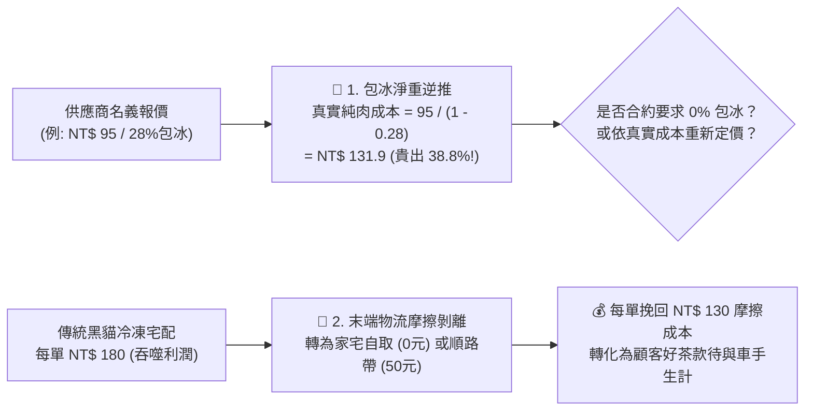

# 🧊 包冰淨重逆推與物流摩擦剝離原子 (Ice & Logistics Stripper)

> 🧮 **原子使命**：貫徹查理·蒙格求真求實的底層物理真值——**「不要花肉的價格買自來水，也不要把利潤白白送給低效的物流巨頭！」** 許多海鮮批發商用 20%~30% 的厚冰衣製造廉價幻象，而高昂的冷鏈快遞又會吞噬 30% 以上的毛利。本原子專門剝離這兩大隱性摩擦成本，逆推真實進貨純肉底價，並引導常民自取與順路帶，挽救每分被浪費的利潤！

---

## 🏛️ 包冰逆推與物流摩擦剝離公式 (Formulas)



### 1. 包冰實質純肉成本逆推
$$\text{真實純肉成本} = \frac{\text{供應商名義報價}}{1 - \text{包冰率}}$$
* 例：名義報價 NT$ 95，包冰率 28%：
  $$\text{真實成本} = \frac{95}{1 - 0.28} = \frac{95}{0.72} = \mathbf{131.94 \text{ 元}} \quad (\text{溢價率 } +38.8\%)$$

### 2. 物流摩擦成本挽回
$$\text{單單挽回摩擦} = \text{傳統宅配費用 (NT\$ 180)} - \text{在地順路帶費用 (NT\$ 50)} = \mathbf{130 \text{ 元}}$$

---

## 🛠️ 命令列工具 (CLI Usage)

```powershell
# 1. 執行包冰淨重逆推真值計算
python scripts/ice_friction_stripper.py --ice-calc '{"nominal_price": 95, "ice_glazing_rate": 0.28}'

# 2. 計算物流批次摩擦成本剝離效益
python scripts/ice_friction_stripper.py --logistics-calc '{"total_orders": 150, "traditional_courier_fee": 180, "local_piggyback_fee": 50}'
```
