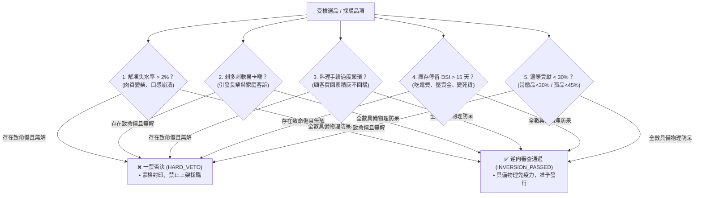

# ⚔️ 查理·蒙格逆向致死缺陷一票否決原子 (Munger Inversion Veto)

> 🧮 **原子使命**：貫徹查理·蒙格最經典的哲學——**「如果我知道我會死在哪裡，我就永遠不去那裡。」** 大多數商業失敗不是因為缺少熱情，而是因為對顯而易見的致死缺陷視而不見。本原子在上架、採購與報價前夕，化身冷酷無情的反向審計官，排查五大致死威脅，凡無具體防呆方案者，一票否決阻斷出廠！

---

## 🏛️ 五大逆向致死缺陷審查清單 (Five Fatal Failure Modes)



### 1. 解凍失水超標（> 2.0%）
* **風險**：解凍後組織液流失，魚肉乾柴，客訴率飆升 40%。
* **解法**：必須配備 -50°C 急速冷凍與磚型真空包裝，現場實測失水 $\le 1.1\%$。

### 2. 多刺難挑刺
* **風險**：家有幼兒長輩者極易噎刺，造成信任崩塌。
* **解法**：必須人工二次去刺檢驗，或提供專業去刺骨切片，否則標註「料理高手專用」降級。

### 3. 料理繁瑣度
* **風險**：需去鱗、去鰓、清內臟者，常民家庭抗拒處理。
* **解法**：產地三去（去鱗、去鰓、去內臟）完成，附 3 分鐘電鍋/香煎圖卡食譜。

### 4. 庫存停留時間（DSI）
* **風險**：超過 15 天未消化，吃電費並排擠容積。
* **解法**：100% 走預售集單制，或設置 20 天警報、25 天保本自噬銷毀。

### 5. 邊際貢獻率底線
* **風險**：常態品邊際貢獻率 $< 30\%$，孤品 $< 45\%$。
* **解法**：毛利不足一律砍單，拒絕為供應商白打工。

---

## 🛠️ 命令列工具 (CLI Usage)

```powershell
# 執行五大逆向致死缺陷審核
python scripts/munger_inversion_veto.py --audit '{"item_name": "野生青甘魚排", "drip_loss_rate": 0.012, "has_pin_bones": false, "kitchen_prep_minutes": 5, "projected_dsi_days": 3, "contribution_margin": 0.36, "is_rare_item": false}'
```
