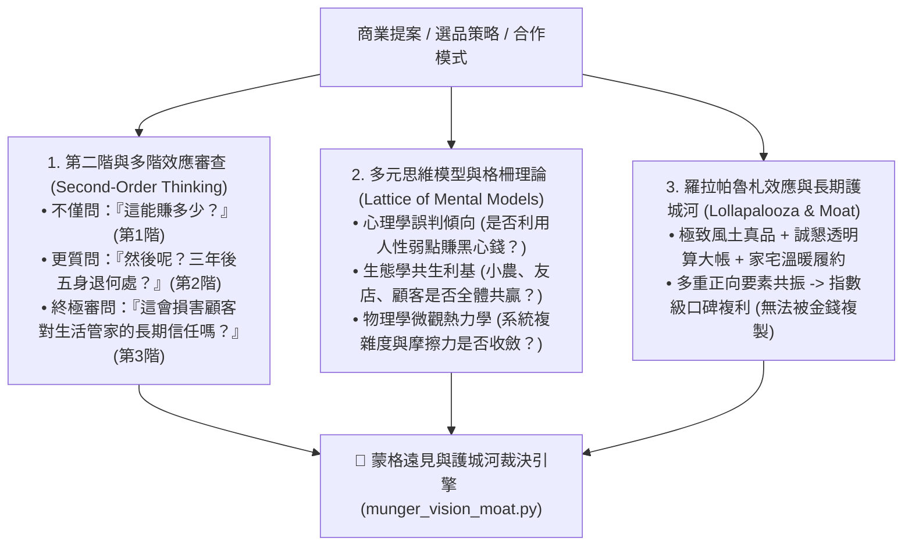

# 👑 查理·蒙格百年遠見與複利護城河原子 (Munger Long-Term Vision & Compound Moat)

> 🧮 **原子使命**：貫徹創辦人親授心法——**「其實芒格除了精通財務之外，最主要的就是有遠見。」** 如果只會精打細算、斤斤計較眼前幾塊錢，那只是尋常帳房；真正的查理·蒙格，著眼於十年後的生態版圖、不可逆的商譽複利、以及多重競爭優勢交織出的「羅拉帕魯札效應（Lollapalooza Effect）」。本原子專門為極星所有商業決策注入超長遠眼光，拒絕「撿雪茄屁股」的短視貪婪，鍛造堅不可摧的長期護城河！

---

## 🏛️ 蒙格遠見三大核心支柱 (Munger's Visionary Pillars)



---

## 🧭 蒙格遠見評估準則 (Evaluation Axioms)

1. **雪茄屁股一票否決律 (No Cigar-Butt Law)**：
   - 凡短期間看似暴利、但品質平庸、缺乏回購力、或消耗創辦人與品牌信譽的商品，一律行使一票否決。
2. **十年不可替代性 (Ten-Year Irreplaceability)**：
   - 評估該品項或服務在 5~10 年後的抗通膨能力與常民生活黏著度。
3. **商譽無形資產複利 (Goodwill Compounding)**：
   - 「失去信譽如千丈懸崖失足，萬難復原。」任何在包冰、分量、產地上企圖模糊偷雞的行為，視為最嚴重的商業自殺。

---

## 🛠️ 命令列工具 (CLI Usage)

```powershell
# 評估商業決策之多階因果效應與十年護城河評級
python scripts/munger_vision_moat.py --proposal '{"name": "台東野生海魚預售", "short_term_margin": 0.35, "reputation_impact": "HIGH_POSITIVE", "reorder_potential": "HIGH", "ecosystem_win_win": true, "has_cigar_butt_greed": false}'
```
