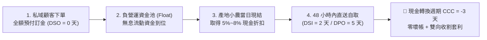

# 🌊 負營運資金與產地現結套利原子 (Negative Float & Cashflow Arbitrage)

> 🧮 **原子使命**：貫徹蒙格與巴菲特最精湛的資本力學——**「拿別人的無息資金做生意，並且讓現金轉換週期變成負數！」** 傳統零售業被「先叫貨、囤倉庫、月結壓貨款」壓垮；極星以私域預售集單制，先收全額訂金再採收叫貨，並用顧客浮水為小農當日現結，榨出 5%~8% 超額現金折扣，年化回報率驚人，徹底消滅資金斷裂風險！

---

## 🏛️ 現金轉換週期與套利公式 (CCC & Arbitrage Equation)



### 1. 現金轉換週期 (Cash Conversion Cycle, CCC)
$$\text{CCC} = \text{DSI (存貨週轉天數)} + \text{DSO (應收帳款天數)} - \text{DPO (應付帳款天數)}$$
* 極星標準：$\text{DSI}=2\text{天}, \text{DSO}=0\text{天}, \text{DPO}=5\text{天} \implies \mathbf{\text{CCC} = -3\text{天}}$（負營運資金，資金比貨物跑得更快）。

### 2. 小農現結折讓年化報酬率 (Annualized Return on Cash Discount)
$$\text{年化報酬率} = \frac{\text{現金折讓率}}{1 - \text{現金折讓率}} \times \frac{365}{\text{提前付款天數}}$$
* 例：提前 20 天現結換取 6% 折讓 $\implies \frac{0.06}{0.94} \times \frac{365}{20} = \mathbf{116.5\%}$ 超高年化純利！

---

## 🛠️ 命令列工具 (CLI Usage)

```powershell
# 計算訂單批次之現金轉換週期與現結折讓套利
python scripts/negative_float_cashflow.py --calculate '{"batch_revenue": 120000, "farm_cost_nominal": 72000, "cash_discount_rate": 0.06, "dsi_days": 2.0, "dso_days": 0.0, "dpo_days": 5.0, "advance_days": 20}'
```
