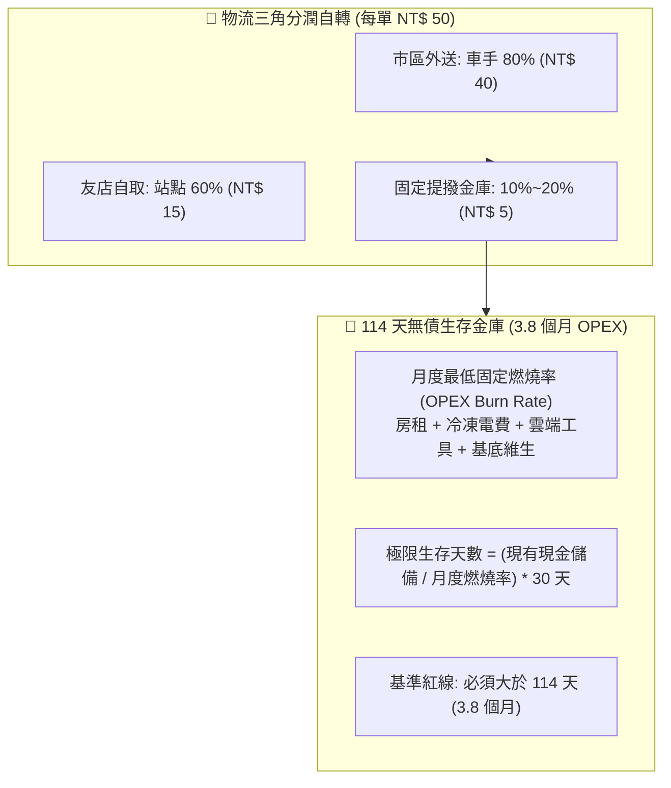

# 🏰 114天極限無債生存水庫與三角分潤原子 (114-Day OPEX Reservoir)

> 🧮 **原子使命**：貫徹查理·蒙格的生存防線哲學——**「你必須先活下來，才能享受複利。」** 商業世界充滿未知的黑天鵝天災（如颱風、地震、產地斷航）。本原子一方面以 80/20 三角分潤讓物流與站點自動運轉，另一方面建立 3.8 個月 OPEX 緊急金庫，在零營收極端衝擊下無債生存 114 天，化天災危機為低價接收市場的防禦堡壘！

---

## 🏛️ 三角分潤與生存水庫架構 (Triangular Sharing & Reservoir)



### 1. 三角分潤自轉規則
* **外送單（收 NT$ 50）**：車手 NT$ 40 (80%)、公積金 NT$ 5 (10%)、極星 NT$ 5 (10%)。
* **自提單（補貼 NT$ 25）**：友店站點 NT$ 15 (60%)、公積金 NT$ 5 (20%)、極星 NT$ 5 (20%)。
* 物流專款專用，不成為總部負擔，且持續為安全水庫注水！

### 2. 114 天生存水庫標準
* 假定發生天災巨變，連續 45 天營收為零。
* 水庫水位必須 $\ge 3.8 \times \text{月度 OPEX}$，確保 114 天零負債存活！

---

## 🛠️ 命令列工具 (CLI Usage)

```powershell
# 1. 審計當前生存水庫水位與存活天數
python scripts/survival_reservoir_opex.py --audit-reservoir '{"monthly_opex_burn": 35000, "current_cash_reserve": 150000}'

# 2. 計算物流批次分潤與儲備金庫提撥
python scripts/survival_reservoir_opex.py --calc-delivery '{"delivery_orders": 80, "pickup_orders": 120}'
```
