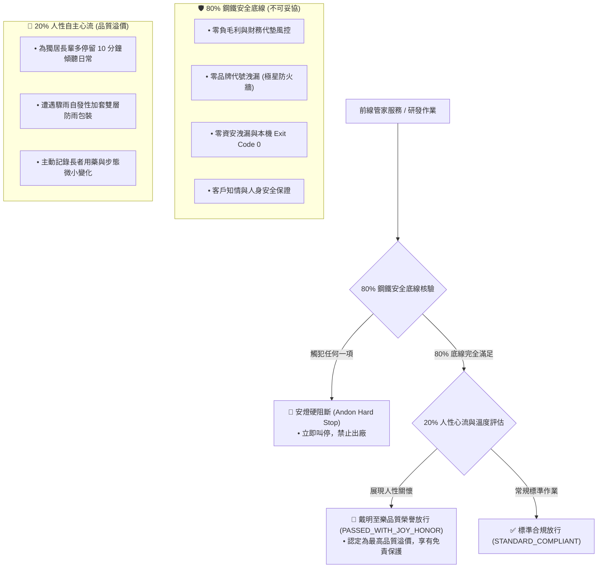

# 👑 戴明 80/20 彈性心流與工作自豪感調配原子 (Deming 80/20 Joy Flow Allocator)

> 📐 **原子使命**：貫徹戴明哲學最溫暖深邃的精髓——「工作自豪感 (Joy in Work)」與「80/20 彈性心流律」。如果一個品質系統只剩下冰冷的懲處與死板的打卡，那不是戴明品質，而是官僚暴政！本原子將 SOP 鎖死於 80% 的鋼鐵安全底線，同時將 20% 的空間授權給前線生活管家的人性善意與溫暖心流；並將主管的唯一 KPI 錨定於「基層工作障礙清除率」！

---

## 🏛️ 80/20 彈性心流架構 (The 80/20 Elastic Flow Architecture)



---

## 🧭 管理者唯一 KPI：障礙清除治理 (Impediment Clearance Governance)

* **傳統錯誤管理**：監工、挑刺、統計違規次數、考勤打卡 $\rightarrow$ 誘發恐懼與隱匿。
* **戴明領導治理**：唯一職責為「為一線夥伴清除工作障礙」！
  - 阻礙公式：$$\text{障礙清除率 (ICR)} = \frac{\text{已排除之工具/流程卡頓數}}{\text{夥伴回報之摩擦痛點總數}} \ge 90\%$$

---

## 🛠️ 命令列工具 (CLI Usage)

```powershell
# 評估前線作業：核驗 80% 底線 + 計算 20% 溫暖心流
python scripts/joy_flow_allocator.py --eval-task '{"safety_checks": {"no_negative_margin": true, "no_brand_leak": true, "no_security_breach": true}, "human_warmth_actions": ["為獨居阿嬤多倒一杯溫水並檢查鞋帶安全", "代客留意門鎖生鏽問題"]}'

# 評估管理者「障礙清除率」KPI
python scripts/joy_flow_allocator.py --eval-manager '{"impediments_reported": 10, "impediments_cleared": 9}'
```
