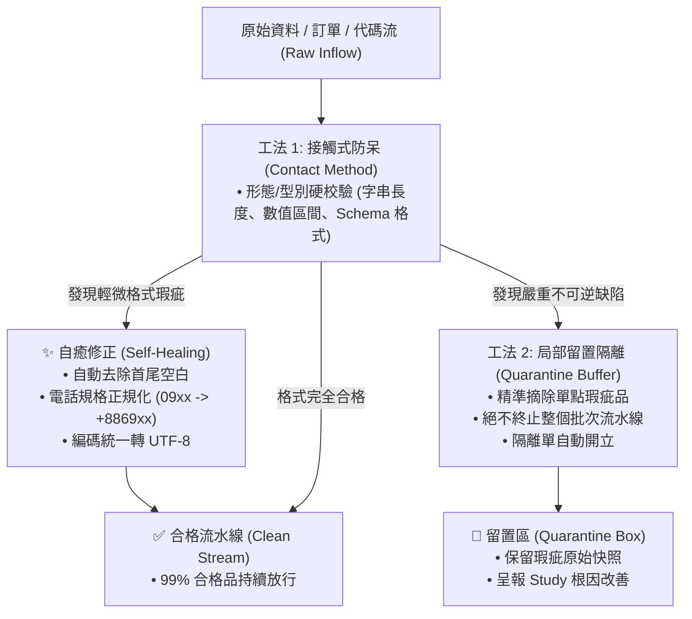

# 🛠️ 戴明神級防呆工坊與局部隔離原子 (Deming Poka-Yoke Engineer)

> 📐 **原子使命**：貫徹戴明「做進源頭律」與新鄉重夫「防呆 (Poka-Yoke)」工程學。好品質不是靠人緊盯，而是打造「想做錯都不可能」的物理或數位防線。本原子提供自動數據清洗自癒機制，並在批次作業中精確建立「局部留置隔離區」，杜絕一顆老鼠屎壞了一鍋粥，確保大盤業務流暢不卡死！

---

## 🏛️ 防呆三大工法與局部隔離架構 (Poka-Yoke & Quarantine)



---

## 🛡️ 防呆自癒與隔離規則 (Rules)

1. **自癒優先（Self-Healing First）**：
   - 能透過確定性邏輯修復的邊界瑕疵（如：全半形轉換、多餘空白、常見標點符號溢出），一律自動修補並留痕。
2. **精準隔離（Quarantine Isolation）**：
   - 遭遇致命缺失（如：缺少收件人電話、金額為負數、缺少商品識別碼），嚴禁讓整個伺服器或排程 Crash，而是將該項目抽取存入 `quarantined_items`。
3. **隔離日誌與根因回饋（PDSA Feedback）**：
   - 隔離區累計之物件自動產出「防呆改進工單」，反哺上游輸入端強化表單防呆。

---

## 🛠️ 命令列工具 (CLI Usage)

```powershell
# 執行批次訂單防呆清洗與留置隔離
python scripts/pokayoke_engineer.py --input-json '[{"id": "ORD01", "name": " 王大明 ", "phone": "0912-345-678", "amount": 1200}, {"id": "ORD02", "name": "李小美", "phone": "invalid", "amount": -500}]'
```
