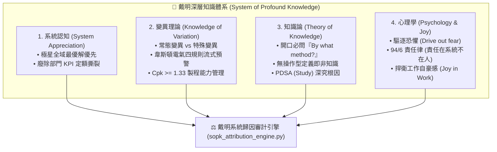

# 🔬 戴明深層知識體系與94/6系統歸因審計原子 (Deming SoPK & 94/6 Attribution)

> 📐 **原子使命**：貫徹戴明哲學最神聖核心——深層知識體系 (SoPK, System of Profound Knowledge) 與 94/6 責任律。任何品質事件開口必問操作型定義「By what method?」；以變異統計理論嚴格區分常態變異（系統固有）與特殊變異（外生異常），杜絕管理者的盲目微調瞎折騰（Tampering）；並將 94% 的品質問題溯源至制度、SOP 與工具缺陷，堅決捍衛基層夥伴的心理安全感！

---

## 🏛️ SoPK 四大核心支柱 (The Four Pillars of SoPK)



---

## ⚖️ 94 / 6 責任律審計守則 (The 94/6 System Attribution Law)

* **94% 系統責任 (Common System Cause)**：
  - 流程模糊、交接表單缺失、器具設計不良、培訓不足、缺乏防呆 (Poka-Yoke)、時間過度緊繃。
  - **處置方針**：100% 由管理層與架構師檢討，修改 SOP 並部署數位防呆機制。
* **6% 人員特殊失誤 (Special Human Cause)**：
  - 僅當存在故意蓄意破壞、或在已具備完善防呆與知情確認下仍刻意繞過者。
  - **處置方針**：嚴禁人身羞辱與公開處罰，進行一對一障礙清除對話與再培訓。

---

## 🛠️ 命令列工具 (CLI Usage)

```powershell
# 1. 執行數值序列變異分析與 Cpk / 韋斯頓電氣規則審計
python scripts/sopk_attribution_engine.py --mode spc --values "10.2, 10.5, 9.8, 10.1, 10.4, 9.9, 12.8" --usl 11.5 --lsl 8.5

# 2. 執行事故 94/6 系統歸因審計（自動糾正甩鍋基層的錯誤報告）
python scripts/sopk_attribution_engine.py --mode incident --report '{"incident": "外送員送錯地址", "claimed_blame": "外送員不細心", "system_context": {"address_format_ambiguous": true, "gps_drift_no_warning": true}}'
```
