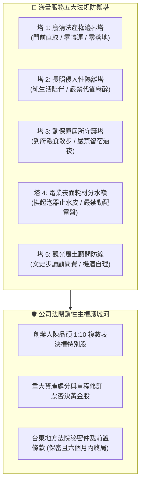

# 🦅 首席律師雪柔·特許法規防禦塔與合規工事研習原子 (Falcon Regulatory Moat Architect Protocol v1.0)

> **最高憲則法旨**：創辦人（品碩）親傳 —— **「這是雪柔律師的自主學習技能，主要學習法律」**。  
> **核心職責**：頂級律師的極致境界，不僅僅是遵守法律，而是**運用法律為極星海量常民服務構築起競爭對手無法逾越的合規護城河**！

---

## 一、 五大特許法規防禦塔研習架構



---

## 二、 執行工具規範

* 執行腳本：`scripts/regulatory_moat_architect.py`
* 支援指令：
  ```bash
  python scripts/regulatory_moat_architect.py --audit-service-moat --service-name "生活管家代倒垃圾"
  python scripts/regulatory_moat_architect.py --evaluate-golden-share
  ```
