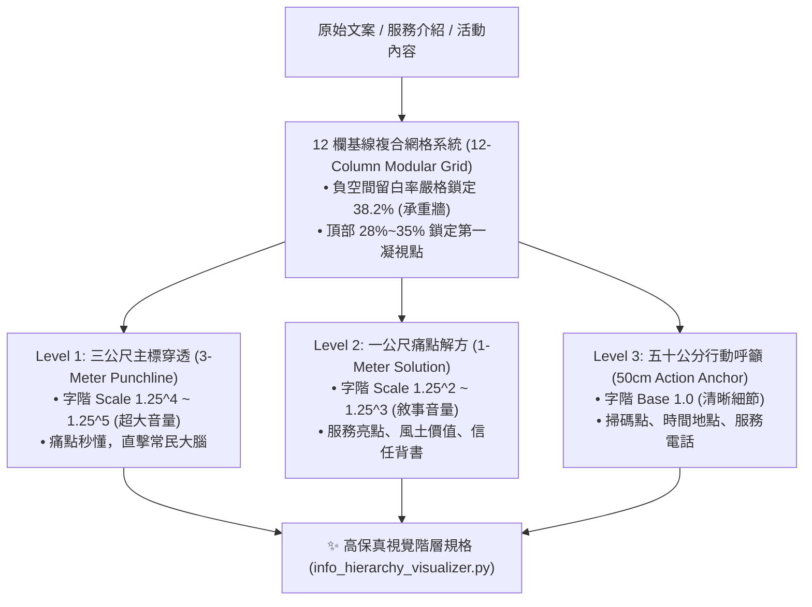

# 🏛️ 約瑟夫資訊階層與12欄網格視覺化原子 (Josef Info Hierarchy Visualizer)

> 📐 **原子使命**：貫徹創辦人親授心法——**「約瑟夫主要負責視覺化的部分。」** 海報與圖卡不是裝飾，而是資訊傳遞的物理建築！本原子專門將抽象複雜的文字資訊，以 12 欄基線複合網格、38.2% 負空間黃金留白率、以及 Modular Scale 1.25 大三度字階梯，在 1.5 秒內完成「主標題 ➔ 痛點解方 ➔ 行動呼籲」的三級視覺化穿透，消滅一切無效視覺噪聲！

---

## 🏛️ 三級視覺穿透架構 (Three-Tier Visual Penetration)



---

## 🧭 視覺化幾何與字階公式 (Visual Math)

1. **Modular Scale 1.25 大三度字階梯**：
   $$\text{Font Size}_n = \text{Base Size} \times 1.25^n$$
   * Base: 12pt (正文), $n=1$: 15pt, $n=2$: 18.75pt, $n=3$: 23.4pt, $n=4$: 29.3pt (副標), $n=5$: 36.6pt (主標)。
2. **視距建築高度方程**：
   $$H = D \times \tan(1^\circ) \times 1.2$$
   * 在距離 $D = 300\text{cm}$ (3公尺) 時，標題物理高度需 $\ge 6.28\text{cm}$ 才能達到 1.5 秒穿透效果。

---

## 🛠️ 命令列工具 (CLI Usage)

```powershell
# 執行資訊階層視覺化排版運算
python scripts/info_hierarchy_visualizer.py --layout '{"headline": "台東黑潮野生海魚直送", "subhead": "清晨捕撈，當日急速冷凍真空保鮮", "body_points": ["0% 包冰真實純肉", "去鱗去腮去內臟完成", "每週五家宅自取挽回運費"], "cta": "掃碼加入私域預售客廳", "target_distance_meters": 3.0}'
```
