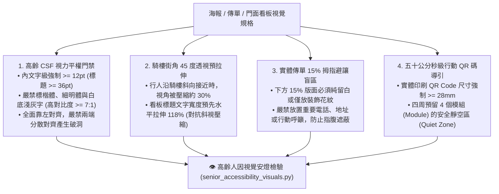

# 👁️ 約瑟夫高齡視力平權與人因視覺引導原子 (Josef Senior Accessibility Visuals)

> 📐 **原子使命**：貫徹創辦人親授心法——**「約瑟夫主要負責視覺化的部分。」** 在台東高齡化常民生活圈，許多長輩有老花、白內障與對比敏感度下降（CSF 衰退）的生理現實。如果海報字小如蟻、白底配淺灰字、標題斜看變形，那就是對長輩的視覺歧視！本原子專門落實高齡視力平權與人因工程光學修正，確保每位長者與行人都能輕鬆無障礙地看清每一項服務！

---

## 🏛️ 高齡人因視覺四大防線 (Four Senior Accessibility Bastions)



---

## 🧭 視覺無障礙量化標準 (Metrics)

| 檢驗維度 | 青年通用標準 | **極星高齡長輩平權標準** | 違規處置 |
| :--- | :--- | :--- | :--- |
| **正文字級** | 9pt ~ 10pt | **$\ge 12\text{pt}$ (推薦 14pt~16pt)** | 強制放大重排 |
| **文字字體** | 任意無襯線/襯線 | **高辨識度粗黑體 / 嚴禁細明標楷** | 替換字族 |
| **顏色對比度** | 4.5 : 1 (WCAG AA) | **$\ge 7.0 : 1$ (WCAG AAA)** | 加深炭黑顏色 |
| **QR Code 尺寸** | 20mm | **$\ge 28\text{mm}$** | 強制放大標定 |
| **拇指避讓區** | 無 | **底部 15% 淨空無文字** | 上移行動區塊 |

---

## 🛠️ 命令列工具 (CLI Usage)

```powershell
# 執行海報視覺人因工程與高齡無障礙審查
python scripts/senior_accessibility_visuals.py --audit-visual '{"body_font_pt": 14, "font_family": "Noto Sans TC", "contrast_ratio": 8.5, "qr_code_size_mm": 30, "bottom_thumb_margin_pct": 16, "is_street_oblique": true}'
```
