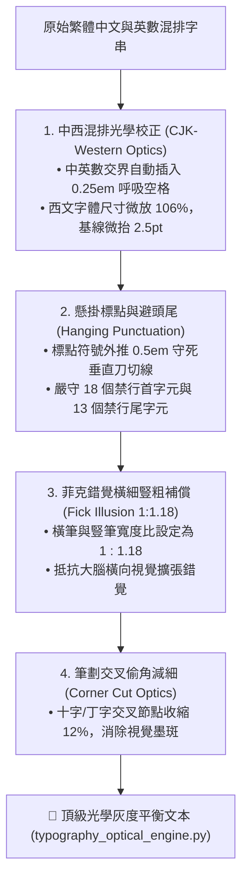

# ✨ 約瑟夫漢字排版美學與光學視錯覺補償原子 (Josef Optical Typography)

> 📐 **原子使命**：貫徹創辦人親授心法——**「約瑟夫主要負責視覺化的部分。」** 繁體漢字是空間幾何的終極試金石！一般未經光學調校的排版，會在大腦中產生筆劃粗細不均、交叉處墨斑堆積、中西混排高低不齊與標點斷行破碎的混亂感。本原子專門執行微觀字體光學補償，以菲克錯覺修正、懸掛標點與中西和聲，為文字賦予頂級瑞士刀切般的秩序感！

---

## 🏛️ 四大字體光學視覺補償法典 (Optical Rules)



---

## 🧭 標點避頭尾禁則規範 (Kinsoku Shori)

* **18 禁行首字元（不可出現在行開頭）**：`、` `。` `，` `？` `！` `：` `；` `）` `〉` `》` `」` `』` `】` `〕` `…` `—` `～` `”`
* **13 禁行尾字元（不可出現在行末端）**：`（` `〈` `《` `「` `『` `【` `〔` `“` `‘` `[` `(` `{` `<`

---

## 🛠️ 命令列工具 (CLI Usage)

```powershell
# 執行中西混排光學校正與避頭尾行切分
python scripts/typography_optical_engine.py --format-text "生活管家在台東市區提供30分鐘到府服務，每週一至週五正常營運！" --line-length 14
```
