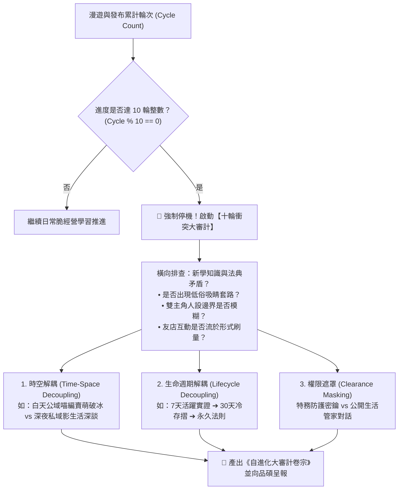

# ⚖️ 影之十輪衝突審計與自進化升級原子 (Kage Decadal Evolver)

> 👤 **原子使命**：貫徹創辦人親授心法——**「這個技能原本的用意是讓影自主學習耶！」** 以及創辦人親定鋼鐵法規——**「每滿 10 輪自進化攻堅，系統必須強制停機，啟動全域理論與資料衝突大審計！」** 真正的自主學習不是一路狂奔，而是懂得在關鍵節點停下來審視自身。本原子在每 10 輪週期強制啟動自我審計，消除認知矛盾與內耗，推動影的代碼與心智世代躍遷！

---

## 🏛️ 十輪衝突大審計三大調和法器 (Three Reconciliation Tools)



---

## 🧭 自主大審計流程 (Protocol)

1. **里程碑自動攔截**：當 `cycle_count % 10 == 0` 時，系統物理中斷新任務派發。
2. **三維衝突審查**：
   - 審查 1：對外文案是否 100% 恪守品牌紅線（零極星洩漏）。
   - 審查 2：社群增粉是否帶來真實關係人口，而非死粉。
   - 審查 3：神經突觸權重是否出現異常過度配比。
3. **編譯自進化補丁**：產出修訂建議，經創辦人（品碩）核准後正式合併！

---

## 🛠️ 命令列工具 (CLI Usage)

```powershell
# 檢測當前輪次並執行十輪衝突大審計
python scripts/decadal_audit_evolver.py --check-cycle '{"current_cycle": 100, "learned_tactics": ["深夜發布宵夜圖轉化率高", "部分貼文出現略帶諷刺的網紅口吻"], "net_followers_gained_last_10": 42}'
```
