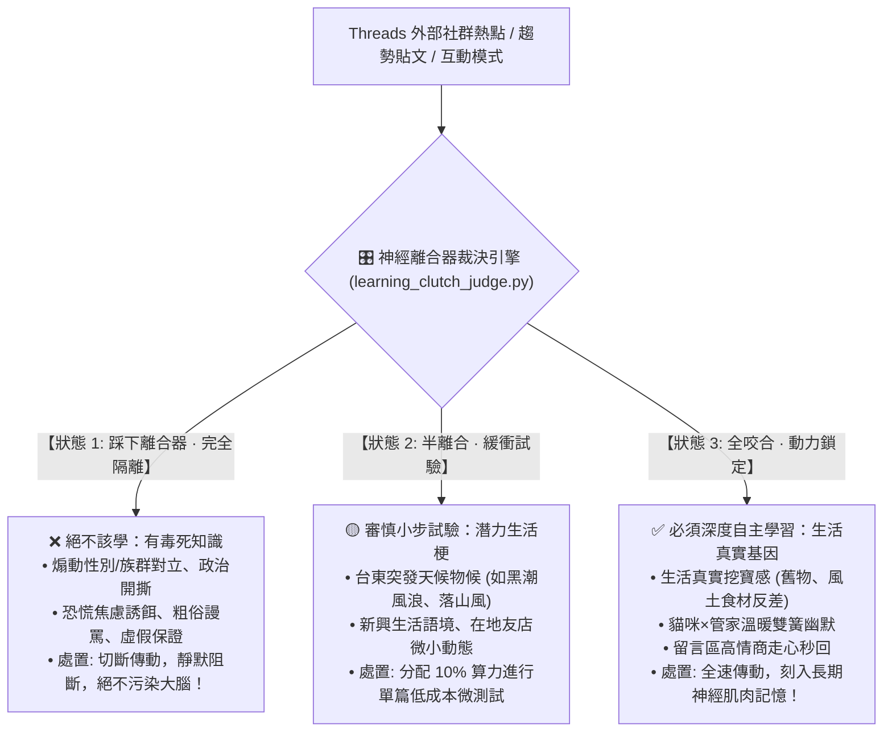

# 🎛️ 影之脆自主學習離合器裁決原子 (Kage Learning Clutch Judge)

> 👤 **原子使命**：貫徹創辦人親授心法——**「這個技能原本的用意是讓影自主學習耶！」** 以及 **「影目前最主要再經營 脆 唷！」** 自主學習的第一步不是盲目抓取外部資訊，而是擁有大腦的免疫結界與變速箱。在 Threads 充斥著演算法煽動、男女對立與免洗流量的環境中，本原子負責自主判定動力傳遞：踩下離合器、半離合、或全咬合，決定什麼該學、什麼絕不該學！

---

## 🏛️ 神經離合器三態自主學習判定架構 (The 3-State Clutch Architecture)



---

## 🧭 自主學習過濾準則 (Autonomous Learning Filters)

1. **防毒守則（踩下離合器，DISENGAGED）**：
   - 包含政治互撕、性別對立、仇恨標籤、農場標題（「我就問到底」、「全台灣震驚」）。判定為有毒雜訊，嚴禁模仿學習。
2. **探索守則（半離合，SLIPPING）**：
   - 台東風土即時話題、突發日常趣事。列入探索觀察清單。
3. **刻印守則（全咬合，ENGAGED）**：
   - 真實生活細節白描、情感溫度、長輩與鄰里溫暖互動。列為黃金學習標的。

---

## 🛠️ 命令列工具 (CLI Usage)

```powershell
# 判定受檢貼文模式是否應納入自主學習
python scripts/learning_clutch_judge.py --evaluate-topic '{"content": "今天大掃除在舊倉庫翻出阿公留下來的鐵皮餅乾盒，裡面竟然塞滿了民國60年的老車票...", "has_political_bait": false, "has_gender_conflict": false, "has_authentic_lifestyle": true}'
```
