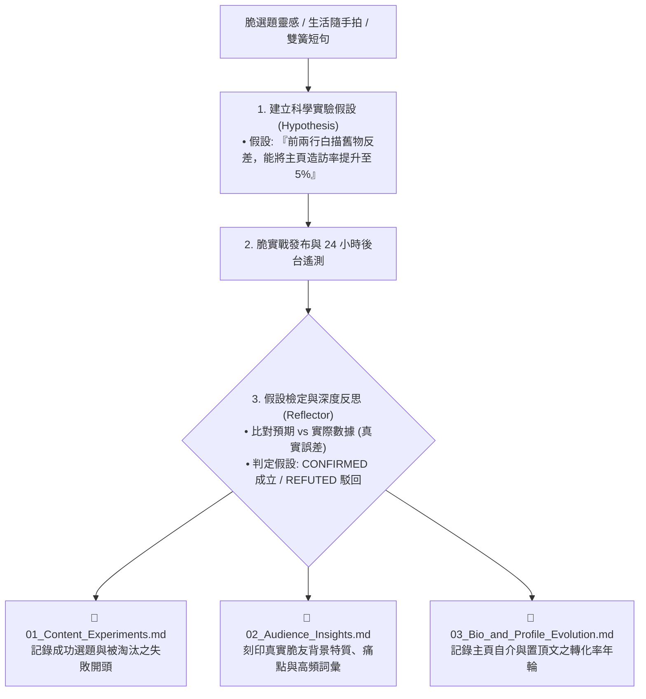

# 📓 影之選題假設實驗與認知存摺反思原子 (Kage Vault Reflector)

> 👤 **原子使命**：貫徹創辦人親授心法——**「這個技能原本的用意是讓影自主學習耶！」** 自主學習不是靠感覺，而是靠嚴謹的科學實驗與長效記憶刻印。本原子在影發布每一篇脆文前，自主建立科學探索假設；在取得真實遙測後，自主覆盤並將後驗客觀經驗刻印入三本認知存摺，讓影永不遺失成功基因，實現真正的複利式自主心智進化！

---

## 🏛️ 三本認知存摺自主刻印架構 (Cognitive Vaults Architecture)



---

## 🧭 假設實驗與反思三部曲 (Protocol)

1. **先假設、後發布**：明確標記「預期核心槓桿（如：貓咪反差、私房風土）」與預期指標。
2. **客觀比對不自欺**：以實際主頁造訪與真實互動檢視，成立者固化為心智定理，駁回者記錄失敗教訓。
3. **存摺 Append-Only 無鎖追加**：遵循 RFC #001 追加協議，將反思自動沉澱入冷儲存，供未來自主學習檢索。

---

## 🛠️ 命令列工具 (CLI Usage)

```powershell
# 執行貼文假設驗證與反思紀錄生成
python scripts/vault_hypothesis_reflector.py --reflect-experiment '{"hypothesis_id": "EXP_20261114_01", "topic": "大掃除舊車票挖寶", "assumed_hook": "翻出民國60年老車票", "expected_profile_visit_rate": 0.05, "actual_views": 650, "actual_profile_visits": 38, "actual_net_followers": 4, "top_comment": "天啊這車票太懷舊了吧！"}'
```
