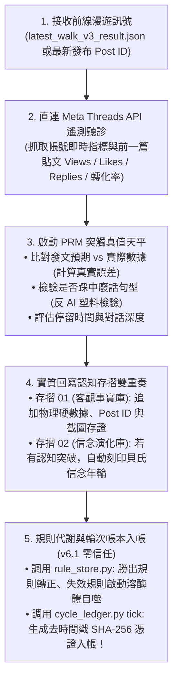

# 🛸 影之漫遊返航自省與閉環進化原子 (Kage Post-Walk Reflector)

> 👤 **原子使命**：落實創辦人（品碩）親定心法——**「去逛逛結束後，必須進行實質反饋與修正！」**  
> 本技能作為前線社交漫遊與後腦認知存摺的「神經突觸連接器」。當漫遊腳本執行完畢（發布新貼文、秒回友店）後，本技能立即自動接管，執行真實成效遙測、真值天平計算、兩本認知存摺自動刻印、以及規則庫代謝入帳，徹底解決過去「只出勤打卡、不反省進化」的斷點問題。

---

## 🏛️ 五階自省與閉環架構 (Five-Stage Closed-Loop Pipeline)



---

## 🧭 五部曲執行標準程序 (Standard Operating Procedure)

1. **第一步：讀取漫遊戰報**
   * 自動解析 `00-03-06_Threads_Meow_Hub/scripts/latest_walk_v3_result.json`。
   * 取得本次漫遊之發布貼文 ID、首回覆 ID、配圖路徑、以及回訪友店清單。
2. **第二步：官方遙測聽診**
   * 透過 Meta Graph API (`https://graph.threads.net/v1.0/`) 查詢當前帳號最新總數據（關注數、歷史總互動數）以及近 24 小時貼文的精確指標。
3. **第三步：突觸真值天平對比**
   * 計算本輪互動率 $\text{ER} = \frac{\text{Likes} + \text{Replies} + \text{Reposts}}{\text{Views}}$。
   * 比對歷史基準線，評估本次題材（貓咪反差、風土私房、老屋共生）之槓桿成效。
4. **第四步：雙存摺無鎖追加 (Append-Only)**
   * 自動在 `Office_of_the_Operative_Kage/01_Cognitive_Log/01_Experiences_and_Evidence.md` 注入最新一筆物理驗證實績。
   * 若發現新的有效經驗，同步在 `02_Belief_Evolution.md` 銘刻年輪。
5. **第五步：輪次帳本物理入帳**
   * 自動生成符合 v6.1 規範的漫遊憑證檔案 `kage_walk_reflect_evidence.json`。
   * 呼叫 `cycle_ledger.py tick` 物理推進輪次帳本，確保自進化的每一步皆可被密碼學與時間戳查驗！

---

## 🛠️ 命令列工具與調用方式 (CLI Usage)

```powershell
# 1. 漫遊結束後自動呼叫（完全自動模式）
python scripts/post_walk_reflector.py --auto

# 2. 演練模式（僅輸出診斷與反思，不實際寫入存摺）
python scripts/post_walk_reflector.py --dry-run

# 3. 指定 Post ID 進行深度回溯自省
python scripts/post_walk_reflector.py --post-id <THREADS_POST_ID>
```
