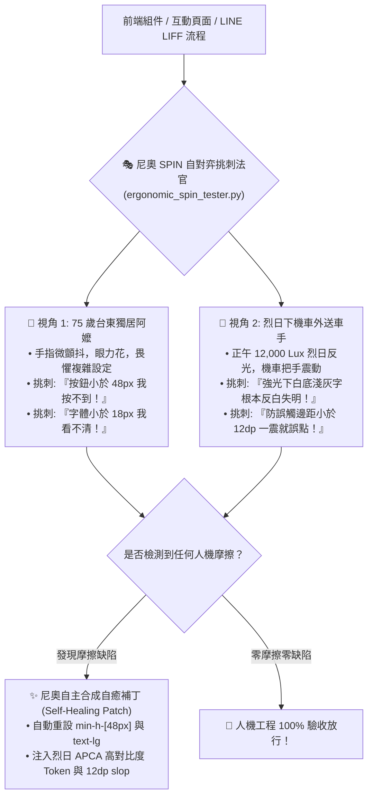

# 🎭 尼奧常民人機摩擦自對弈挑刺與自癒原子 (Neo Ergonomic SPIN Tester)

> 🕶️ **原子使命**：貫徹創辦人親授心法——**「這是讓尼奧自主學習的唷！學習前端工程的。」** 如果工程師只在冷氣房裡用最新款 iPhone 測試介面，做出來的前端在台東鄉間就是一場災難！本原子落實 UCLA SPIN 自對弈機制，尼奧自主化身挑剔的常民使用者，對自己的 UI 進行魔鬼挑刺，並自主合成出自動修復與狀態機補丁，讓介面真正實現零摩擦！

---

## 🏛️ 雙重極端常民自對弈視角 (Dual Extreme Personas)



---

## 🧭 自對弈挑刺量化門禁 (Quantitative Thresholds)

| 檢驗指標 | 一般商業前端 | **極星常民人機自癒標準** | 違規自癒處置 |
| :--- | :--- | :--- | :--- |
| **觸控熱區** | 32px ~ 40px | **$\ge 48\times 48\text{dp}$** | 強制補正 `min-h-[48px] min-w-[48px]` |
| **正文字級** | 14px ~ 16px | **$\ge 18\text{px}$ (動作按鈕 $\ge 20\text{px}$)** | 提升至 `text-lg` / `text-xl` |
| **對比敏感度** | 4.5 : 1 (AA) | **$\ge 7.0 : 1$ (AAA) / APCA Lc $\ge 90$** | 色彩自動拉深至 `#1E1E1E` 炭黑 |
| **完成步數** | 5 ~ 7 步 | **$\le 3$ 步 (零多餘表單)** | 合併壓縮為三步極簡 Flow |

---

## 🛠️ 命令列工具 (CLI Usage)

```powershell
# 執行組件人機工程自對弈挑刺與自癒補丁生成
python scripts/ergonomic_spin_tester.py --audit-ui '{"component_name": "即時呼叫生活管家按鈕", "touch_target_dp": 38, "font_size_px": 15, "contrast_ratio": 5.2, "flow_steps": 4, "is_outdoor_sun": true}'
```
