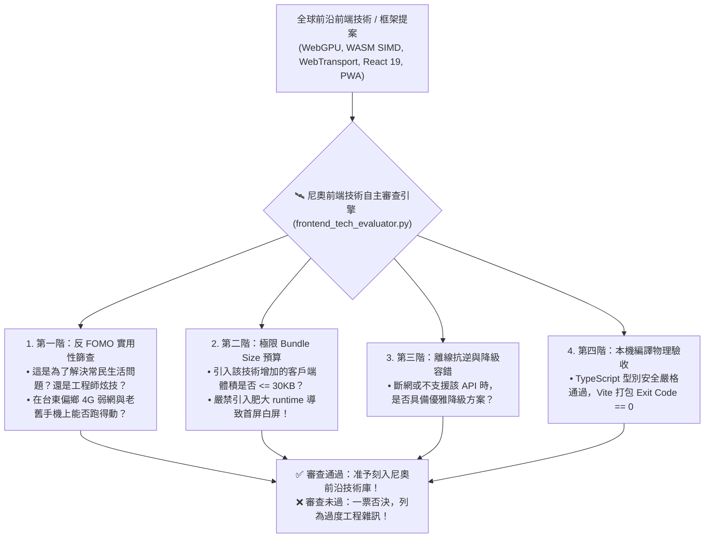

# 🛰️ 尼奧前端前沿技術自主偵察與物理驗收原子 (Neo Frontend Tech Evaluator)

> 🕶️ **原子使命**：貫徹創辦人親授心法——**「這是讓尼奧自主學習的唷！學習前端工程的。」** 前端工程生態瞬息萬變，滿是過度設計與浮誇行銷名詞。尼奧的自主學習不是盲目追新，而是擁有一套硬核物理驗收天線：自主偵察全球前沿技術，以真實終端 Exit Code 0、常民低頻寬實用性、以及 Bundle Size 嚴格預算為門禁，去蕪存菁，鍛造真正能抗擊天災風雨的前端武器！

---

## 🏛️ 前端技術自主學習五階物理篩查架構 (Five-Tier Triage)



---

## 🧭 技術自主學習驗收標準 (Evaluation Standards)

1. **常民第一原則**：任何技術若不能縮短用戶等待時間、提升長輩可讀性或增強斷網生存力，一票否決。
2. **零代碼體積膨脹**：新增套件 gzip 體積 $> 50\text{KB}$ 者必須有極致無可替代之理由，否則強制自研或尋找原生 Web API 替代。
3. **終端驗收原則**：必須由本機腳本驗證 Exit Code 0，無任何未定義型別（`any`）洩漏。

---

## 🛠️ 命令列工具 (CLI Usage)

```powershell
# 評估前沿技術提案之常民實用性與體積預算
python scripts/frontend_tech_evaluator.py --evaluate-tech '{"tech_name": "WebTransport 毫米波雨衰穿透", "gzip_size_kb": 12, "offline_fallback_ready": true, "rural_usefulness": "HIGH", "solves_real_friction": true}'
```
