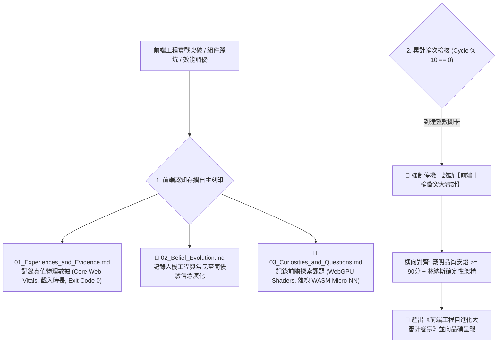

# 📓 尼奧前端工程認知存摺與十輪審計自進化原子 (Neo Frontend Vault Evolver)

> 🕶️ **原子使命**：貫徹創辦人親授心法——**「這是讓尼奧自主學習的唷！學習前端工程的。」** 前端工程師的成長，取決於他如何系統化地反思每一次架構踩坑與技術突破。本原子負責將尼奧自主學習的客觀事實、人機信念與前瞻好奇心，自動刻印入專屬認知存摺；並在每 10 輪演化節點強制停機，由品質長戴明博士出廠安燈質檢，推動前端架構的世代自進化！

---

## 🏛️ 前端三本認知存摺與十輪大審計架構 (Architecture)



---

## 🧭 十輪大審計門禁 (Audit Standards)

1. **出廠安燈質量線**：綜合評分必須 $\ge 90.0$ 分，若包含未處理之冷冰冰錯誤代碼（如露出 500 / Null）一票否決。
2. **設計與工程無縫咬合**：前端 Tokens 必須 100% 映射自約瑟夫視覺法典（菲克 1:1.18、阿美八角花幾何、黑潮色票）。
3. **零代碼死鎖**：任何非同步狀態必須具備超時自癒與取消機制（AbortController）。

---

## 🛠️ 命令列工具 (CLI Usage)

```powershell
# 檢測當前輪次並執行前端工程十輪衝突審計
python scripts/frontend_vault_evolver.py --audit-cycle '{"current_cycle": 220, "deming_andon_score": 96.5, "unhandled_errors_count": 0, "design_tokens_aligned": true, "learned_features": ["離線 Service Worker 狀態自癒", "常民去機器人冰冷報錯對話"]}'
```

---

## 真實資料入口 (v1.1)

* 指令：`neo_real_learning.py --measure <目錄> [--budget-kb 50]`
* 說明：量測前端目錄的靜態檔案重量（gzip 後首屏程式碼對照預算）與肥大套件；非瀏覽器實測的 FCP/LCP/INP。尚未對任何真實上線網站量測（taste-skill 為技能套件，結果僅驗證引擎可跑）。
* 示範腳本（舊檔）中的數字與評語為示範文字，非實測，請勿引用。
