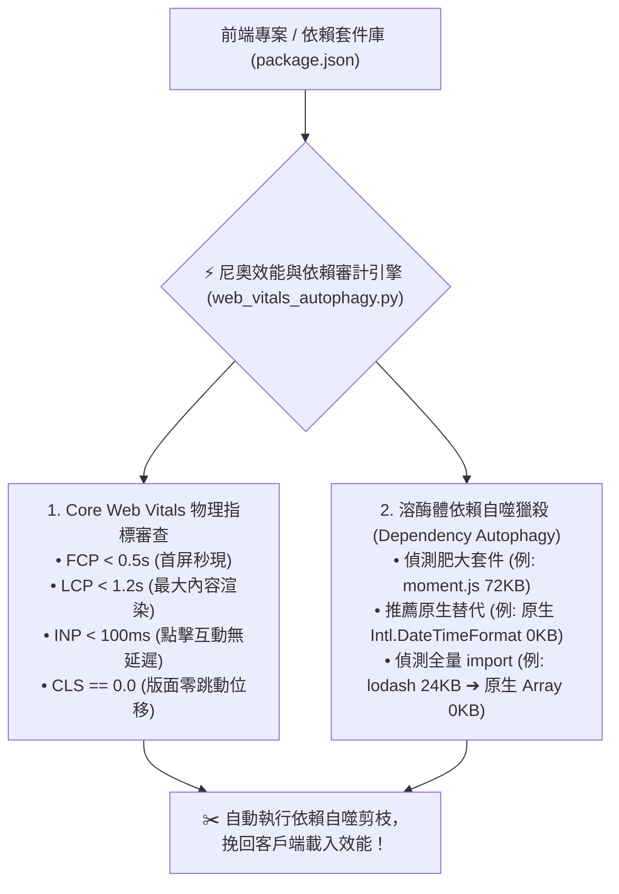

# ⚡ 尼奧前端效能遙測與依賴自噬原子 (Neo Web Vitals Autophagy)

> 🕶️ **原子使命**：貫徹創辦人親授心法——**「這是讓尼奧自主學習的唷！學習前端工程的。」** 一個優秀的前端工程師不是看他裝了多少套件，而是看他在面對任何功能時，能否用最精簡、甚至零依賴的原生代碼實現！本原子落實極星溶酶體代謝自噬機制：以 Google Core Web Vitals 為冷酷物理法官，主動獵殺肥大 npm 套件，守死首屏 280ms 載入與極端低碳低耗！

---

## 🏛️ 效能物理指標與依賴自噬架構 (Performance & Autophagy)



---

## 🧭 肥大套件自噬替代對照表 (Autophagy Replacement Table)

| 肥大待自噬套件 | 體積 (gzip) | **尼奧原生自噬替代方案** | 節省體積 (Savings) |
| :--- | :--- | :--- | :--- |
| `moment.js` | ~ 72 KB | **原生 `Intl.DateTimeFormat`** | **- 72 KB (100% 降解)** |
| `lodash` (全量) | ~ 25 KB | **現代 ES6+ 原生方法 (Map/Filter/Set)** | **- 25 KB (100% 降解)** |
| `axios` | ~ 13 KB | **原生 `fetch` API** | **- 13 KB (100% 降解)** |
| `uuid` | ~ 3 KB | **原生 `crypto.randomUUID()`** | **- 3 KB (100% 降解)** |

---

## 🛠️ 命令列工具 (CLI Usage)

```powershell
# 審查前端效能指標與套件依賴自噬機會
python scripts/web_vitals_autophagy.py --audit-performance '{"fcp_sec": 0.45, "lcp_sec": 1.1, "inp_ms": 68, "cls": 0.0, "dependencies": ["moment", "lodash", "react", "tailwindcss"]}'
```
