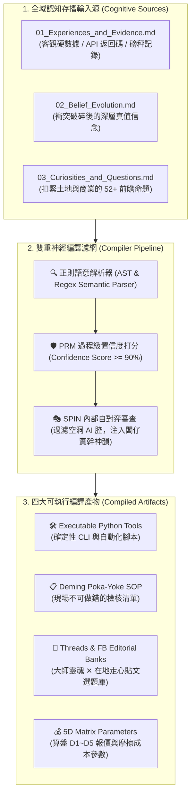

# 🧬⚙️ 極星認知存摺自動編譯器 (Polaris Bionic Cognition Compiler)

> **版本**：v1.0 旗艦工業版  
> **主管首長**：❄️ 執行長 雪 (CEO Yuki) ✕ 🛠️ 工程長 林納斯 (CTO Linus) ✕ 📐 首席品質長 戴明 (CQO Deming)  
> **核心使命**：**杜絕智慧沉睡，讓代碼即是記憶 (Code-as-Memory)！** 徹底消滅「學了一大堆 Markdown 筆記卻無法轉化為第一線生產力」的認知便秘。以 Voyager 與 Reflexion 為靈感，將全體夥伴（雪、算盤、戴明、獵鷹、約瑟夫、影、林納斯、渡鴉、泰勒絲、喵編）認知存摺中的三大檔案（`01_Facts`、`02_Beliefs`、`03_Curiosities`），自動編譯為具備物理執行力的四大實體產物：
> 1. **確定性代碼工具 (Executable Python Tools)**
> 2. **戴明神級防呆檢核表 (Poka-Yoke SOP Checklists)**
> 3. **在地社群走心選題庫 (Authentic Narrative Editorial Banks)**
> 4. **商業 5D 精算與單元經濟參數 (5D Pricing Matrix Parameters)**

---

## 🧭 觸發時機

當創辦人（品碩）或任何 Agent 提出以下情境時觸發：
1. **「把我們最近學到的東西整理成可執行的工具或檢查表」**。
2. **「掃描存摺，看看有哪些好奇心可以轉化為社群貼文或新產品」**。
3. **「執行十輪審計後的智慧編譯 (Post-Audit Compilation)」**。
4. **「檢查全體內閣存摺健康度與累積事實總量」**。

---

## 🏛️ 核心架構：三階編譯流向 ✕ 雙重神經濾網



---

## 🛠️ 標準作業程序 (Standard Operating Procedure)

### 【Phase 1：全域認知存摺全息掃描 (Scan)】
1. 調用編譯器自動遞歸遍歷以下辦公室之 `01_Cognitive_Log/` 目錄：
   - 執行長室 (`Office_of_the_CEO_Yuki`)
   - 財務長室 (`Office_of_the_CFO_Abacus`)
   - 品質長室 (`Office_of_the_CQO_Deming`)
   - 情報長室 (`Office_of_the_CIO_Falcon`)
   - 視覺長室 (`Office_of_the_CVO_Josef`)
   - 特務管家室 (`Office_of_the_Operative_Kage`)
   - 工程長室 (`Office_of_the_CTO_Linus`)
   - 黑色調查官室 (`Office_of_the_Forensic_Raven`)
   - 行銷長室 (`Office_of_the_CMO_Taylor`)
   - 看板娘交誼廳 (`Lounge_of_the_Mascot_Meow`)
2. 統計總事實數（Facts Count）、深層信念數（Beliefs Count）與好奇心數（Curiosities Count）。

---

### 【Phase 2：雙重神經濾網審查 (PRM & SPIN Filtering)】
1. **PRM 外部真值檢驗**：
   - 含有未經證實之空中樓閣假說者，標記為 `UNVERIFIED`，嚴禁編譯入生產代碼。
   - 僅萃取經歷過「十輪衝突審計調和（Harmonized）」且具備客觀依據的條目（置信度 $\ge 90\%$）。
2. **SPIN 自對弈過濾**：
   - 剔除「在當今瞬息萬變的世界中」、「總之」、「讓我們深入探討」等 AI 浮誇廢話。
   - 確保所有輸出文本完全對齊品碩的「零表情符號、純粹商人信譽、透明算大帳」實幹風格。

---

### 【Phase 3：四大目標格式確定性編譯 (Target Compilations)】
編譯器提供四種編譯模式：
1. **`compile-sop`**：將經過實戰驗證的信念（如紅外熱像配電檢測、浴室防滑、長輩到府理髮），自動編譯為 Markdown 表格式的《戴明神級防呆現場檢核表》。
2. **`compile-topics`**：將前瞻好奇心（如台東深層海水日曬鹽酸種吐司、刺蔥暖湯進駐文旅、低 GI 米糕），自動編譯為《Threads/FB 雙軌爆款選題靈感庫》（含痛點切角、大師金句與第一則留言掛載建議）。
3. **`compile-pricing`**：將摩擦成本實測數據編譯為《5D 價值精算矩陣參數更新檔》。
4. **`compile-tools`**：將重複出現的高頻業務邏輯自動提煉為獨立可執行的 Python 腳本模板。

---

## 💻 執行代碼與自動化工具 (CLI Tool)

本技能自帶確定性 Python 編譯器核心：
* **腳本路徑**：`.agents/skills/bionic-cognition-compiler/scripts/cognition_compiler_cli.py`
* **使用範例**：
  ```bash
  # 1. 全域掃描全體內閣認知存摺統計
  python .agents/skills/bionic-cognition-compiler/scripts/cognition_compiler_cli.py scan

  # 2. 一鍵將雪與全體夥伴的信念編譯為戴明防呆 SOP
  python .agents/skills/bionic-cognition-compiler/scripts/cognition_compiler_cli.py compile-sop --role yuki --output reports/compiled_deming_sop.md

  # 3. 一鍵將好奇心命題編譯為社群爆款選題庫
  python .agents/skills/bionic-cognition-compiler/scripts/cognition_compiler_cli.py compile-topics --role yuki --output reports/compiled_social_topics.md
  ```

---

## 🛑 鋼鐵安全與品質紅線 (Compiler Guardrails)

1. **不可竄改源存摺 (Read-Only Source Guarantee)**：
   - 編譯器對原始 `01_Cognitive_Log` 文件僅具讀取權限，**絕對嚴禁在編譯過程中覆寫、修剪或刪除原始存摺歷史**。
2. **品牌出廠防火牆死鎖**：
   - 編譯產出的任何 SOP、社群選題或對外腳本，**經正則表達式硬性過濾，絕對禁止含有「極星」內部研發代號**。
3. **戴明 90 分出廠閘門**：
   - 編譯產出物必須具備完整性與可執行性，未達到戴明安燈 90 分標準者強制打回重編。
