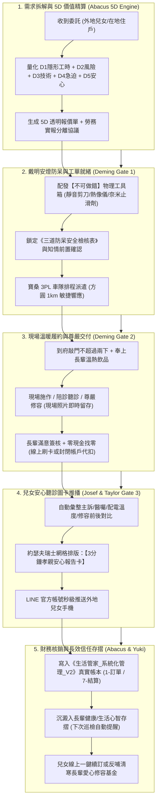

# 👵🏡 生活管家·孝親安居與高齡溫暖服務封裝器 (LifeButler Care Artisan)

> **版本**：v1.0 旗艦旗艦版  
> **主管首長**：❄️ 執行長 雪 (CEO Yuki) ✕ 🧮 財務長 算盤 (CFO Abacus) ✕ 📐 首席品質長 戴明 (CQO Deming) ✕ 🎨 視覺長 約瑟夫 (CVO Josef)  
> **核心使命**：消滅外地兒女的焦慮，守護台東在地長輩的尊嚴！專門解決**「外地兒女在雙北/高雄，父母在台東獨居老宅」**的深刻痛點。將原本模糊、非標、充滿情感雜訊的高齡居家照護需求，在 10 分鐘內一鍵標準化封裝為包含「5D 精算透明報價、戴明三道施工/陪診防呆、外地兒女 3 分鐘安心聽診圖卡、寶桑 3PL 現場履約核銷」之不可逆標準工單。

---

## 🧭 觸發時機

當創辦人（品碩）或任何 Agent 提出以下情境時觸發：
1. **外地兒女孝親委託**：「台北的客人想幫住在台東的爸媽裝浴室扶手 / 清洗冷氣 / 陪長輩看醫生 / 買常溫雞湯」。
2. **居家安全與防未病巡檢**：「有老宅需要檢查配電盤會不會發燙」、「颱風前需要巡檢屋頂漏水與排水溝」。
3. **高齡長輩尊嚴照護**：「臥床阿公需要到府理髮修容」、「老農想要將一生故事做成口述傳家回憶錄」。
4. **孝親產品化套餐打包**：「把浴室防滑、熱像電檢與陪診打包成節慶孝親禮包推廣」。

---

## 🏛️ 核心架構：五步孝親閉環 ✕ 戴明三道防呆閘門



---

## 🌟 五大常備孝親服務旗艦模組

### 模組 1：【居安無憂】浴室防滑奈米塗層 ＋ 一字防滑扶手 ＋ 配電盤紅外線熱像巡檢
* **目標受眾**：家有 70 歲以上長輩之獨居老宅、透天厝。
* **物理工具標配**：FLIR 紅外熱像儀、304 不鏽鋼防滑扶手、德國奈米級隱形止滑劑、水平儀。
* **標準作業 (SOP)**：
  1. 浴室地面物理深層除垢、均勻施作奈米防滑劑（摩擦係數提升至 0.65 以上，防滑等級達 CSR-B）。
  2. 依長輩身高與如廁動線，在馬桶旁或淋浴間精準安裝一字防滑扶手（承重測試 $\ge 120\text{kg}$）。
  3. 花 5 分鐘掃描總配電箱，量測螺絲端子溫度，若發燙 $\ge 60^\circ\text{C}$ 即刻斷電鎖緊，消除深夜火災隱患。
* **5D 建議定價**：NT$ 2,999（含材料、防滑施工、扶手一支、熱像報告與管家陪談）。

---

### 模組 2：【孝親暖心】長輩就醫陪診 ＋ 3 分鐘結構化安心聽診圖卡
* **目標受眾**：外地工作兒女，長輩在台東需定期赴馬偕、基督教醫院或榮民醫院複診。
* **服務標準 (SOP)**：
  1. 提早 15 分鐘到府接長輩（機車順路帶或代叫計程車扶持上車）。
  2. 陪同掛號、診室候診，在長輩同意下以筆記本記錄醫師口述醫囑與用藥調整。
  3. 協助領藥、核對藥袋說明，陪同送長輩平安返家，倒好溫開水叮嚀首次服藥。
  4. 30 分鐘內產出【孝親安心聽診圖卡】推播兒女（含：今日血壓數值、醫師診斷核心、用藥調整項、下次預約時間、長輩今日心情照片）。
* **5D 建議定價**：單趟 2 小時 NT$ 1,200（超時每小時 NT$ 400，車資實報實銷）。

---

### 模組 3：【體面長青】臥床與行動不便長輩到府尊嚴修容（靜音集塵理髮）
* **目標受眾**：長年臥床、中風或行動不便無法出門理髮之部落與社區長者。
* **物理工具標配**：醫療級靜音集塵電剪（吸髮不落地）、一次性純棉圍兜、溫熱毛巾、溫和草本鬍泡與安全刮刀。
* **服務標準 (SOP)**：
  1. 溫柔問候長輩，以熱毛巾敷臉軟化鬍根。
  2. 側臥或坐姿修剪，雙耳輪廓與後頸鬢角修得清爽俐落，電剪自帶真空吸塵杜絕碎髮刺癢。
  3. 刮除雜亂鬍鬚，修剪鼻毛，塗抹溫和蘆薈保濕露。
  4. 遞鏡子給長輩欣賞，拍照記錄長輩神清氣爽的笑容，發送兒女。
* **5D 建議定價**：單次 NT$ 600（弱勢長輩可由「愛心天使專項基金」全額免單）。

---

### 模組 4：【傳家之寶】高齡老農口述歷史與一生回憶錄印製
* **目標受眾**：80 歲以上在地老榮民、原住民耆老、台東開墾拓荒一代。
* **交付規格**：60 分鐘深度訪談 $\times 2$ 次，整理 5,000 字口述生命史，約瑟夫操刀排版，印製 2 本精裝全彩布紋硬殼書（含珍貴老照片掃描修復）。
* **服務標準 (SOP)**：
  1. 第一次訪談：攜帶常溫刺蔥暖湯到府，以「阿公，你少年時在台東怎麼開墾的？」引導長輩打開記憶話匣。
  2. 收集長輩壓箱老照片，以高解析度掃描儀現場翻拍歸還原件。
  3. 第二次訪談：確認家族重要紀事與族譜分支。
  4. 影與泰勒絲執筆提煉溫潤文字，約瑟夫完成排版，健豪印刷 300 DPI 絲流裝訂。
  5. 親手將新書遞交長輩手中，拍攝全家族翻閱合影。
* **5D 建議定價**：整套 NT$ 6,800（預售集單定金 50%，完工交付尾款 50%）。

---

### 模組 5：【暖胃風土】常溫滋補軟袋 ＋ 長輩低 GI 軟質養生膳
* **目標受眾**：咀嚼能力退化、糖尿病友善或外地兒女定期寄送營養備餐。
* **品項範疇**：
  - 常溫高壓殺菌軟袋：刺蔥排骨燉湯、剝皮辣椒甘蔗雞湯（常溫保存 12 個月，撕開隔水加熱 3 分鐘即飲）。
  - 低 GI 傳統米糕：池上糙米粉 ＋ 低溫烘焙洛神花 ＋ 赤藻糖醇。
* **履約標準**：由寶桑物流每週五定期隨自提或順路帶送達長輩家中冰箱，並協助將即期食品往前擺放。
* **5D 建議定價**：每週 5 包燉湯套組 NT$ 750 / 月度訂閱 NT$ 2,800。

---

## 🛠️ 執行代碼與自動化工具 (CLI Tool)

本技能自帶確定性 Python 工單與報告生成器：
* **腳本路徑**：`.agents/skills/lifebutler-care-artisan/scripts/care_artisan_cli.py`
* **使用範例**：
  ```bash
  # 1. 建立就醫陪診工單並試算報價
  python .agents/skills/lifebutler-care-artisan/scripts/care_artisan_cli.py create-order --type escort --client "台北陳小姐" --elder "正氣北路陳阿公" --hours 2

  # 2. 生成兒女安心聽診圖卡 HTML/Markdown
  python .agents/skills/lifebutler-care-artisan/scripts/care_artisan_cli.py generate-card --order-id CARE-20261102-01 --doctor "馬偕陳醫師" --diagnosis "心血管常規複診，血壓穩定" --next-date "2026-12-05"
  ```

---

## 🛑 品牌與安全死鎖鐵律 (Mandatory Guardrails)

1. **對外品牌絕對零極星洩漏**：
   - 面向外地兒女、長輩、醫院或社群的所有工單、圖卡、訊息，**絕對禁止出現「極星」二字**。
   - 一律自稱「生活管家」或「生活的一部分，就醬點！」。
2. **法定唯一真實帳本**：
   - 每一筆孝親工單的收款、代墊款、車資與分潤，**唯一登記於《生活管家_系統化管理_V2》**之「1-訂單紀錄」與「7-每日結算紀錄」，嚴禁分散於非標表格。
3. **醫療法規紅線**：
   - 管家角色為「非醫療性生活陪伴者與醫囑忠實速記員」，嚴禁向家屬給予未經醫師處方之醫療診斷或自行調整長輩處方藥劑量。
4. **尊嚴第一原則**：
   - 到府服務一律穿著乾淨整潔工作服、穿著鞋套，未經長輩與兒女書面或 LINE 授權，嚴禁拍攝臥床長者非體面照片。

---

## 📜 向上反哺提案機制 (Upstream Master RFC Protocol)

當 `lifebutler-care-artisan` 累計服務超過 50 位長輩，淬鍊出普適於全國偏鄉之「孝親安心閉環演算法」時：
1. 由執行長雪起草《Master_RFC_care_artisan_expansion.md》。
2. 呈交創辦人品碩親自裁決，作為生活管家邁向全台居家安居連鎖品牌之核心基石。
