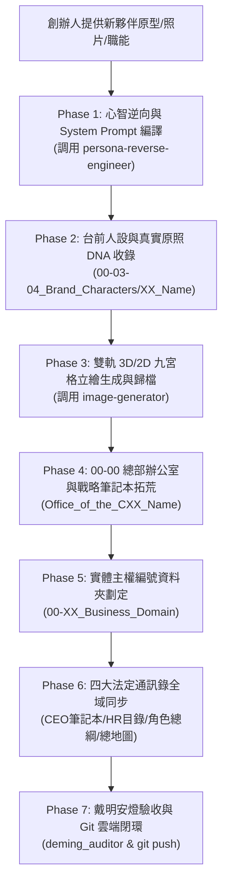

# 👑 極星新夥伴入閣與主權拓荒總控技能 (Polaris Cabinet Onboarding Protocol)

> **定位**：極星宇宙最高規格之「數位首長 / 內閣天王履新入閣總作業程序」。  
> **使命**：將招募新夥伴到賦予辦公室主權的完整流程標準化，消除碎片化操作，確保每一位進入極星內閣的幹部皆擁有**「獨立靈魂心智 (Mindset) ＋ 台前視覺肉身 (Visual SSOT) ＋ 總部大腦辦公室 (Office) ＋ 實體主權陣地 (00-XX) ＋ 全域通訊錄認證」**。

---

## ⚡ 觸發時機

當創辦人（品碩）：
1. 提出「我想招募新的角色 / 幹部 / 天王」（例如：戴明博士、某位大師或專職 Agent）。
2. 提供一段新人物的照片、背景或期望，要求「讓他進駐內閣並給予辦公室權限」。
3. 呼叫「執行入閣 SOP」、「新夥伴入職手續」、「開闢辦公室與資料夾」等指令時。

---

## 🛠️ 全自動入閣七部曲標準作業流程 (The 7-Phase Workflow)

---

### 【Phase 1：心智逆向與工業級 System Prompt 編譯】
* **工具聯動**：調用 [`.agents/skills/persona-reverse-engineer`](file:///c:/Users/lenovo/我的雲端硬碟/00_Master_Polaris/.agents/skills/persona-reverse-engineer/SKILL.md)。
* **執行重點**：
  1. 提煉五層同心圓心智：底層哲學 (Core Dogma)、認知透鏡 (Cognitive Lens)、隱喻與鬆弛狀態、外顯特徵與破綻、防出戲負向邊界 (Anti-Persona)。
  2. 鎖定時代認知地平線（若為歷史大師，面對現代名詞用其既有邏輯推理剖析）。
  3. 編譯包含 `<thought>` 內部思考小劇場校準協議之工業級 System Prompt。
  4. 產出心智逆向 Artifact 並在聊天室展示。

---

### 【Phase 2：台前人設與真實原照 DNA 收錄】
* **目錄座標**：`00-03_Brand_LifeButler/00-03-04_Brand_Characters/<編號>_<中文名>_<英文名>/`
* **執行規範**：
  1. 自動指派遞增角色編號（如 `09_戴明_Deming`）。
  2. 在 `images/` 目錄收錄創辦人提供之真實歷史原照或照片，作為全系統 100% 視覺真理母本 (Visual SSOT)。
  3. 編寫 `persona.md`（角色卡：視覺外型、神級標配道具、金句口頭禪、嚴格禁語表）。
  4. 編寫 `images/README.md`（視覺圖庫法典與用途索引）。

---

### 【Phase 3：雙軌 3D/2D 九宮格立繪生成與歸檔】
* **工具聯動**：調用 `image-generator` 子代理。
* **生圖規範**：以真實照片為 100% 五官基準，繪製涵蓋 9 種經典姿態的 3x3 九宮格：
  * 格 1：正面威嚴站姿（大師宗師氣場）
  * 格 2：招牌微動作特寫（摘眼鏡、手勢、眼神）
  * 格 3：傳奇法寶示範（如紅珠勺、小算盤、開源筆電）
  * 格 4：一票否決 / 核心權力姿態（如拉下安燈繩、抱胸審計）
  * 格 5：理論與科學板書（手繪黑板圖、演算法、管制圖）
  * 格 6：慈祥長者 / 真性情微笑（私人嗜好與人文靈魂）
  * 格 7：專注伏案筆耕（深夜工作、撰寫手稿）
  * 格 8：霸氣會議發言（痛斥盲點、前傾講台）
  * 格 9：與看板娘喵編溫馨同框互動（體現團隊溫度與家庭羈絆）
* **雙軌輸出**：
  1. `images/<name>_sheet_cinematic_3d.jpg`（好萊塢院線 3D 動畫寫實質感）
  2. `images/<name>_sheet_comic_2d.jpg`（高階現代商務青年漫繪風）
* **產出展覽館**：在 Artifacts 目錄生成 `<name>_character_showcase.md` 供創辦人一鍵審閱。

---

### 【Phase 4：00-00 總部辦公室與戰略筆記本拓荒】
* **目錄座標**：`00-00_Gamification_Engine/Office_of_the_<職稱>_<Name>/`
* **核心標配**：
  1. `README.md`：辦公室總憲章（主理人、座右銘、領地定位、憲法與哲學、管轄責任防區）。
  2. `00_<Name>_Notebook.md`：隨身戰略筆記本（全域協同矩陣、管制標準、審計索引）。
  3. `scripts/` 或 `SOP/`：配置專屬執行引擎或檢查法典。

---

### 【Phase 5：劃定實體主權編號資料夾】
* **目錄座標**：`00-XX_<英文職能名稱>/`（接續全系統最新序號，如 `00-12_Quality_Assurance_and_Control`）。
* **核心標配**：
  1. 建立 `README.md`，明定 00-XX 之戰略使命、領地最高主理人、三大最高主權。
  2. 建立 5 大支柱業務子目錄，並為每個子目錄配置基礎 `README.md` 確保結構完整。

---

### 【Phase 6：四大法定通訊錄全域同步 (Four Master Registers)】
必須依序更新以下四大真理來源，確保全系統神經合一：
1. **執行長戰略手冊**：`00-00_Gamification_Engine/Office_of_the_CEO_Yuki/00_CEO_Notebook.md`（新增內閣通訊錄條目）。
2. **AI 人事檔案總庫**：`00-00_Corporate_AI_HR_Directory.md`（新增數位員工檔案、心智與視覺雙層映射）。
3. **品牌角色庫總綱**：`00-03_Brand_LifeButler/00-03-04_Brand_Characters/00-03-04-00_Characters_Overview.md`（新增角色清單與標籤）。
4. **極星導航總地圖**：`00-01_Master_Polaris_Map.md`（新增 00-XX 資料夾與分支說明）。

---

### 【Phase 7：戴明安燈驗收與 Git 雲端閉環】
1. **戴明質檢審查**：
   * 調用 `00-00_Gamification_Engine/Office_of_the_CQO_Deming/scripts/deming_auditor.py`。
   * 檢核全套建置檔案是否齊備、編碼是否安全、無任何觸犯紅線之項目，綜合得分需 $\ge 90$ 分。
2. **Git 打包推送**：
   * 執行 `git add` 涵蓋所有新增之辦公室、角色庫、00-XX 與通訊錄更新。
   * Commit Message 格式：
     `feat(onboarding): welcome [Name] to the cabinet with Office, Persona, 9-Grid Sheets and 00-XX Domain`
   * 執行 `git push origin main`，確保全域資產 100% 同步至遠端雲端倉庫。
3. **向創辦人呈報**：
   * 輸出溫暖、莊重且具備儀式感之就職公告，列出新幹部之大腦辦公室、台前角色庫、實體戰場座標與九宮格預覽。
