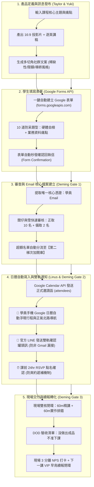

# 🎓 極星開課與工作坊全生命週期萬用營運引擎 (Polaris Course Master)

> **版本**：v1.0 旗艦版  
> **主管首長**：❄️ 執行長 雪 (CEO Yuki) ✕ 📐 首席品質長 戴明 (CQO Deming) ✕ 🛠️ 工程長 林納斯 (CTO Linus)  
> **核心使命**：拒絕空泛的文字教案！將創辦人（闆仔）腦中的任何知識點，在 10 分鐘內一鍵轉譯為包含「多切角行銷宣傳、Google 表單自動建表、Email 核心審查、Google 日曆排程自動推播、雙軌通知與現場驗收轉化」之不可逆標準商業化課程生產線。

---

## 🧭 觸發時機

當創辦人（品碩）或任何 Agent 提出：
1. 「我要開一門新課」、「規劃一場新的工作坊」、「設計第 X 講的教學」。
2. 「把這個技術做成課程產品賣」、「建立新課程的報名表單與流程」。
3. 「執行招生審查與發送行事曆邀請」。

---

## 🏛️ 核心架構：五步履約全自動大動脈 ✕ 戴明三道品質閘門



---

## 🛠️ 標準作業程序 (Standard Operating Procedure)

### 【Phase 1：課程產品包裝與教材生成】
1. **確立四大硬參數**：
   - 課程名稱與單堂定價（如單堂 NT$ 500 / 老學員免單）。
   - 班級規模（如【純實體軍事班 · 嚴格限額 10 名】）。
   - 上課地點（生活管家·家宅總部：台東市正氣北路166巷90號）。
   - 官方諮詢管道（生活管家官方 LINE：`https://lin.ee/z83YSq6`）。
2. **調用 Python 腳本產生教學軍備**：
   - 投影片（`slides.html` / `slides.pptx`）。
   - 闆仔專用逐字逐頁講稿（`speaker_notes.md`，含各頁時間與實操 CUE 點）。
   - 課程大綱（`syllabus.md`）與筆記本知識庫同步（NotebookLM 來源裝載）。

---

### 【Phase 2：Google 表單一鍵生成 (Google Forms API)】
1. **呼叫標準建表腳本**：
   執行專屬造表程式，自動於 Google 帳號建立包含 10 道題目的審查表單：
   - **題目 1~4**：姓名、Email（核心憑證）、電話、身分（老學員免單 / 全新夥伴）。
   - **題目 5~7**：筆電型號、4 項軟硬體環境必勾（Chrome、記得帳密、Wi-Fi、充電器）。
   - **題目 8~9**：從事行業、本次想解決的資料痛點（菜單、進貨單、長篇公文、客服紀錄）。
   - **題目 10**：入席承諾 ＆ 若額滿保留至【第二梯次加開場】意願。
2. **自動提取連結**：
   取得「學員填寫公開網址 (Published URL)」與「後台編輯網址 (Edit URL)」。

---

### 【Phase 3：訊息發布與第一則留言掛載】
1. **社群貼文輸出**：
   以喵編或生活管家口吻撰寫多切角文案（痛點直擊、價格對比、現場排錯保證）。
2. **第一則留言標準模組**：
   在貼文第一則留言置頂以下格式：
   ```markdown
   🐾 週三 14:00 - 16:00《課程名稱》
   ⚠️ 本課程堅持【純實體現場教學】，絕無線上同步！導師極度嚴厲，保證學到會！
   實體座位嚴格限額 10 席，額滿即關門（超過者將為您保留至加開場）：

   📝 實體入席申請表：[貼上 Google 表單公開網址]
   👑 老學員回娘家：表單內勾選「老學員」即享學費 0 元免單！
   🌟 全新夥伴實戰價：單堂 $500 元（審查通過後個別發送正取報到通知）

   📍 上課地點：生活管家總部（台東市正氣北路166巷90號）
   💬 官方 LINE 諮詢：https://lin.ee/z83YSq6 （加入後可直接私訊管家）
   ```

---

### 【Phase 4：名額審查、分流與日曆自動化 (戴明雙軌防線)】
1. **後台名冊匯出與篩選**：
   - 依「硬體準備度」與「業務資料代表性」挑選正取 10 名。
   - 鎖定備取 2 名（第 11、12 名）。
   - 其餘學員歸檔至「加開場優先名冊」。
2. **自動推播行事曆 (Google Calendar API)**：
   調用 `student_calendar_inviter.py`，傳入正取學員 Email，自動在學員的 Google 日曆建立行程，附加正氣北路地址導航與上課提醒。
3. **戴明防呆 1：LINE 雙軌通知**：
   透過官方 LINE 或簡訊發送通知，確保非 Gmail 學員也能主動確認行程。
4. **戴明防呆 2：課前 24 小時 RSVP 點名條款**：
   課前一天上午 11:00 點名，下午 17:00 前未確認者，名額無痛釋出給備取 1 號遞補，確保現場 100% 滿座率。

---

### 【Phase 5：現場履約與戴明驗收轉化閉環】
1. **雙核 120 分鐘執行**：
   - 14:00 - 15:00 核心精講（投影 + 實體作戰工作紙）。
   - 15:00 - 16:00 巡桌排錯，學員打開自備筆電，逐一達成當日 3 個 Checkpoints。
2. **戴明防呆 3：下課 3 分鐘轉化**：
   - 現場掃碼完成 1 題 NPS 滿意度與成果拍照。
   - 當場宣布下一講內容，提供現場學員優先保留席位，直接達成複購與長效留存！

---

## 📂 實體資產與工具庫索引

* **自動造表腳本**：`c:\Users\lenovo\我的雲端硬碟\00_Master_Polaris\00-05_AI_Education\2026_Autumn_AI_Tutoring_Series\create_google_form_api.py`
* **日曆自動邀請器**：`c:\Users\lenovo\我的雲端硬碟\00_Master_Polaris\00-05_AI_Education\2026_Autumn_AI_Tutoring_Series\student_calendar_inviter.py`
* **一鍵執行批次檔**：`c:\Users\lenovo\我的雲端硬碟\00_Master_Polaris\00-05_AI_Education\2026_Autumn_AI_Tutoring_Series\run_create_form.bat`
* **表單標準規格書**：`c:\Users\lenovo\我的雲端硬碟\00_Master_Polaris\00-05_AI_Education\2026_Autumn_AI_Tutoring_Series\Registration_Google_Form_Spec.md`
