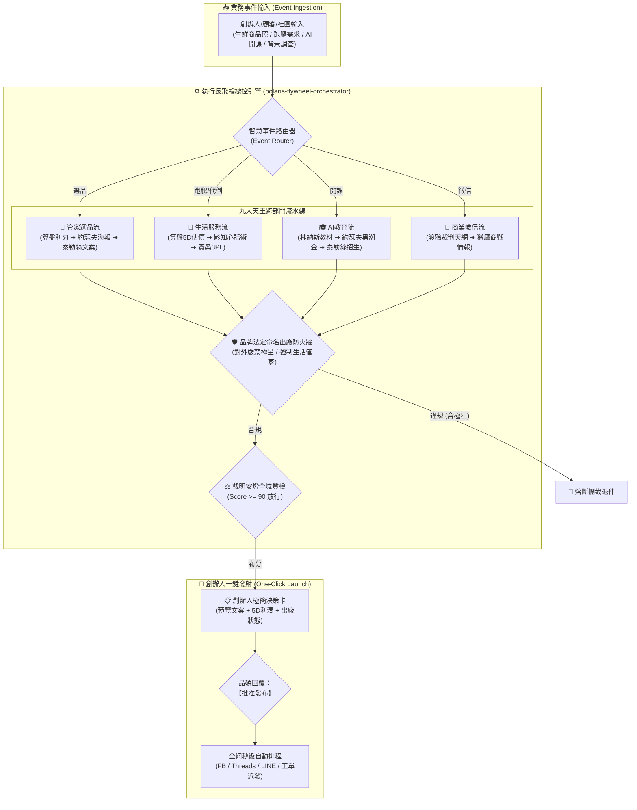

# ⚙️ 極星全域飛輪總控協議 (Polaris Flywheel Orchestrator Protocol v1.0)

> 🏛️ **主政首長**：首席執行長兼跨內閣總協調 雪 (Yuki, CEO)  
> 🛡️ **品質監製**：首席品質長 戴明博士 (Dr. W. Edwards Deming)  
> 🛠️ **技術驗收**：CTO 林納斯 (Linus Torvalds)  
> 🎯 **最高統帥**：陳品碩 (Pinshuo Chen)  
> 📜 **法典依據**：嚴格恪守《執行長雪二十項戰略導航終極鐵律》（`bionic-learning-yuki v4.0`）  
> 📏 **核心定位**：**極星全域業務飛輪的中央神經調度引擎（Central Nervous Flywheel Orchestrator）**。將任何傳入的業務事件秒級路由至九天王流水線，經品牌防火牆（嚴禁極星洩漏）與戴明安燈質檢，組裝為極簡卡片呈報創辦人一鍵批准發布！

---

## 🏗️ 第一章｜系統架構全貌 (System Architecture)



---

## ⚡ 第二章｜三大核心子系統規範

### 1. 智慧事件路由器 (Event Router)
* **`groupbuy` (管家選品)**：自動調用 `sharp-groupbuy-analyzer` 逆推成本，調用 `polaris-poster-artisan` 渲染 300 DPI 雙色調海報，調用泰勒絲四大面向文案。
* **`life_service` (生活服務)**：自動調用 `polaris-5d-pricing-engine` 轉化 TP 點數，生成防彈衣對話話術，無縫對接特務影與生活管家客服。
* **`ai_education` (AI 教育)**：自動調用 `00-05` 實戰教材與 `polaris-course-master`，生成黑潮金旗艦海報與招生文案。
* **`forensics` (商業調查)**：自動調用 `polaris-forensic-investigator` 進行裁判書全文穿透與資產不對稱審計。

### 2. 品牌出廠防火牆 (Brand Sovereign Gate)
* **硬性攔截詞**：
  * **「極星」**：對外面向大眾文案一律禁止出現，違者一票否決、立即熔斷！
  * **「團購」**：商品販售一律改稱**「管家選品」**。
  * **「便宜貨 / 破盤價」**：一律改稱**「品質越級 / 產地直選 / 聰明省心」**。
* **法定標準命名**：
  * 品牌名稱：`生活的一部分，就醬點！`
  * 團隊自稱：`生活管家`
  * 商品販售：`管家選品`
  * 其他服務：`生活服務`

### 3. 創辦人一鍵審批發射台 (One-Click Launch Pipeline)
* 嚴禁向品碩丟出未經整理的發散長篇大論。
* 輸出標準化決策卡：包含【業務類型】、【對外預覽文案】、【利潤/價格】、【防火牆狀態】。
* 品碩只需回覆**「批准」**，引擎直連 `facebook-publisher` 與 `threads-publisher` 全自動發布！

---

## 🛠️ 第三章｜實體腳本規範與 CLI 調用

* **腳本路徑**：`00-00_Gamification_Engine/polaris_flywheel_orchestrator.py`
* **CLI 指令語法**：
```bash
# 執行自我質檢
python 00-00_Gamification_Engine/polaris_flywheel_orchestrator.py --test

# 模擬管家選品事件
python 00-00_Gamification_Engine/polaris_flywheel_orchestrator.py \
  --event groupbuy --item "枋寮特選午仔魚" --price 180

# 模擬生活服務事件
python 00-00_Gamification_Engine/polaris_flywheel_orchestrator.py \
  --event life_service --item "台東市代倒垃圾日常服務" --price 999
```
