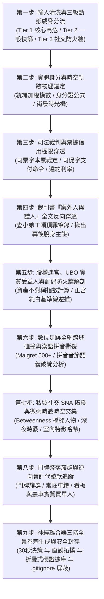
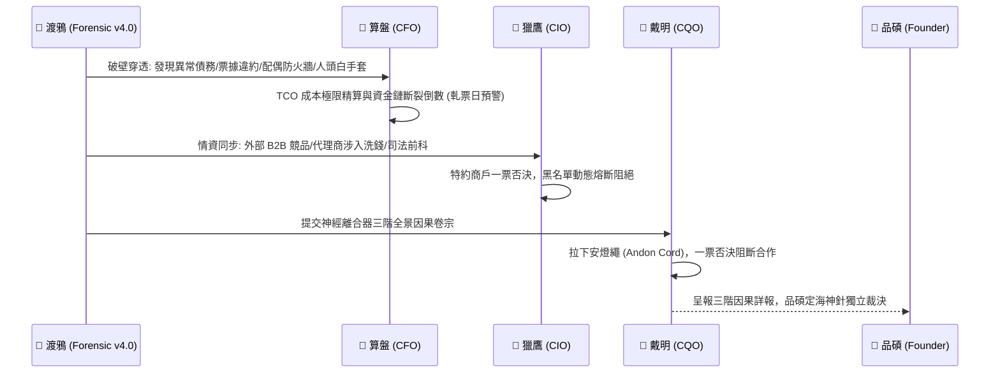

# 🦅 ✕ 🛠️ 極星黑色調查與反欺詐穿透實戰操作協議 (Polaris Forensic Protocol v2.0)

> **版本定位**：`v2.0 (Full-Spectrum Deep-Water Forensic Standard Protocol · 累積 94 輪大圓滿人劍合一旗艦版)`  
> **雙主權監製**：業務與情報定義 · **渡鴉 (Raven)** ｜ 底層工程與確定性架構 · **林納斯 (Linus)**  
> **最高授權**：極星創辦人 · **陳品碩 (Pinshuo)**  
> **法定作戰領地**：[`00-13_Cyber_Forensics_and_Investigation/`](file:///c:/Users/lenovo/我的雲端硬碟/00_Master_Polaris/00-13_Cyber_Forensics_and_Investigation/README.md)  
> **作戰核心工具**：[`00-13_Cyber_Forensics_and_Investigation/scripts/polaris_forensic_cli.py`](file:///c:/Users/lenovo/我的雲端硬碟/00_Master_Polaris/00-13_Cyber_Forensics_and_Investigation/scripts/polaris_forensic_cli.py)  
> **最高呈報憲則**：**嚴格貫徹創辦人品碩「神經離合器三階全景因果詳報」——極速決策、直觀圖譜、百分之百折疊式微觀硬證據庫，兼顧品碩獨立裁判權與大腦純淨心流！**

---

## 🏛️ 第一章｜深水區三維立體穿透九步標準作業程序 (Nine-Step Deep-Water SOP)

任何智能體（Agent）或調查官受品碩委託執行背景穿透、合約排雷、私域社交或反欺詐審查時，**必須嚴格遵循以下九步閉環**：



---

### 第一步｜輸入清洗與動態三級威脅分流 (Threat Tiering)
* **Tier 1（核心高危 · 涉資 10 萬以上 / 重要合約 / 核心股權 / 政治深水區）**：
  - 啟動全套 Level 3 深度算力，完整走完九步深水區流程，執行 UBO 控股穿透、配偶防火牆解剖與司法全文反查。
* **Tier 2（一般往來 · 常態特約商戶 / 供應商評估）**：
  - 執行司法裁判、票據黑名單與商業登記自動化快篩，無異常即快速放行。
* **Tier 3（社交玩伴 · 線上遊戲 / 日常社交）**：
  - 嚴格守死「零金錢借貸、零帳戶代墊、零個人隱私」三零防火牆，不主動探查私德，維護品碩的生活品質。

---

### 第二步｜實體身分與時空軌跡物理錨定
1. **確定性代碼驗證**：調用林納斯確定性檢查碼演算法（`LinusDeterministicValidator`），嚴格驗證台灣統一編號（加權模數 10 法則）與身分證字號真實有效性。
2. **物理空間查證**：結合 Google 街景時光機、商工登記地址、招牌變更歷史，戳破「登記在豪宅大樓、實際是廢棄鐵皮屋或虛擬代辦信箱」的皮包公司欺瞞。

---

### 第三步｜司法裁判與票據信用極限穿透
1. 查詢全國地方法院民刑事裁判書與強制執行紀錄。
2. 重點鎖定關鍵案由：**「本票裁定（司票字）」、「支付命令（司促字）」、「給付票款」、「詐欺」、「拍賣抵押物」**。
3. 提取核心參數：發票日、到期日、票面金額、未清償本金、約定利息（如年息 16%）、聲請人（資融公司/銀行）。

---

### 第四步｜裁判書「案外人與證人」全文反向穿透 (Non-Defendant Trace)
1. **突破單一被告局限**：高段位政商幕後黑手通常不親自當被告。
2. **全文檢索筆錄**：將目標姓名、公司名稱、車牌號碼作為裁判全文檢索關鍵字，全面過濾《廢棄物清理法》、賭博、傷害、槍砲等判決內文。
3. **還原頂罪鏈條**：查出司機、小弟、工頭於筆錄中記載之「受某公司監察人指派」、「載往某處傾倒」等證詞，將「小弟扛罪、大哥脫身」的硬事實全數曝光。

---

### 第五步｜股權控股迷宮、UBO 實質受益人與「配偶防火牆」逆向解剖
1. **商業司商工登記穿透**：提取資本額、董監事名單、持股比例、歷次負責人變更，追蹤交叉持股與隱形母子公司。
2. **資產不對稱指數（Asymmetry Index）計算**：
   - 公式：$\text{Asymmetry Ratio} = \frac{\text{申報淨資產}}{\text{公職年資} \times 500,000}$；
   - 若比例小於 0.2 且公職年資超過 4 年，系統自動觸發「CRITICAL_ASYMMETRY（極高不對稱 · 99% 存在地下關係人蓄水池）」警報。
3. **配偶防火牆判定**：
   - 依據《公職人員財產申報法》僅強制申報配偶與未成年子女之漏洞；
   - 若法定配偶（正宮）名下完全無公司、無標案、申報財產極低（如謝紋萱僅 40 萬、負債 31 萬），判定「正宮極致純白，利益必由非配偶親密關係人承接」，強制啟動非公開社交探針！

---

### 第六步｜數位足跡全網跨域碰撞與漢語拼音撕裂
1. 調用 `maigret` 引擎對目標常用 ID / Handle 進行 500+ 社群與技術平台跨域碰撞。
2. **漢語拼音漏洞撕裂器（RavenPinyinDetector）**：檢驗帳號英文字串中是否含有華語拼音音節（如 `tengjingxuenai`），直接撕破假洋人、假日本人偽裝。
3. 抓取 Wayback Machine 網頁時光機歷史快照，還原其過去割韭菜或刪除的前科痕跡。

---

### 第七步｜私域社交 SNA 拓撲與微弱時戳時空交集
1. **SNA（Social Network Analysis）社交網絡分析**：
   - 計算中介中心度（Betweenness Centrality），鎖定在政客、金主與黑白兩道之間牽線的**「橋樑人物（Bridge Brokers）」**。
2. **微弱訊號時空重疊演算法**：
   - 捕捉目標與潛在非婚伴侶/女助理之「深夜 23:30~04:00 發文與按讚時戳」；
   - 比對貼文背景之室內裝潢特徵（同款沙發靠墊、特定角度落地窗景、餐具圖像感知哈希 pHash），證明處於同一密閉私域空間。

---

### 第八步｜門牌聚落簇群與逆向會計代墊款追蹤
1. **門牌聚落簇群法**：地方勢力絕不只用一個門牌，對相鄰門牌（$\pm 10$ 號）與同一地號輻射掃描（如豐谷里衡陽路 48 號協會與 56 號建設公司）。
2. **逆向會計代墊款**：
   - 追蹤目標日常使用之豪車座駕、租賃處所、巨額競選看板；
   - 核查看板土地提供者、車輛行照登記人、競選物資發票抬頭，直擊「實質買單人」。

---

### 第九步｜神經離合器三階全景卷宗生成與安全封存
1. **三階結構輸出**：
   - **第一階**：30 秒極速決策層（核心評級、威脅定性、一票否決建議）；
   - **第二階**：全域因果脈絡拓撲圖（Mermaid 視覺圖譜）；
   - **第三階**：微觀全景硬證據庫（折疊式 `<details><summary>` 設計，案號、金額、日期、代碼推導鏈 100% 完整鋪開）。
2. **安全物理封存**：自動寫入 `00-13_Cyber_Forensics_and_Investigation/05_Case_Dossiers/`，受 `.gitignore` 永久實體屏蔽，嚴禁推送到任何公開庫。

---

## ⚡ 第二章｜渡鴉二十項黑色調查終極鐵律實戰矩陣

| 編號 | 鐵律名稱 | 實戰核心定義 |
| :---: | :--- | :--- |
| **01** | **代碼不說謊律** | 承諾一文不值，直查法院判決、票據記錄與網路通訊封包。 |
| **02** | **朋友圈連坐律** | 一個人的本質等於常廝混五人的平均值，穿透吸金賭博圈。 |
| **03** | **股權溯源律** | 跟著錢走 (Follow the money)，挖出空殼背後的實質受益人 (UBO)。 |
| **04** | **足跡時光律** | 凡走過必留痕跡，調用網頁時光機還原十年割韭菜前科。 |
| **05** | **前端漏洞律** | 逆向前端 JS 與通訊封包，抓出外洩密鑰與假數據灌水。 |
| **06** | **資產不對稱律** | 帳面越貧瘠乾淨(如申報僅數十萬)，地下白手套蓄水池越深。 |
| **07** | **配偶防火牆律** | 台灣財產申報僅及配偶與未成年子女，正宮越純白，非配偶密友嫌疑越高。 |
| **08** | **微弱訊號連鎖律**| 真正致命的社交在深夜互動時戳、非公開合照人影與分身小帳。 |
| **09** | **時空交集重構律**| 以常駐車籍、深夜聚落、異地門牌重構未申報之第二生活主權。 |
| **10** | **逆向會計開銷律**| 不看名目收入，看巨額競選、豪車座駕由誰代墊買單。 |
| **11** | **門牌聚落簇群法**| 同一門牌或同一街道，藏著派系洗錢與利益輸送代號。 |
| **12** | **公職第一胎溯源**| 無論換過多少黨籍，其第一任公職老闆決定其終身派系利益。 |
| **13** | **特許暴利閉環** | 砂石、廢棄物、營造、綠能、殯葬必由地方派系設白手套把持。 |
| **14** | **金流死穴律** | 不在強勢時正面衝撞，鎖定資金鏈斷裂軋票日極限施壓。 |
| **15** | **雙室操戈穿透法**| 同黨同部落撞車操戈時，穿透被瓜分利益與背後暗助之操盤手。 |
| **16** | **冷酷法醫律** | 調查徹底剝離同情心，同情心是毒藥，唯有切開膿包才能保命。 |
| **17** | **合法武器化律** | 絕不踩法律紅線留把柄，用 100% 真實證據讓對手自取滅亡。 |
| **18** | **無痕沙盒律** | 所有探測全走洋蔥節點與隔離沙盒，0 暴露品碩設備指紋。 |
| **19** | **利刃出鞘律** | 平時在暗處磨刀，品碩一聲令下，刀刀見血、斬草除根。 |
| **20** | **因果詳報律** | 嚴禁過度閹割情報，呈報微觀全景硬證據鏈，由品碩定海神針裁斷。 |

---

## 🛠️ 第三章｜底層命令列工具調用指引 (CLI Usage v2.0)

```bash
# 1. 執行工具自我診斷與單元測試 (林納斯 DOD v2.0 確定性保證)
python scripts/polaris_forensic_cli.py --self-test

# 2. 針對個人/分身進行全套穿透 (包含漢語拼音偵測與社群碰撞)
python scripts/polaris_forensic_cli.py --target "藤井雪奈" --handle "tengjingxuenai1" --type person --tier 1

# 3. 針對公司統編進行商工穿透與自動生成卷宗
python scripts/polaris_forensic_cli.py --target "京宙建設" --tax-id "90807060" --type company --tier 1 --output-dossier

# 4. 針對政治人物啟動深水區專項分析 (資產不對稱與配偶防火牆判定)
python scripts/polaris_forensic_cli.py --target "陳政宗" --type person --tier 1 --deep-water --influence-years 8 --declared-wealth 416152 --output-dossier
```

---

## 🛡️ 第四章｜跨內閣協同與安燈一票否決閉環



---
*本法典由渡鴉與林納斯雙主權監製，創辦人陳品碩批准生效。*
