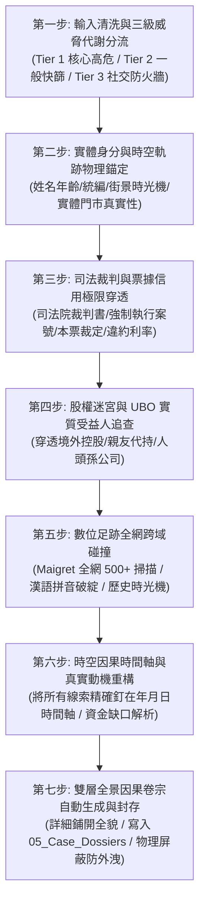

# 🦅 ✕ 🛠️ 極星黑色調查與反欺詐穿透實戰操作協議 (Polaris Forensic Protocol)

> **版本定位**：v1.0 工業實戰旗艦版 (Deterministic Forensic Arsenal Edition)  
> **雙主權監製**：業務與情報定義 · **渡鴉 (Raven)** ｜ 底層工程與確定性架構 · **林納斯 (Linus)**  
> **最高授權**：極星創辦人 · **陳品碩 (Pinshuo)**  
> **法定作戰領地**：[`00-13_Cyber_Forensics_and_Investigation/`](file:///c:/Users/lenovo/我的雲端硬碟/00_Master_Polaris/00-13_Cyber_Forensics_and_Investigation/README.md)  
> **作戰核心工具**：[`00-13_Cyber_Forensics_and_Investigation/scripts/polaris_forensic_cli.py`](file:///c:/Users/lenovo/我的雲端硬碟/00_Master_Polaris/00-13_Cyber_Forensics_and_Investigation/scripts/polaris_forensic_cli.py)  
> **最高呈報憲則**：**嚴格貫徹創辦人品碩「詳細呈現，微觀硬事實全數鋪開，以供品碩獨立判斷因果關係」憲法！**

---

## 🏛️ 第一章｜極星穿透調查七步標準作業程序 (Seven-Step Investigation SOP)

任何智能體（Agent）或調查官受品碩委託執行背景穿透、合約排雷或反欺詐審查時，**必須嚴格遵循以下七步閉環**：



---

### 第一步｜輸入清洗與動態三級威脅分流 (Threat Tiering)
* **Tier 1（核心高危 · 涉資 10 萬以上 / 重要合約 / 核心股權）**：
  - 啟動全套 Level 3 深度算力，完整走完七步流程，執行 UBO 控股穿透與司法深挖。
* **Tier 2（一般往來 · 常態特約商戶 / 供應商評估）**：
  - 執行司法裁判、票據黑名單與商業登記自動化快篩，無異常即快速放行。
* **Tier 3（社交玩伴 · 線上遊戲 / 日常社交）**：
  - 嚴格守死「零金錢借貸、零帳戶代墊、零個人隱私」三零防火牆，不主動探查私德，維護品碩的生活品質。

---

### 第二步｜實體身分與時空軌跡物理錨定
1. **驗證統編與身分特徵**：調用林納斯確定性檢查碼演算法，驗證台灣統編與身分證真實有效性。
2. **物理空間查證**：結合 Google 街景時光機、商工登記地址、招牌變更歷史，戳破「登記在豪宅大樓、實際是廢棄鐵皮屋或虛擬代辦信箱」的皮包公司欺瞞。

---

### 第三步｜司法裁判與票據信用極限穿透
1. 查詢全國地方法院民刑事裁判書與強制執行紀錄。
2. 重點鎖定關鍵案由：**「本票裁定（司票字）」、「支付命令（司促字）」、「給付票款」、「詐欺」、「拍賣抵押物」**。
3. 提取核心參數：發票日、到期日、票面金額、未清償本金、約定利息（如年息 16%）、聲請人（資融公司/銀行）。

---

### 第四步｜股權控股迷宮與 UBO 實質控制人追查
1. 穿透商業司登記資料，提取資本額、董監事名單、持股比例、歷次負責人變更。
2. 追蹤隱形交叉持股，識別是否由同一組人馬在同一個地址反覆註冊多家人頭公司（如曾柏崴案之京宙建設、承豐環衛、玥媛企業社）。

---

### 第五步｜數位足跡全網跨域碰撞
1. 調用 `maigret` 引擎對目標常用 ID / Handle 進行 500+ 社群與技術平台跨域碰撞。
2. **語義與拼音漏洞檢驗**：利用渡鴉拼音撕裂器，檢驗英文字串是否為漢語拼音（如 `tengjingxuenai` 出賣其母語為華語）。
3. 抓取 Wayback Machine 網頁時光機歷史快照，還原其過去割韭菜或刪除的前科痕跡。

---

### 第六步｜時空因果時間軸與動機重構
1. 拒絕模糊扣帽子，**將所有事件精確釘在時間軸（精確到年月日）**：
   - 範例：`2022-03 簽本票` $\rightarrow$ `2022-04 建立新分身` $\rightarrow$ `2023-02 遭法院強制執行`。
2. 解構底層動機：資金缺口在何處？為何在特定時間點尋求合作？是否有迫在眉睫的軋票或還款壓力？

---

### 第七步｜雙層全景因果卷宗生成與安全封存
1. **嚴格執行品碩知情權憲則**：呈報格式分為「表層宏觀拓撲」與「深層微觀硬證據鏈」，**精確案號、金額、日期、代碼細節 100% 鋪開**，絕不擅自閹割！
2. **自動封存路徑**：
   `00-13_Cyber_Forensics_and_Investigation/05_Case_Dossiers/DOSSIER_YYYYMMDD_標的名稱.md`
3. **物理安全天網**：受 `.gitignore` 永久實體屏蔽，嚴禁推送至外部雲端公開庫。

---

## 🛠️ 第二章｜底層命令列工具調用指引 (CLI Usage)

```bash
# 1. 執行工具自我診斷與單元測試 (林納斯 DOD 確定性保證)
python 00-13_Cyber_Forensics_and_Investigation/scripts/polaris_forensic_cli.py --self-test

# 2. 針對個人/分身進行全套穿透 (包含漢語拼音偵測與社群碰撞)
python 00-13_Cyber_Forensics_and_Investigation/scripts/polaris_forensic_cli.py --target "藤井雪奈" --handle "tengjingxuenai1" --type person --tier 1

# 3. 針對公司統編進行商工穿透與自動生成卷宗
python 00-13_Cyber_Forensics_and_Investigation/scripts/polaris_forensic_cli.py --target "京宙建設" --tax-id "90807060" --type company --tier 1 --output-dossier
```
