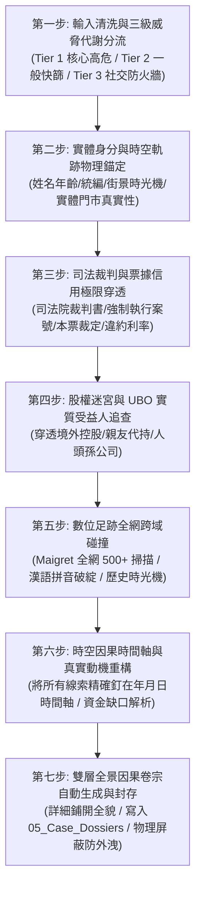
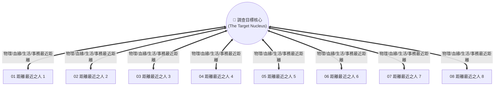
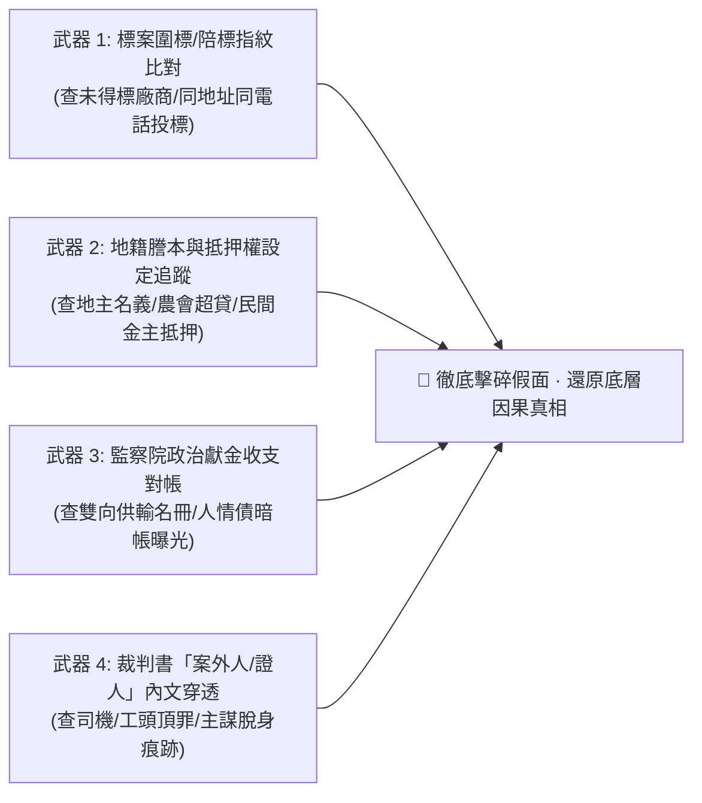

# 🦅 ✕ 🛠️ 極星黑色調查與反欺詐穿透實戰操作協議 (Polaris Forensic Protocol)

> **版本定位**：v1.1 實戰深度演化旗艦版 (Deep Penetration Evolution Edition)  
> **雙主權監製**：業務與情報定義 · **渡鴉 (Raven)** ｜ 底層工程與確定性架構 · **林納斯 (Linus)**  
> **最高授權**：極星創辦人 · **陳品碩 (Pinshuo)**  
> **法定作戰領地**：[`00-13_Cyber_Forensics_and_Investigation/`](file:///c:/Users/lenovo/我的雲端硬碟/00_Master_Polaris/00-13_Cyber_Forensics_and_Investigation/README.md)  
> **作戰核心工具**：[`00-13_Cyber_Forensics_and_Investigation/scripts/polaris_forensic_cli.py`](file:///c:/Users/lenovo/我的雲端硬碟/00_Master_Polaris/00-13_Cyber_Forensics_and_Investigation/scripts/polaris_forensic_cli.py)  
> **最高呈報憲則**：**嚴格貫徹創辦人品碩「詳細呈現，微觀硬事實全數鋪開，以供品碩獨立判斷因果關係」憲法！**

---

## 🏛️ 第一章｜極星穿透調查七步標準作業程序 (Seven-Step Investigation SOP)

任何智能體（Agent）或調查官受品碩委託執行背景穿透、合約排雷或反欺詐審查時，**必須嚴格遵循以下七步閉環**：



---

### 第一步｜輸入清洗與動態三級威脅分流 (Threat Tiering)
* **Tier 1（核心高危 · 涉資 10 萬以上 / 重要合約 / 核心股權）**：
  - 啟動全套 Level 3 深度算力，完整走完七步流程，執行 UBO 控股穿透與司法深挖。
* **Tier 2（一般往來 · 常態特約商戶 / 供應商評估）**：
  - 執行司法裁判、票據黑名單與商業登記自動化快篩，無異常即快速放行。
* **Tier 3（社交玩伴 · 線上遊戲 / 日常社交）**：
  - 嚴格守死「零金錢借貸、零帳戶代墊、零個人隱私」三零防火牆，不主動探查私德，維護品碩的生活品質。

---

### 第二步｜實體身分與時空軌跡物理錨定
1. **驗證統編與身分特徵**：調用林納斯確定性檢查碼演算法，驗證台灣統編與身分證真實有效性。
2. **物理空間查證**：結合 Google 街景時光機、商工登記地址、招牌變更歷史，戳破「登記在豪宅大樓、實際是廢棄鐵皮屋或虛擬代辦信箱」的皮包公司欺瞞。

---

### 第三步｜司法裁判與票據信用極限穿透
1. 查詢全國地方法院民刑事裁判書與強制執行紀錄。
2. 重點鎖定關鍵案由：**「本票裁定（司票字）」、「支付命令（司促字）」、「給付票款」、「詐欺」、「拍賣抵押物」**。
3. 提取核心參數：發票日、到期日、票面金額、未清償本金、約定利息（如年息 16%）、聲請人（資融公司/銀行）。

---

### 第四步｜股權控股迷宮與 UBO 實質控制人追查
1. 穿透商業司登記資料，提取資本額、董監事名單、持股比例、歷次負責人變更。
2. 追蹤隱形交叉持股，識別是否由同一組人馬在同一個地址反覆註冊多家人頭公司（如曾柏崴案之京宙建設、承豐環衛、玥媛企業社）。

---

### 第五步｜數位足跡全網跨域碰撞
1. 調用 `maigret` 引擎對目標常用 ID / Handle 進行 500+ 社群與技術平台跨域碰撞。
2. **語義與拼音漏洞檢驗**：利用渡鴉拼音撕裂器，檢驗英文字串是否為漢語拼音（如 `tengjingxuenai` 出賣其母語為華語）。
3. 抓取 Wayback Machine 網頁時光機歷史快照，還原其過去割韭菜或刪除的前科痕跡。

---

### 第六步｜時空因果時間軸與動機重構
1. 拒絕模糊扣帽子，**將所有事件精確釘在時間軸（精確到年月日）**：
   - 範例：`2022-03 簽本票` $\rightarrow$ `2022-04 建立新分身` $\rightarrow$ `2023-02 遭法院強制執行`。
2. 解構底層動機：資金缺口在何處？為何在特定時間點尋求合作？是否有迫在眉睫的軋票或還款壓力？

---

### 第七步｜雙層全景因果卷宗生成與安全封存
1. **嚴格執行品碩知情權憲則**：呈報格式分為「表層宏觀拓撲」與「深層微觀硬證據鏈」，**精確案號、金額、日期、代碼細節 100% 鋪開**，絕不擅自閹割！
2. **自動封存路徑**：
   `00-13_Cyber_Forensics_and_Investigation/05_Case_Dossiers/DOSSIER_YYYYMMDD_標的名稱.md`
3. **物理安全天網**：受 `.gitignore` 永久實體屏蔽，嚴禁推送至外部雲端公開庫。

---

## 🛠️ 第二章｜底層命令列工具調用指引 (CLI Usage)

```bash
# 1. 執行工具自我診斷與單元測試 (林納斯 DOD 確定性保證)
python 00-13_Cyber_Forensics_and_Investigation/scripts/polaris_forensic_cli.py --self-test

# 2. 針對個人/分身進行全套穿透 (包含漢語拼音偵測與社群碰撞)
python 00-13_Cyber_Forensics_and_Investigation/scripts/polaris_forensic_cli.py --target "藤井雪奈" --handle "tengjingxuenai1" --type person --tier 1

# 3. 針對公司統編進行商工穿透與自動生成卷宗
python 00-13_Cyber_Forensics_and_Investigation/scripts/polaris_forensic_cli.py --target "京宙建設" --tax-id "90807060" --type company --tier 1 --output-dossier
```

---

## 🌌 第三章｜創辦人品碩親定：【目標核心 ＋ 最近 8 人全景擴大穿透法】(Core + 8 Closest Affiliates Protocol)

> **最高軍規憲則（品碩親定）**：  
> **「以被調查的人物為核心，全面擴大調查距離目標核心最近的 8 個人，再進行交叉比對與全景拓撲！」**



### 🌟 實戰執行 SOP：
1. **錨定核心標的**：鎖定目標本尊之基本資料、統編、登記公職或事業。
2. **快速清查並鎖定「距離最近的 8 個人」**：
   - 無論其對外宣稱的身分是什麼，直接找出在生活、實體空間、每日公務或血緣上**距離他最近的 8 個人**（如：同住者、同辦公室者、天天同框者、合資掛名者、代為簽名發聲者）。
3. **對這 8 個人逐一展開獨立穿透**：
   - 查核 8 人之：真實身分、前科裁判、債信與本票、商工董監事、土地建物、公務業務往來。
4. **繪製關係網絡拓撲圖**：
   - 將核心與這 8 個人的真實資金流、權力流、利益連帶與相互制約關係完整還原，呈報品碩！

---

## ⚡ 第四章｜創辦人品碩親定：【實戰進階拓撲穿透三大法典】(Advanced Forensic Penetration Axioms)

在實戰高壓對抗（如 2026 年臺東豐谷里長候選人何國維案）中淬鍊出的三項高級穿透法典，**強制納入調查官本能**：

### 1. 門牌聚落簇群穿透法 (Address-Cluster Forensics)
* **核心邏輯**：地方勢力不會只用一個門牌。鎖定實體空間時，必須對**相鄰門牌（$\pm 10$ 號）與同一地號**進行全面輻射掃描。
* **穿透指標**：
  * **同戶多號／隔壁門牌**：例如衡陽路 48 號（社區協會）相鄰的 56 號（建設公司）。
  * **二代與宗族隱形實體**：查出由二代或親信掛名的行號（如赤城行何均磊），往往是實體金流與物資的調度轉運站。

### 2. 公職與派系「第一胎基因溯源法」 (First Origin Pedigree Tracing)
* **核心邏輯**：表面上的獨立參選人、無黨籍頭人，其政治本質由其「政治生父」決定。
* **穿透指標**：
  * 強制調閱其**「最早一任公職履歷、第一份選務公報、或踏入政壇的初任銜稱」**。
  * **實戰案例**：吳景槐現為連任四屆之實力派議員，但回溯其第一胎經歷，赫然為「議長吳俊立辦公室秘書」，直接坐實其吳家班親信家臣的原始基因。

### 3. 特許暴利產業閉環模型 (Regulated Monopoly Closed-Loop)
* **核心邏輯**：凡涉及「事業廢棄物清除、土石方、砂石開採、都市計畫重劃、日照長照」等極高執照門檻行業，必存在權力閉環。
* **四位一體閉環驗證**：
  $$\text{營造土方源頭 (如維誠營造)} \longrightarrow \text{特許清運處理 (如群達環保)} \longrightarrow \text{政府公帑開口契約 (如環保局標案)} \longrightarrow \text{議會預算特權監督 (如議員公權力)}$$
  一圖鎖定「左手審預算、右手標工程、底下營造供貨」的封閉利益體系。

---

## 💣 第五章｜地下深水區「四重重裝武器」實戰操典 (The Four Deep-Penetration Arsenals)

當目標手腳乾淨、檯面無直接前科時，啟動以下地下深水區四重武器實施降維打擊：



1. **武器一｜標案圍標與陪標指紋比對 (Tender Bid-Rigging Forensics)**：
   * 調閱目標公司歷年投標案，不僅查得標結果，更**調閱未得標廠商名冊**。
   * 比對陪標廠商之負責人親屬、登記地址、標單筆跡與押標金來源，揪出假性競爭的圍標同盟。
2. **武器二｜地籍謄本與抵押權設定追蹤 (Cadastral & Mortgage Trace)**：
   * 調閱目標核心營業場所與土地之「土地及建物登記第二類謄本」。
   * 重點審查「他項權利證明」：若向特定地方農會高額抵押，揭露農會信用部超貸金脈；若設定給私人自然人，直接揭發地下錢莊或幕後隱形金主。
3. **武器三｜監察院政治獻金收支明細雙向對帳 (Campaign Finance Cross-Audit)**：
   * 進入監察院陽光法令政治獻金資料庫，執行雙向勾稽：
     - 查目標公司及其董監事歷年捐給了哪些議員、立委、縣市長？
     - 查特定政治人物的收入名冊中，是否有目標系統的人頭或關係企業？
4. **武器四｜司法院裁判書「案外人與證人」全文穿透 (Non-Defendant Full-Text Search)**：
   * 高段位罪犯本尊通常手腳乾淨、不當被告。
   * 將目標姓名、公司名稱、車牌或營運場所地址，**直接作為裁判理由書全文關鍵字搜尋**。
   * 穿透司機、工頭因違反《廢棄物清理法》或重大刑案被判刑時，判決書內記載之「受某公司監察人指派」、「載往某某處所」等筆錄證詞，將「手下頂罪、主謀脫身」的硬事實全數曝光！
