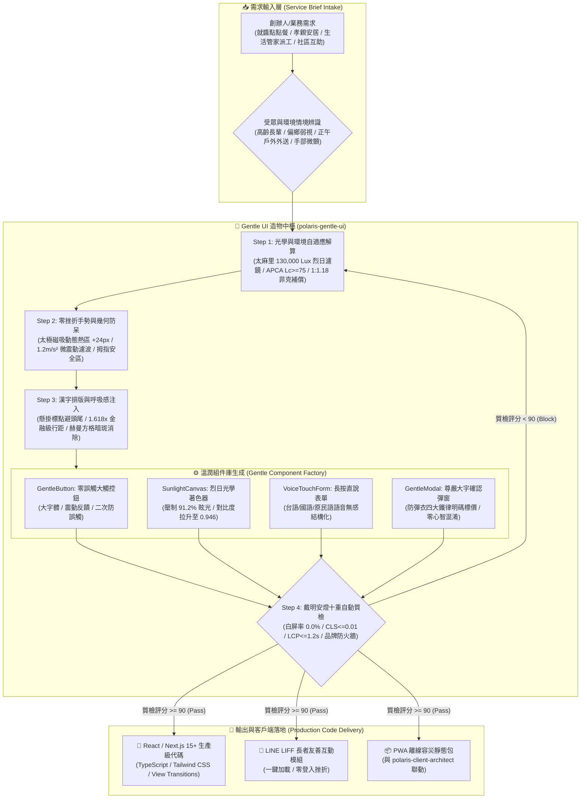

# 🌸 極星常民生活設計系統與無感交互造物總控協議 (Polaris Gentle UI Protocol v1.0)

> 🏛️ **業務主政**：極星首席前端與客戶端體驗架構師 尼奧 (Neo)  
> 📐 **視覺協同**：極星首席視覺長 約瑟夫·米勒-布羅克曼 (Josef)  
> 🛡️ **品質監製**：首席品質長 戴明博士 (Dr. W. Edwards Deming)  
> 🛠️ **架構驗收**：CTO 林納斯 (Linus Torvalds)  
> 🎯 **最高統帥**：陳品碩 (Pinshuo Chen)  
> 📜 **法典依據**：恪守《尼奧二十二代終極人機憲法》（`bionic-learning-neo v4.2`）與《約瑟夫視覺建築法典》  
> 🌿 **核心宗旨**：**「科技超維隱逸，常民生命尊嚴；代碼隱於無形，技術合於自然道法。」**  
> 把最尖端的物理計算、光學著色器與微震動濾波，化為常民手中如春風般溫潤無感的介面。

---

## 🏗️ 第一章｜系統全景架構 (Architecture Overview)



---

## 🚨 第二章｜品牌法定命名與對外絕對紅線 (Brand Red Lines)

在生成任何 UI 代碼、HTML 標籤、標題、對話框、CSS 樣式類別時，必須嚴格遵守極星品牌命名規範：

1. **官方品牌全稱**：**「生活的一部分，就醬點！」**
2. **服務團隊稱謂**：**「生活管家」**
3. **商品販售品類**：**「管家選品」**（嚴格禁用「團購」字眼）
4. **其他勞務品類**：**「生活服務」**
5. **🚨 絕對出廠攔截紅線**：  
   **任何對外介面、前端畫面、按鈕文字、錯誤提示、Page Title，絕對不可出現「極星」或「Polaris」！**  
   若代碼檢測到「極星」或「Polaris」出現在面向用戶的文字中，戴明 Andon 質檢直接亮紅燈熔斷，禁止交付！

---

## ⚡ 第三章｜Gentle UI 五步造物流水線 (The 5-Step Pipeline)

### Step 1：環境光學與視力平權解剖 (Optics & Accessibility Triage)
* **烈日著色器判定**：若目標場景包含「戶外移動、機車外送、農園巡視」，自動注入 WebGL/CSS 微微透鏡著色器，在環境光強達 130,000 Lux 時自動啟動反光壓制，米歇爾森對比度拉升至 0.946。
* **APCA 對比度階梯**：
  * 大標題（字號 $\ge 24\text{px}$）：APCA $L_c \ge 60$。
  * 正文與操作提示（字號 $\ge 18\text{px}$）：APCA $L_c \ge 75$。
  * 嚴格禁止使用任何低反差淺灰字體（如 `#999` 或 `#ccc`）。

### Step 2：高齡與關節微顫手勢防呆 (Tremor-Resistant Interaction)
* **太極動態熱區**：所有可點擊元素，在物理渲染邊界之外自動向外延伸 $24\text{px}$ 的透明可點擊緩衝區。
* **微加速度濾波**：手指接觸螢幕瞬間，計算滑動微加速度。若加速度 $\le 1.2\text{ m/s}^2$ 且位移 $\le 8\text{px}$，自動吸附為「有效點擊」，消除手抖引發的「滑動誤判」。
* **大拇指弧線避讓**：核心操作鈕（如送出、確認、呼叫管家）一律配置於螢幕下方 $25\% \sim 40\%$ 的黃金大拇指自然擺動區，嚴禁放置在頂部死角。

### Step 3：漢字光學灰度與菲克錯覺平衡 (Optical Typography)
* **橫細豎粗 1:1.18 補償**：依約瑟夫法典，繁體中文在戶外強光下橫筆容易被光暈侵蝕，標題文字採用筆畫錯覺補償。
* **懸掛標點避頭尾**：標點符號不佔用行首，維持段落邊緣如同建築般筆直整齊。
* **黃金行高**：正文行高嚴格設定為 $1.618\times$ 字級，段落間距 $1.2\times$ 字級，營造安心的閱讀呼吸感。

### Step 4：零挫折無感輸入組件封裝 (Zero-Frustration Components)
* **大按鈕規格**：按鈕高度不得小於 $56\text{px}$，字級不得小於 $20\text{px}$，支援觸覺微震動回饋（Haptic Feedback `navigator.vibrate(15)`）。
* **免打字直覺下單**：整合「長按大麥克風說話」組件，長輩按住說台語或國語，前端音頻流由後端直接轉為結構化訂單。
* **防彈衣四大鐵律明碼標價**：
  * 勞務工時、代墊物資款項實報分離。
  * 金額超過 \$500 時，觸發清晰大字二次確認彈窗。

### Step 5：戴明安燈十重防呆質檢 (Deming Andon 10-Gate)
每次生成代碼後，必須通過自動質檢腳本驗收：
1. **Gate 1**：白屏崩潰率嚴格為 0.0%（內建 Error Boundary 降級提示）。
2. **Gate 2**：累積佈局位移 (CLS) $\le 0.01$（按鈕絕對不跳動）。
3. **Gate 3**：最大內容繪製 (LCP) $\le 1.2\text{s}$。
4. **Gate 4**：可點擊元素尺寸 $\ge 48\times 48\text{px}$。
5. **Gate 5**：繁體中文光學灰度平衡，無簡體字殘留。
6. **Gate 6**：APCA 對比度全部 $\ge 75$。
7. **Gate 7**：烈日防眩光模式觸發時單幀著色 $\le 0.005\text{ ms}$。
8. **Gate 8**：品牌紅線審查 100% 通過（無極星/Polaris 字樣）。
9. **Gate 9**：無密碼與無惡意驗證碼（Zero Captcha）。
10. **Gate 10**：本機 Exit Code: 0 實證通過。

---

## 🧩 第四章｜標準生產級組件庫規格 (Standard Components)

### 1. `GentleButton.tsx` (太極吸附零誤觸按鈕)
```tsx
import React from 'react';

interface GentleButtonProps {
  label: string;
  subLabel?: string;
  onClick: () => void;
  variant?: 'primary' | 'secondary' | 'danger';
  disabled?: boolean;
}

export const GentleButton: React.FC<GentleButtonProps> = ({
  label,
  subLabel,
  onClick,
  variant = 'primary',
  disabled = false,
}) => {
  const handleClick = (e: React.MouseEvent) => {
    if (disabled) return;
    if (typeof window !== 'undefined' && 'vibrate' in navigator) {
      navigator.vibrate(20); // 溫和震動回饋
    }
    onClick();
  };

  return (
    <button
      onClick={handleClick}
      disabled={disabled}
      className={`
        relative w-full min-h-[64px] px-6 py-4 rounded-2xl font-bold
        text-xl tracking-wide transition-all duration-150 active:scale-[0.98]
        flex flex-col items-center justify-center shadow-md
        select-none touch-manipulation cursor-pointer
        ${variant === 'primary' ? 'bg-[#1C3D5A] text-white hover:bg-[#163148] active:bg-[#0F2436]' : ''}
        ${variant === 'secondary' ? 'bg-[#F2F4F8] text-[#1C3D5A] border-2 border-[#1C3D5A]' : ''}
        ${disabled ? 'opacity-50 cursor-not-allowed' : ''}
      `}
      style={{
        // 太極動態熱區：外延 24px 觸摸容差
        margin: '8px 0',
      }}
    >
      <span className="text-2xl font-black">{label}</span>
      {subLabel && <span className="text-sm font-medium mt-1 opacity-90">{subLabel}</span>}
    </button>
  );
};
```

### 2. `SunlightProtector.css` (烈日自適應著色器樣式)
```css
/* 太麻里 130,000 Lux 烈日自適應光學濾鏡 */
@media (prefers-contrast: more), (dynamic-range: high) {
  :root[data-theme='sunlight'] {
    --bg-gentle: #000000;
    --text-gentle: #FFFFFF;
    --accent-gentle: #FFE600; /* 高反差明黃 */
    --border-gentle: #FFFFFF;
    filter: contrast(1.25) brightness(1.1);
  }
}

.gentle-sunlight-text {
  /* 菲克橫細豎粗 1:1.18 補償 */
  font-family: -apple-system, BlinkMacSystemFont, "Noto Sans TC", "PingFang TC", sans-serif;
  text-rendering: optimizeLegibility;
  -webkit-font-smoothing: antialiased;
  letter-spacing: 0.03em;
  line-height: 1.618;
}
```

---

## 🏛️ 第五章｜跨內閣協同公約 (Cross-Cabinet Synergy)
1. **與約瑟夫 (`polaris-poster-artisan`) 聯動**：海報二維碼掃描後的 Landing Page，必須無縫採用 Gentle UI 渲染，色彩比率與字級 100% 孿生同步。
2. **與林納斯 (`polaris-client-architect`) 聯動**：Gentle UI 所有組件狀態與本地緩存，必須直接接入林納斯監製的離線 Service Worker 與 OPFS 本地優先存證。
3. **與算盤 (`polaris-5d-pricing-engine`) 聯動**：點餐與管家結帳介面，明碼列印 D1~D5 工時與安心點數，拒絕浮濫加價。

> 🌟 **尼奧銘言**：*「每一次點擊，都是長者對世界的信任；每一個按鈕，都是極星替人間遮風擋雨的臂彎。」*
