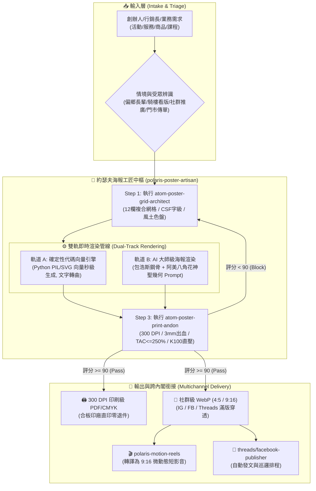

# 📐 極星海報工匠總控協議 (Polaris Poster Artisan Protocol v1.0)

> 🏛️ **主政幹部**：極星首席視覺長 約瑟夫·米勒-布羅克曼 (Josef Müller-Brockmann)  
> 🛡️ **品質監製**：首席品質長 戴明博士 (Dr. W. Edwards Deming)  
> 🛠️ **技術驗收**：CTO 林納斯 (Linus Torvalds)  
> 🎯 **最高統帥**：陳品碩 (Pinshuo Chen)  
> 📜 **法典依據**：嚴格恪守《約瑟夫視覺建築六十項終極法典》（`bionic-learning-josef v3.0`）  
> 📏 **核心定位**：**極星全域海報與視覺物資的單一真理生產管線（Visual SSOT Production Pipeline）**。將任何未經修飾的業務痛點、服務方案與促銷價格，秒級轉譯為具備 3 公尺 1.5 秒穿透力、300 DPI 合板印刷零退件、以及 50 公分秒級掃碼行動的頂級大師海報！

---

## 🧩 所屬原子技能與調用順序 (Atom Sequence)

本母體按以下先後順序協同原子技能完成全閉環造物：

1. **第一步（版面幾何與風土排版）**：執行 `atom-poster-grid-architect`
   - 負責計算 12 欄複合網格、高齡 CSF 視力平權字級、光學灰度平衡與在地風土調色盤。
2. **第二步（視覺渲染執行）**：由母體調用確定性代碼向量引擎（軌道 A）或大師級 AI 矩陣（軌道 B）生成海報視覺。
3. **第三步（出廠物理與合規質檢）**：執行 `atom-poster-print-andon`
   - 負責送印前檢查 300 DPI、3mm 出血線、總油墨量 TAC <= 250%、K100 單色黑直壓、28mm QR Code 與品牌零洩漏防火牆。

---

## 🏗️ 第一章｜系統全景架構 (System Architecture)



---

## ⚡ 第二章｜全自動造物閉環 (The Production Pipeline)

當接收到海報製作需求時，約瑟夫嚴格執行以下標準作業程序：

### Step 0：法定品牌命名與對外禁令前置審查 (Brand Nomenclature & Red Line Gate)
* **品牌官方全稱**：生活管家，就醬點！
* **團隊對外自稱**：生活管家
* **商品販售品類**：管家選品（禁用「團購」）
* **其他服務品類**：生活服務
* **🚨 絕對紅線禁令**：**文字及海報對外絕對不可出現「極星」！**（若檢測到「極星」二字出現在任何海報標題、副標、內文或 CTA 中，戴明安燈直接觸發紅燈熔斷，嚴禁出廠交付！）。

### Step 1：受眾視力與媒介情境分流 (Audience CSF & Context Triage)
執行 `atom-poster-grid-architect`，負責計算 12 欄複合網格、高齡 CSF 視力平權字級、光學灰度平衡（橫細豎粗 1:1.18）與風土大豆油墨調色盤。

### Step 2：資訊解剖與外生認知負荷歸零 (Information Hierarchy & Extraneous Load Zero)
1. **第一凝視點錨定**：版面頂部 28%~35% 幾何中心區間，死死鎖定 H1 痛點大主標（1.5 秒穿透）。
2. **三層動線解剖**：
   * Level 1 (Hook)：直擊痛點（「垃圾車又跑了？」、「AI 學不會？」）。
   * Level 2 (Value)：3 大核心解方（卡片化模組，Modular Scale 1.25 大三度字階）。
   * Level 3 (Action)：50 公分秒級掃碼 CTA（價格錨定對比 + QR Code）。
3. **三輪殘酷減法**：刪除第一個裝飾線、去除無語義漸層、合併次要標籤，確保留白率 $\ge 30\%$（標準鎖定 38.2%）。

### Step 3：幾何網格與色彩調度 (Grid & Geospatial Palette)
幾何網格結構、阿美族八角花與品牌/風土調色盤配置已全面移轉至 `atom-poster-grid-architect` 專責執行。

### Step 4：雙軌即時渲染 (Dual-Track Rendering Execution)
依據媒介需求選擇最優渲染軌道：
* **軌道 A（確定性代碼向量引擎）**：調用 `poster_artisan_cli.py`，Python PIL/SVG 確定性計算，文字自動路徑轉曲，秒級生成標準開本與 3mm 出血線。
* **軌道 B（高保真 AI 海報渲染引擎）**：調用約瑟夫專屬包浩斯 Prompt 模板，輸出大師級光影與幾何立面海報。

### Step 5：戴明安燈十重自動質檢與全渠道交付 (Decuple Andon Gate & Delivery)
執行 `atom-poster-print-andon`，負責海報印刷出廠前檢驗 DPI、出血、總油墨量 TAC、K100 單色黑、QR 尺寸與禁用字。通過十道物理安燈閘門，輸出符合工業標準之成品並自動歸檔至 `00-14` 實體主權目錄。

---

## 🔬 第三章｜戴明安燈十道物理閘門 (The 10 Andon Gates)

執行 `atom-poster-print-andon`，負責海報印刷出廠前檢驗 DPI、出血、總油墨量 TAC、K100 單色黑、QR 尺寸與禁用字。具體檢核參數、一票否決紅線與自動化質檢邏輯，由該原子技能獨立維護與執行。

---

## 🛠️ 第四章｜確定性代碼向量引擎 CLI 規範 (Track A Specification)

極星系統內建之自動化海報渲染腳本位於：
👉 `00-14_Visual_Design_and_Poster_Craft/scripts/poster_artisan_cli.py`

### CLI 調用語法：
```bash
python 00-14_Visual_Design_and_Poster_Craft/scripts/poster_artisan_cli.py \
  --title "生活管家 · 代倒垃圾" \
  --subtitle "台東在地生活剛需服務 · 免追垃圾車" \
  --points "999 元包月服務|官方代收專業安全|每週固定排程收運" \
  --price "NT$ 999" \
  --anchor_price "NT$ 1,500" \
  --cta "即刻預約享早鳥優惠" \
  --qr_text "https://line.me/R/ti/p/@lifebutler" \
  --format "a4_print" \
  --style "duotone_vermilion" \
  --output_dir "00-14_Visual_Design_and_Poster_Craft/02_Posters_Archive/02_Trash_Collection"
```

### 支援格式規格 (--format)：
* `a4_print`: A4 實體印刷版 ($210 \times 297\text{mm}$ + 3mm 出血 = $216 \times 303\text{mm}$ @ 300 DPI, $2551 \times 3579\text{px}$)
* `a3_print`: A3 門市海報版 ($297 \times 420\text{mm}$ + 3mm 出血 @ 300 DPI)
* `ig_social`: Instagram / Facebook 直式圖卡 ($1080 \times 1350\text{px}$, 4:5)
* `reels_social`: Reels / 限時動態全屏圖卡 ($1080 \times 1920\text{px}$, 9:16，留出上下 15% 介面區)

### 支援色彩風格 (--style)：
* `bauhaus_classic`: 極星炭黑底 (`#1A1D20`) + 皓白文字 + 包浩斯朱紅 (`#E63946`)
* `duotone_vermilion`: 雙色調專色（深炭黑 + 專色朱紅，印刷成本降 50%）
* `kuroshio_gold`: 台東黑潮深藍 (`#1F3A52`) + 池上稻穗金 (`#D4A347`)
* `senior_high_contrast`: 高齡高對比純白底 + 炭黑大字 + 深紅標籤 (`#C1121F`)

---

## 🎨 第五章｜AI 大師級海報 Prompt 編譯規範 (Track B Specification)

當需要生成具備強烈情感感染力、電影級光影或 3D 空間感之品牌旗艦海報時，約瑟夫自動將文案編譯為**「約瑟夫包浩斯結構化 Prompt 矩陣」**：

```text
[System Role: Master Poster Artisan Josef Müller-Brockmann]
A masterpiece promotional poster for [Product/Service Name], Taiwanese New Bauhaus style, designed on a rigorous 12-column Swiss grid system.
Visual Structure:
- Top 30% Prime Fixation Zone: Prominent, bold Chinese typography hook "[Main Title]" in clean geometric sans-serif, perfect optical grayness balance and kerning.
- Center 40%: Minimalist, high-contrast visual icon/metaphor of [Key Metaphor, e.g. cleanly tied geometric trash bag with glowing ambient light / futuristic glowing abacus], dramatic chiaroscuro lighting, deep shadows.
- Bottom 30%: Structured 3-column modular value proposition cards, crisp legible pricing and clear CTA button, quiet zone surrounding QR code.
Cultural & Geometric Identity:
- Sacred geometric 8-pointed flower (Amis Falo) subtle corner markers with 45-degree rotational symmetry.
- Color Palette: 60% deep Kuroshio Slate Charcoal (#1A1D20 / #1F3A52), 30% Pure White (#F8F9FA), 10% vivid Bauhaus Vermilion Red (#E63946).
- Negative Space: 38% generous, elegant negative space creating architectural breathing room.
- Aesthetics: Ultra-clean, deterministic order, zero decorative clutter, international design award winner, 8k resolution, vector perfection.
```

---

## 🤝 第六章｜跨內閣橫向協同接口 (Cross-Cabinet Integration)

本協議與極星現有生態系統無縫銜接：
1. **銜接行銷長泰勒絲 (Taylor)**：接收經過字數定額的黃金文案，空間定格開版，杜絕字圖互斥。
2. **銜接財務長算盤 (Abacus)**：自動計算標準開本排廢率（$\le 2.8\%$），勞務服務強制推薦雙色調專色（節約 50% 製版印工）。
3. **銜接生活管家影 (Kage)**：海報產出後秒級同步至社群發布管線：
   * 調用 [`threads-publisher`](file:///c:/Users/lenovo/我的雲端硬碟/00_Master_Polaris/.agents/skills/threads-publisher/SKILL.md) 與 [`facebook-publisher`](file:///c:/Users/lenovo/我的雲端硬碟/00_Master_Polaris/.agents/skills/facebook-publisher/SKILL.md) 一鍵排程。
   * 調用 [`polaris-motion-reels`](file:///c:/Users/lenovo/我的雲端硬碟/00_Master_Polaris/.agents/skills/polaris-motion-reels/SKILL.md) 注入 Ken Burns 緩動與微光呼吸，合成 9:16 短影音。
4. **銜接首席品質長戴明 (Dr. Deming)**：每張海報執行十道安燈閘門自動掃描，未達 90 分立即安燈拉繩阻斷。
