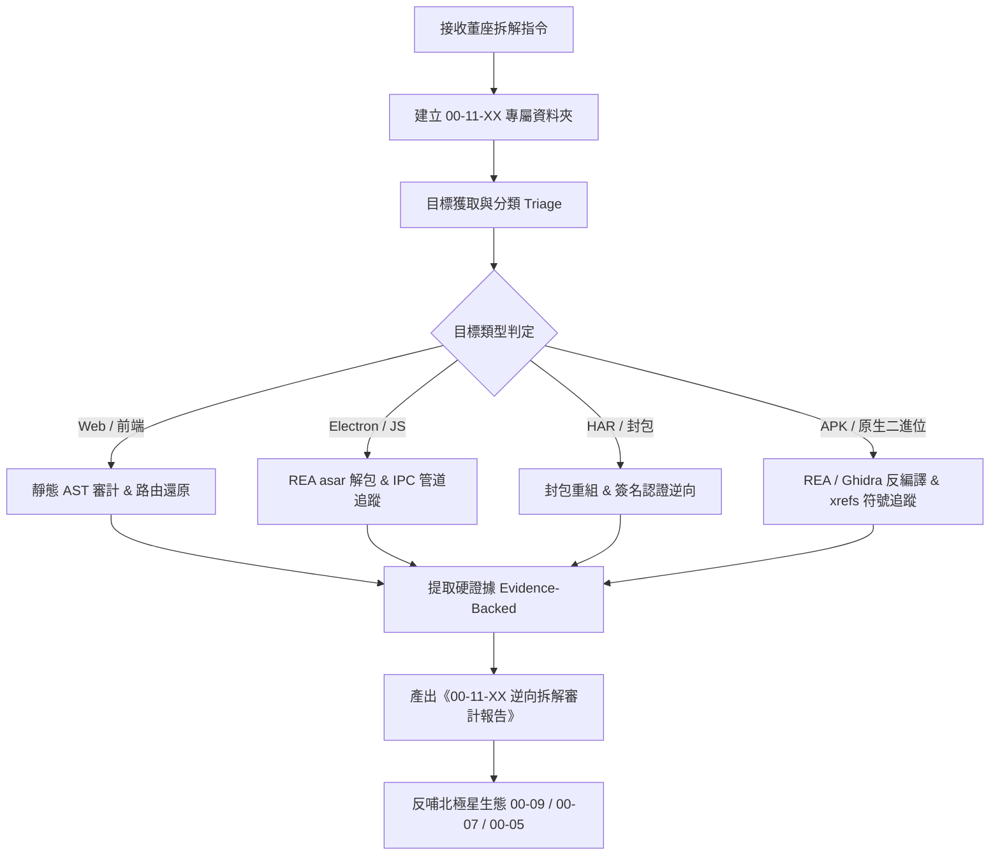

# 逆向拆解工程技能協議 (REA Reverse Engineer Protocol)

> **負責單位**：北極星戰略總署 · 核心技術研究室 (00-11 逆向工程實驗室)  
> **技術負責人**：林納斯 (Linus)  
> **核心標準**：拒絕憑空臆測，所有分析必須基於真實反組譯、AST 語法樹、封包日誌與代碼佐證（Evidence-Backed），**且必須窮盡拆解至最細微的互動原子層級（每一個按鈕文案、選項ID、卡牌數據庫、數值公式全量導出，絕不放過任何細節）**。

---

## 🎯 一、 技能使用時機

當使用者（品碩董座）提出以下需求時觸發：
* 「幫我逆向拆解這個專案 / 系統 / APK / 軟體」
* 「分析這個 GitHub 倉庫的底層通訊協議與架構」
* 「拆解這包 HAR 封包 / API 請求簽名機制」
* 「研究這個 Electron 桌面應用的 IPC 渠道與前端模組」
* 「把目標軟體放進 00-11 進行逆向拆解」

---

## 📂 二、 專屬資料夾規範（One Dedicated Folder Per Target）

**【鐵律】：嚴禁將多個目標混在同一目錄！**
每接到一個拆解目標，必須在 `c:\Users\lenovo\我的雲端硬碟\00_Master_Polaris\00-11_Reverse_Engineering_Lab\` 下方建立專屬獨立資料夾：

```text
00-11_Reverse_Engineering_Lab/
└── 00-11-XX_<目標專案名稱>/
    ├── target/             # 目標原始檔案（Git Clone 倉庫、二進位 Executable、APK、HAR 封包等）
    ├── extracted/          # 解包產物（asar 解開內容、靜態 AST 解析、反編譯輸出代碼）
    ├── analysis_notes/     # REA 輸出 JSON 日誌、通訊協議流程圖、封包分析記錄
    ├── prototypes/         # （選填）依據拆解所得的自研驗證或改裝原型代碼
    └── 00-11-XX_<目標名稱>_逆向拆解審計報告.md  # 最終產出的核心架構審計與反哺報告
```

*其中 `XX` 為流水編號（如 `00-11-01_TastyIgniter_Core`, `00-11-02_TargetApp` 等）。*

---

## ⚙️ 三、 逆向拆解標準作業流程 (SOP)



### Step 1: 建立專屬資料夾與沙盒隔離
1. 檢視 `00-11_Reverse_Engineering_Lab/` 現有目錄，決定下一個流水編號（如 `00-11-01_<名稱>`）。
2. 建立 `target/`、`extracted/`、`analysis_notes/` 三個子目錄。
3. 若目標為 Git 倉庫，Clone 至 `target/` 時注意避免主倉庫 Git Submodule 污染（可在沙盒隔離執行）。

### Step 2: 目標類型識別與環境檢查
檢查本機執行環境：
```bash
# 檢查 Node.js 版本 (需 >= 22.19, 24.11 或 26+)
node -v

# 執行 REA 環境診斷
npx -y rea-agents@latest doctor
```

### Step 3: 調用 REA 進行特徵萃取
根據目標類型執行對應分析指令，並將結果儲存至 `analysis_notes/`：

1. **JavaScript / Electron 應用程式**：
   ```bash
   npx -y rea-agents@latest analyze-javascript-application "00-11-XX_<目標>/target" --json > "00-11-XX_<目標>/analysis_notes/ast_analysis.json"
   ```
   * 提煉出：模組清單、依賴圖譜、IPC 通訊端點、環境變數命名、未混淆之 API Endpoint。

2. **HAR 網路封包或 mitmproxy 記錄**：
   * 分析 Request Headers（特別是 Authorization, X-Sign, Timestamp, Nonce）。
   * 逆向出簽名組裝規則（例如：`md5(apiKey + timestamp + payload)`）。

3. **原生二進位檔 / APK (Native)**（若有安裝 Ghidra/Hopper）：
   ```bash
   # 偽代碼反編譯
   npx -y rea-agents@latest decompile "00-11-XX_<目標>/target/binary" --procedure="target_function"
   
   # 符號與記憶體交叉引用
   npx -y rea-agents@latest xrefs "00-11-XX_<目標>/target/binary" --address=0x140001000
   ```

### Step 4: 產出《00-11-XX_<目標名稱>_逆向拆解審計報告.md》
報告必須存放在該專案專屬資料夾根目錄，且嚴格包含以下七大核心章節（特別包含供創辦人、業務、行銷與合作夥伴溝通的「業務需求與流程規格包」）：

1. **🔬 目標概況與技術棧指紋 (Fingerprint)**
   * 專案名稱、版本、核心技術棧（React/Vue、Electron、Go、Rust、Spring 等）、運行環境。
2. **🏗️ 系統架構圖與模組拓撲 (Architecture Topology)**
   * 使用 Mermaid 畫出前後端、數據流向或 IPC 管道架構圖。
3. **🔐 通訊協議與安全機制拆解 (Protocol & Security)**
   * API 接口清單、請求加解密算法、認證流程（Token/Session 傳遞）。
   * 指出其資安防護強項或漏洞弱點（附代碼/封包佐證）。
4. **💡 核心亮點與架構技巧 (Engineering Highlights)**
   * 對方在效能、狀態管理、快取或併發上的精妙設計。
5. **📋 跨部門溝通與業務落地套件 (Business & Product Communication Kit)**
   * **【專供品碩董座與業務、行銷、外部夥伴對齊溝通使用】**，包含：
     * **業務泳道流程圖 (Swimlane Flowchart)**：使用 Mermaid 呈現「消費者 ➜ 前線外送/業務 ➜ 店家/夥伴 ➜ 系統大腦」的跨角色互動，一圖看懂業務球怎麼傳。
     * **極簡 2 頁 PRD (輕量級產品需求規格書)**：
       * 商業目標 (Why) 與核心價值主張
       * 使用者故事 (User Stories: 作為...我想要...以達到...)
       * 功能優先級分級 (P0 核心必備 / P1 第二階段 / P2 錦上添花)
       * 邊界條件與例外規則 (Edge Cases: 斷網、退費、缺貨、取消違約)
       * 驗收標準 (Definition of Done, DoD: 可量化指標)
     * **商業定價與業務狀態字典表**：費用階梯、分潤扣點、訂單生命週期狀態表。
6. **🔄 北極星生態反哺矩陣 (Polaris Ecosystem Backport)**
   * 針對以下北極星業務提出具體借鑒方案：
     * **`00-01` 寶桑物流與車輛調度**：計費階梯與路線排程如何吸收？
     * **`00-09` 開源點餐系統**：架構如何優化？
     * **`00-07` TWQR 金流整合**：API 封裝與非同步通知安全如何借鑒？
     * **`00-05` AI 教育文庫**：能提煉出哪些教學案例？
     * **`00-03` 生活管家**：如何轉化為高頻客戶服務？
7. **🛠️ 林納斯核心自研評估：能不能複製？ (Replication Feasibility & Blueprint)**
   * **明確判定**：能不能複製？（100% 可行 / 高度可行 / 具備技術瓶頸）。
   * **可行性評分卡**：前端、後端狀態機、計費模組、金流與即時通訊難度拆解。
   * **淨室重構技術藍圖**：五大核心模組實現方式（拒絕代碼抄襲，100% 自研原創架構）。
   * **超越對手亮點**：北極星在地化的差異化優勢。
   * **階段式落地路徑 (Phased Roadmap)**：預估工期（MVP 開發天數）與原型存檔路徑。

---

## ⚠️ 四、 避坑與合規守則 (Common Pitfalls)

1. **絕對禁止憑空猜測**：報告中每一項 API 路徑、結構或函式，必須在 `analysis_notes/` 或源碼中有確切行號佐證。
2. **敏感資訊脫敏**：若逆向過程中發現目標系統中遺留的測試 Private Key、正式環境 API Key 或個資，必須在報告中馬賽克脫敏處理。
3. **專屬資料夾純淨性**：嚴禁跨目錄污染，每個專案所有產物皆封裝在其 `00-11-XX` 專屬目錄內。
