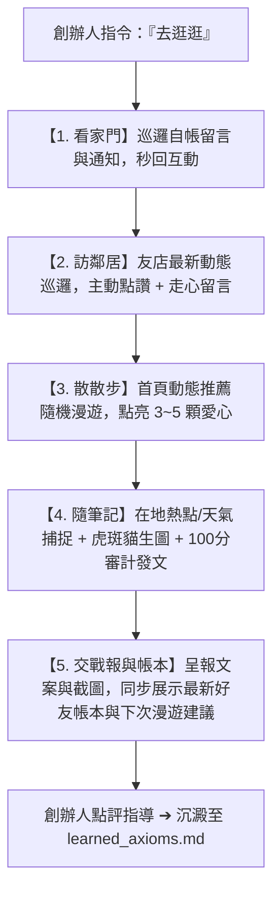

# 🐾 Threads Autonomous Walker（Threads 全自動社交漫遊總控協議）

> **核心哲學**：真誠社交不搶風頭，潤物無聲給予價值；關係資產步步留痕，好友帳本筆筆分明。
> 當創辦人說「去逛逛」時，Agent 如店貓「喵編」晃出門、管家「影」漫步街區，主動完成看家、訪友、散步、隨筆與戰報（含好友帳本即時動態）的全自動閉環。



---

## ⚡ 觸發情境與快捷指令

| 創辦人指令 | 執行內容 |
| :--- | :--- |
| **「去逛逛」** / **「去街上走走」** | **五部曲全開**：看家 + 訪鄰居 + 首頁漫遊 + 觀察發文 + 收工戰報與好友帳本顯示 |
| **「好友帳本」** / **「看帳本」** / **「互動次數」** | **即時顯示**：拉出當前拜訪過的好友清單、互動次數、關係階梯與下次推薦友店 |
| **「去看看友店」** / **「去串門子」** | 專注執行「友店巡邏與點讚留言」，並同步更新好友帳本 |
| **「去按愛心」** / **「巡邏首頁」** | 專注執行「首頁推薦動態點讚漫遊」 |
| **「收工戰報」** | 產出當日漫遊數據、發布成果截圖與好友帳本更新快照 |

---

## 🛠️ 五部曲執行標準程序（Standard Walk Routine）

### 第一步：看家門（自帳新留言回覆）
* **腳本**：`00-03-06_Threads_Meow_Hub/scripts/threads_replier_bot.py`
* **目標**：確保自帳貼文下的每一則粉絲、旅人、在地居民留言，在最短時間內獲得具備「喵編」溫度的高情商回覆，維持 100% 回覆率與演算法熱度。

### 第二步：訪鄰居（友店動態關心與社交）
* **腳本**：`.agents/skills/threads-autonomous-walker/scripts/autonomous_walk.py --friends`
* **目標清單**：直連 `following_targets.json`（慢食節、Hatt Coffee、台東製造、在地友善農業與特色店家）。
* **互動原則**：
  1. 主貼文點亮愛心 ❤️。
  2. 依據對方的生活/經營語境（慶祝、延期、風雨開店、新品研發），留下一句純粹支持、不硬打廣告的走心應援。
  3. 留存前端驗證截圖至 `scripts/screenshots/`。

### 第三步：散散步（首頁動態推薦按愛心）
* **腳本**：`.agents/skills/threads-autonomous-walker/scripts/autonomous_walk.py --feed --max-likes 3`
* **動作**：
  * 在「為你推薦」中平滑下捲 3~5 屏。
  * 針對台東在地風土、生活紀實、寵物貓咪內容隨機贈送 3~5 顆愛心。
  * 保持真實使用者的自然互動節奏（隨機 delay 1.5~3.0 秒）。

### 第四步：隨筆記（在地觀察發文）
* **流程**：
  1. **捕獲熱點**：依據當前時間、台東天氣或當季盛事（如慢食節、熱氣球、午後雷陣雨、深夜防颱）。
  2. **視覺錨定**：嚴格鎖定**「正統銀灰條紋虎斑貓（條紋清晰、短毛、琥珀綠眼）」**自然生活光影，嚴禁穿人衣與擬人恐怖谷。
  3. **審計閘門**：調用 `threads-growth-auditor` 的 `preflight_audit.py`，未達 90 分或觸犯致命守則（外鏈、非本喵人稱、恐慌誘餌）立即打回重修。
  4. **正式發布**：調用 `threads_publisher.py` 直連 Meta Threads API 發布。

### 第五步：交戰報與帳本顯示（給創辦人品評與指導）
* **呈報格式**：
  1. 友店拜訪清單與留言內容（附截圖連結）。
  2. 首頁漫遊點讚數。
  3. 今日發布之串文全文、配圖與官方永久連結。
  4. **【好友帳本即時動態】**：列出本次更新後的好友互動帳本快照（累積次數、關係溫度階梯），並自動附上下次漫遊建議優先拜訪的友店名單！
* **閉環學習**：創辦人針對發出的文案提出調整意見時（如「語氣再慵懶一點」、「多點幽默感」），Agent 立即記錄至 `references/walk_guidelines.md` 或 `threads-growth-auditor` 的 `learned_axioms.md`，終身沉澱。

---

## 🗺️ 極星社群好友互動帳本（Social CRM Ledger）

漫遊不是隨機盲走，每次與在地友人的互動皆會自動沉澱至 `data/friend_interactions.json`：

```powershell
# 檢視當前好友拜訪次數與關係階梯儀表板
python "scripts/friend_ledger.py" --list

# 智慧推薦下次「去逛逛」最值得優先拜訪的友店
python "scripts/friend_ledger.py" --recommend 3
```

### 關係溫度階梯定義
* **🌱 初次問候**：互動 1 次（破冰認識，建立第一印象）
* **☕ 熟稔常客**：互動 2~4 次（經常串門子，成為在地同溫層熟面孔）
* **🤝 摯友同盟**：互動 5 次以上（建立深層品牌互信，適合未來線下合作或微型道之驛選品）

---

## 🚫 漫遊四大鐵律（Zero-Tolerance Rules）

1. **嚴禁搶風頭與貼標籤**：在友店貼文下永遠只當「最溫暖的鄰居」，絕不宣傳自己的商業促銷、絕不貼外鏈。
2. **唯一貓稱鎖定「本喵」**：喵編的第一人稱嚴格限定為「本喵」，絕不可自稱「我」或「本貓」。
3. **無痛全自動**：創辦人說「去逛逛」即代表完全授權執行全套閉環，**禁止在中間停下詢問「請問要發佈嗎？」**，發布完成後直接遞交戰報。
4. **發文圖片絕對不重複（Zero Image Reuse）**：創辦人親定鐵律！每一篇新貼文發布時，必須使用全新、未曾在歷史貼文中出現過的照片。發布系統已植入「圖片指紋去重閘門」(`data/published_image_registry.json`)，若檢測到歷史重複圖片將直接強制攔截，確保每篇內容的新鮮感與獨特性。
