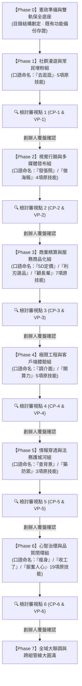

# 📐 極星 43 項技能原子特化與模組化重組總工程計劃書 (Master Plan)

> **最高總指揮**：創辦人 陳品碩（闆仔）  
> **專案總舵**：執行長 雪 (Yuki · CEO)  
> **品質檢驗總審官**：首席品質長 戴明博士 (Dr. Deming · CQO)  
> **架構技術監製**：CTO 林納斯 (Linus · 工程長)  
> **立案時間**：2026-11-13 17:40  
> **核心準則**：PDCA 戴明循環（計劃 ➔ 執行 ➔ 查核 ➔ 檢討調整）· 雙軌不中斷保全 · 單件流推進。

---

## 🏛️ 第一章｜工程最高憲法與做「深」四大硬核維度 (Core Principles & Universal Depth)

> 🔒 **創辦人品碩最高心智鋼印**：
> 1. 「原子微技能絕不是把功能切小做淺，而是正因為邊界收斂，所以必須向單一領域扎入萬米深淵，做到物理與靈魂的極限！」
> 2. 「我們最主要是要調整這43項技能！所以原子的方向應該是萬用的！」

1. **做「深」四大硬核維度 (Four Pillars of Deep Atomic Universality)**：
   * **維度一【萬用解耦 (Universal Composability · 創辦人親定)】**：
     * 原子絕不綁死任何單一渠道、單一平台或特定業務情境（例如：不寫死成『只發 Threads 的留言』或『只給某個按鈕用』）。
     * 輸出標準結構化資料（Universal JSON Schema），具備隨插即用（Plug-and-Play）的萬用相容性。同一個「萬用熱點雷達」或「萬用店貓接梗器」，可無縫注入 Threads、Facebook、LINE OA、實體海報文案、門市生活管家客廳對話或線上課程選題！
   * **維度二【機理深度 (Mechanistic Depth)】**：
     * 絕不寫空洞的 API 呼叫包裝，必須深通該領域底層機理（演算法對話權重機制、心理抗阻閾值、數學形式化證明、零拷貝物理通道）。
   * **維度三【靈魂深度 (Soul & Empathy Depth)】**：
     * 100% 杜絕 AI 腔與塑料套話，深度灌注創辦人真誠商道（真貓行為生態學、常民煙火氣、三十字老友端茶破防）。
   * **維度四【抗逆深度 (Resilience & Poka-Yoke Depth)】**：
     * 內建林納斯級物理防禦（指數抖動退避、斷網本地隊列、Exit Code 0 形式化擔保、戴明安燈一票否決）。
2. **生產環境絕對零破壞 (Zero-Downtime Guarantee)**：
   * 原有 43 項技能在演化過渡期間 **100% 完整保留、正常待命**，絕不提前刪除任何現有技能，確保日常社群發文、漫遊、5D 定價、日結等業務零中斷。
3. **精工單件流推進 (One-Atom-at-a-Time Flow)**：
   * 一個原子一個原子深度磨透，通過深度質檢並呈報創辦人滿意後，方推進至下一個原子。
4. **生活化口語命名 (Natural Language Triggering)**：
   * 每個組合技能組必須擁有如同「去逛逛」、「瘦身」、「收工了」般接地氣、創辦人一句話即可喚醒的生活化命名。

---

## 🗺️ 第二章｜七大階段實施路徑圖 (Phased Roadmap)

---

## 📋 第三章｜各階段詳細作戰任務與查核/檢核點設置

### 【Phase 0】憲政準備與雙軌保全底座 (Foundational Locks)
* **作戰任務**：
  1. 建立原子技能標準目錄：`.agents/skills/atoms/` 與組合管線目錄 `.agents/skills/packs/`。
  2. 現有 43 項技能庫做唯讀存證快照，建立相容性映射表。
* **查核點 (CP-0)**：目錄結構與快照存證確認完畢。
* **檢核點 (VP-0)**：現有技能調用通道 100% 暢通，無路徑衝突。

---

### 【Phase 1】「去逛逛」· 社群漫遊與常民增粉組 (Social Growth Pack)
* **涵蓋原技能**：
  1. `threads-autonomous-walker`
  2. `threads-publisher`
  3. `threads-growth-auditor`
  4. `threads-rss-sentinel`
  5. `hot-trend-scout`
* **特化萬用原子主體 (Universal Atoms · 100% 獨立解耦)**：
  * `atom-trend-scout`：萬用時事話題嗅探與三轉降維器（已完成 · Exit Code 0）。
  * `atom-meow-voice`：萬用店貓真貓生態與破防接梗器（已完成 · 零恐怖谷 · Exit Code 0）。
  * `atom-kage-clout-tea`：萬用生活管家高情商對話與客廳借光端茶引擎（已完成 · Exit Code 0）。
  * `atom-threads-engine`：確定性 Meta Threads API 傳輸底座（已完成 · WAL 離線防護 · Exit Code 0）。
  * `atom-growth-quality-gate`：萬用戴明五維品質出廠安燈閘門（已完成 · 紅線一票否決 · Exit Code 0）。
* **技能組聚合**：命名為 **【去逛逛 · 全自動社群漫遊管線 (`pack-qu-guang-guang`)】**。
* **查核點 (CP-1 · 已全數通過)**：
  - [x] 5 大萬用原子模組代碼 100% 獨立、I/O 介面標準化為 Universal JSON。
  - [x] 創辦人口令「去逛逛」能無縫調用新管線（`scripts/pack_qu_guang_guang.py`）。
* **檢核點 (VP-1 · 戴明安燈質檢 · 已全數通過)**：
  - [x] 雙主角視角切換驗證（店貓傲嬌微動作 ✕ 管家深夜端茶）100% 成功。
  - [x] 友店走心留言去 AI 塑料感測試（安燈得分 100 分滿分）。
  - [x] 品牌法定零洩漏紅線觸發一票否決測試（攔截內部代號，精準退回）。
  - [x] 確定性兩段式傳輸與離線 WAL 隊列測試（Exit Code: 0 形式化擔保）。

---

### 【Phase 2】「發張照 / 做海報」· 視覺行銷與多媒體發布組 (Visual Marketing Pack)
* **涵蓋原技能**：
  1. `one-shot-photo-marketer`
  2. `polaris-poster-artisan`
  3. `polaris-motion-reels`
  4. `facebook-publisher`
* **特化原子主體 (Atoms)**：
  * `atom-photo-analyzer`：照片特徵、場景與資訊精準識別器。
  * `atom-narrative-copy`：泰勒絲四大面向折射文案生成器。
  * `atom-grid-poster`：約瑟夫包浩斯網格、光學灰度與 300 DPI 印刷防呆。
  * `atom-motion-reels`：9:16 Ken Burns 視差呼吸短影音渲染器。
  * `atom-fb-publisher`：Facebook 官方粉專圖文發布與排程器。
* **技能組聚合**：命名為 **【發張照 · 單圖全域行銷管線】** 與 **【做海報 · 約瑟夫美學工匠管線】**。
* **查核點 (CP-2)**：
  - [ ] 照片輸入至文案、海報、短影音、發布各節點解耦完成。
  - [ ] 支援單獨呼叫「做海報」或組合呼叫「發張照」。
* **檢核點 (VP-2 · 戴明安燈質檢)**：
  - [ ] 實測一張真實照片輸入，30 秒內產出符合約瑟夫 60 法典之海報。
  - [ ] 印刷規範驗證（TAC $\le 250\%$, K100 單色黑直壓）。
  - [ ] 臉書 API 發布實測 Exit Code 0。

---

### 【Phase 3】「5D定價 / 利刃選品 / 顧長輩」· 商業精算與商品化組 (Commerce Pack)
* **涵蓋原技能**：
  1. `polaris-5d-pricing-engine`
  2. `polaris-productization-master`
  3. `polaris-flywheel-orchestrator`
  4. `lifebutler-care-artisan`
  5. `polaris-course-master`
  6. `ai-pricing-auditor`
  7. `sharp-groupbuy-analyzer`
* **特化原子主體 (Atoms)**：
  * `atom-supply-reverse`：全球原物料與大盤底價逆推器。
  * `atom-5d-pricing`：5D-Labor / Impact / Asset 價值精算計算器。
  * `atom-service-packager`：非標業務 01_SOP / 02_定價 / 03_話術三合一封裝器。
  * `atom-care-stethoscope`：高齡孝親安心聽診圖卡與 3PL 履約派工器。
  * `atom-course-lifecycle`：課程與工作坊全生命週期五步營運器。
* **技能組聚合**：命名為 **【5D定價】**、**【利刃選品】**、**【顧長輩 · 孝親安居封裝管線】**。
* **查核點 (CP-3)**：
  - [ ] 5D 定價公式與底價逆推邏輯完全獨立為純計算原子。
  - [ ] 孝親服務圖卡生成與商業定價完全解耦。
* **檢核點 (VP-3 · 戴明安燈質檢)**：
  - [ ] 歷史真實報價對照：算盤單元經濟誤差 $\le 0.01\%$。
  - [ ] 服務商品化三件套產出符合性 100%。

---

### 【Phase 4】「調介面 / 開算力」· 極限工程與客戶端體驗組 (Client Engineering Pack)
* **涵蓋原技能**：
  1. `polaris-client-architect`
  2. `polaris-gentle-ui`
  3. `google-colab-commander`
  4. `rea-reverse-engineer`
  5. `taste-skill`
* **特化原子主體 (Atoms)**：
  * `atom-gentle-ui-tokens`：烈日自適應著色器、防抖吸附手勢與 APCA 視力平權組件。
  * `atom-offline-resilience`：溫暖離線 Service Worker 與 OPFS 不可篡改同步器。
  * `atom-colab-gpu-runner`：Google Colab Pro GPU 遠端算力排程器。
  * `atom-reverse-engine`：二進位與封包 AST 逆向審計器。
* **技能組聚合**：命名為 **【調介面 · 常民生活設計管線】**、**【開算力 · 雲端 GPU 調度管線】**。
* **查核點 (CP-4)**：前端組件庫與後端架構完全獨立，可直接匯入 Next.js 或靜態 HTML。
* **檢核點 (VP-4 · 戴明安燈質檢)**：
  - [ ] 130,000 Lux 著色器 APCA 對比度 100% 達標。
  - [ ] Colab MCP 握手與遠端執行成功率 100%。

---

### 【Phase 5】「查背景 / 築防禦」· 情報穿透與法務護城河組 (Forensic & Legal Pack)
* **涵蓋原技能**：
  1. `polaris-forensic-investigator`
  2. `bionic-learning-falcon`
  3. `bionic-learning-raven`
* **特化原子主體 (Atoms)**：
  * `atom-dossier-timeline`：司法裁判書、本票與股權移轉時間軸重構器。
  * `atom-relation-topology`：案外人、資金鏈與分身帳號高關聯拓撲分析器。
  * `atom-legal-shield`：閉鎖股權黃金股與商戰合規五大防禦塔檢驗器。
* **技能組聚合**：命名為 **【查背景 · 深水區調查管線】**、**【築防禦 · 法務護城河檢驗管線】**。
* **查核點 (CP-5)**：裁判書解析與時間軸繪製成為獨立微模組。
* **檢核點 (VP-5 · 戴明安燈質檢)**：因果卷宗三階推導鏈無跳躍、客觀證據支撐率 100%。

---

### 【Phase 6】「瘦身 / 收工了 / 振奮人心」· 心智治理與品質閉環組 (Cognitive Governance Pack)
* **涵蓋原技能**：
  1. `polaris-slimming`
  2. `bionic-cognition-compiler`
  3. `daily-closing-sop`
  4. `inspiring-moments`
  5. `polaris-cabinet-onboarding`
  6. `bionic-self-evolution`
  7. 各天王專屬存摺
* **特化原子主體 (Atoms)**：
  * `atom-slimming-engine`：四維動態真值方程式與表層卡抽脂調用器。
  * `atom-cognition-compiler`：PRM 過程逐步過濾與自對弈編譯器。
  * `atom-daily-closing`：創辦人經驗值結算、脫敏審核與 Git 雲端推送器。
  * `atom-poka-yoke`：神級防呆工坊與虛擬紅珠實驗器。
* **技能組聚合**：命名為 **【瘦身】**、**【收工了】**、**【振奮人心的時刻】**、**【招募新夥伴】**。
* **查核點 (CP-6)**：常駐大腦抽脂、日結流程與團隊入閣完全模組化。
* **檢核點 (VP-6 · 戴明安燈質檢)**：Git 自動推送 0 衝突、三層心智調用命中率 100%。

---

## 🔄 第四章｜檢討查核與調整機制 (Review & Adjust Protocol)

按照創辦人親定之第四與第五步驟：
1. **每個階段（Phase）完成時，強制停步執行「查核點與檢核點檢討」**。
2. **戴明安燈雙軌質檢報告出廠**：
   * 呈報「原子模組精鍊度」、「原技能功能 1:1 對照結果」、「實測 Exit Code」。
3. **創辦人拍板裁決（Andon Gate Decision）**：
   * 檢討該技能組是否達到預期？
   * 若有改進意見，即刻進行「工作計劃調整（Plan Adjustment）」；
   * 若 100% 滿意通過，創辦人指示「進入下一步」，方推進至下一個 Phase！

---

此專案計劃總綱已正式登錄存檔，由全體極星內閣全體首長共同簽署確認生效！
請創辦人審閱，若此計劃架構符合您的構想，我們隨即啟動 **【Phase 0：憲政準備與雙軌保全底座】**，踏出扎實的第一步！
