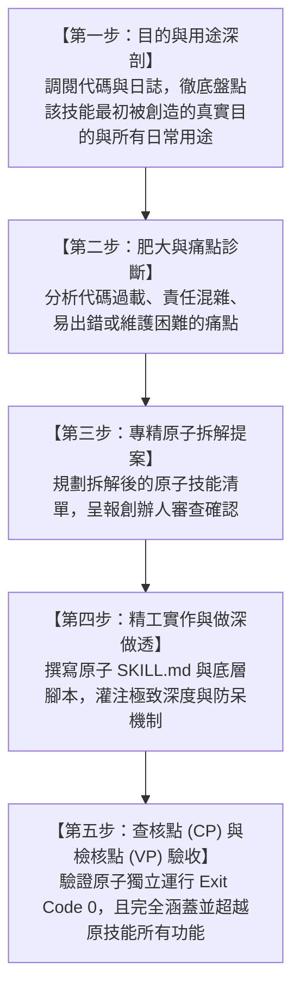

# 📐 極星 43 項技能專精拆解與原子特化重組總工程計劃書 (Master Plan v2.0)

> **最高總指揮**：創辦人 陳品碩（闆仔）  
> **專案總舵**：執行長 雪 (Yuki · CEO)  
> **品質檢驗總審官**：首席品質長 戴明博士 (Dr. Deming · CQO)  
> **架構技術監製**：CTO 林納斯 (Linus · 工程長)  
> **最新修訂時間**：2026-11-13 18:50 (創辦人親授心法校準版)  
> **核心準則**：PDCA 戴明循環（計劃 ➔ 執行 ➔ 查核 ➔ 檢討調整）· 雙軌不中斷保全 · 先明目的後拆解 · 專精做深絕不泛化。

---

## 🏛️ 第一章｜創辦人親定之最高心智鋼印 (The Founder's Core Axioms)

> 🔒 **創辦人品碩最高心智鋼印（2026-11-13 親授）**：
> 1. **「技能如果萬用就無法做深了。」**
> 2. **「『原子』是一個動詞，是幫技能做調整的行為與工法。」**
> 3. **「有些肥大的技能我們必須先瞭解技能的目的與用途，再來拆解成原子技能，確保能符合原本技能的功能與目的。」**
> 4. **「做『深』的用意，就是讓技能的功能更聚焦、更完善！」**

### 🎯 做「深」三大硬核維度 (Three Pillars of Deep Specialization)
1. **【功能極致聚焦 (Laser Focus)】**：
   * 絕不做泛泛而談的通用模組。每個原子技能只鎖定一個核心目標，剝除所有無關旁枝，專精深入該領域底層機理。
2. **【原初目的完美超越 (Purpose Fulfillment)】**：
   * 拆解前後必須嚴格比對：原本肥大技能所承載的每一項業務目的，拆解後不僅 100% 被完整覆蓋，且運行更流暢、更少故障、邊界更清晰。
3. **【抗逆與靈魂深度 (Resilience & Soul Depth)】**：
   * 100% 杜絕 AI 腔與塑料套話（真貓行為生態、常民客廳煙火氣）。
   * 內建林納斯級物理防禦（Exit Code: 0 確定性擔保、戴明安燈一票否決、離線 WAL 隊列）。

---

## 📊 第二章｜當前整體工作進度即時儀表板 (Live Progress Dashboard)

| 階段代號 | 階段名稱 | 核心作戰內容 | 當前進度 | 戴明安燈狀態 |
| :---: | :--- | :--- | :---: | :---: |
| **Stage 0** | **12 閣員認知瘦身** | 九大天王 + 首長大腦瘦身，動態調用三層心智，常駐 Token $\le 850$ | **100% 完成** | 🟢 綠燈 (Exit Code 0) |
| **Stage 0.5** | **43 項技能快照存證** | 原有 43 項技能庫生成唯讀快照清冊，雙軌保全，生產環境零破壞 | **100% 完成** | 🟢 綠燈 (快照存檔) |
| **Stage 1** | **心智校準與工法確立** | 釐清「原子是調整動作」，否定泛化萬用，確立「先明目的、專精做深」工法 | **100% 完成** | 🟢 綠燈 (創辦人對齊) |
| **Stage 2** | **43項肥大技能逐一解剖** | 深入剖析各肥大技能目的，精準拆解為專精原子，單件流逐項驗收 | **進行中 (29/43 完成 · 第六梯隊推進至 3/17)** | 🟢 Target 29 驗收綠燈 |
| **Stage 3** | **生活化口語技能組重組** | 串聯已深耕之專精原子，重組為「去逛逛」、「發張照」等自然語言管線 | 待啟動 | ⚪ 佇列中 |
| **Stage 4** | **全域大聯調與閉環驗收** | 跨組全流程壓力測試，雙軌切換驗收，完成 43 項技能全面進化 | 待啟動 | ⚪ 佇列中 |

---

## 🛠️ 第三章｜肥大技能解剖五步標準工法 (SOP for Atomic Deconstruction)

每一項被列為調整對象的技能，強制遵守以下五步閉環工法：

---

## 📋 第四章｜43 項技能分類與拆解作戰梯隊 (Action Cohorts)

我們將 43 項現有技能依據業務關聯性，劃分為六大作戰梯隊，採**單件流（一次專注處理一項技能）**依序推進：

### 🎯 第一梯隊：社群漫遊與常民增粉類（已 100% 拆解大圓滿 · 產出 13 專精原子）
* **已解剖肥大技能 (5/5)**：
  1. `threads-autonomous-walker` ➔ 拆解為 `atom-threads-frontdoor`, `atom-threads-neighbor-crm`, `atom-threads-tea-funnel`, `atom-threads-bi-protagonist`, `atom-threads-reply-bridge`
  2. `threads-publisher` ➔ 拆解為 `atom-threads-post-dispatcher`, `atom-threads-tree-watcher`
  3. `threads-growth-auditor` ➔ 拆解為 `atom-threads-preflight-gate`, `atom-threads-telemetry-compass`
  4. `threads-rss-sentinel` ➔ 拆解為 `atom-threads-rss-watcher`, `atom-threads-trio-crafter`
  5. `hot-trend-scout` ➔ 拆解為 `atom-trend-radar-converter`, `atom-trend-visual-parody`

### 🎨 第二梯隊：視覺行銷與多媒體發布類 (已 100% 拆解大圓滿 · 產出 9 專精原子)
* **已解剖肥大技能 (4/4)**：
  6. `one-shot-photo-marketer` ➔ 已拆解為 `atom-photo-classifier`, `atom-event-intel-copy`, `atom-boss-direct-copy` (完成)
  7. `polaris-poster-artisan` ➔ 已拆解為 `atom-poster-grid-architect`, `atom-poster-print-andon` (完成)
  8. `polaris-motion-reels` ➔ 已拆解為 `atom-motion-camera-engine`, `atom-motion-overlay-safezone` (完成)
  9. `facebook-publisher` ➔ 已拆解為 `atom-fb-preflight-gate`, `atom-fb-feed-dispatcher` (完成)

### 💰 第三梯隊：商業價值精算與服務商品化類 (已 100% 拆解大圓滿 · 產出 14 專精原子)
* **已解剖肥大技能 (7/7)**：
  10. `polaris-5d-pricing-engine` ➔ 已拆解為 `atom-pricing-5d-calculator`, `atom-pricing-bulletproof-clause` (完成)
  11. `polaris-productization-master` ➔ 已拆解為 `atom-product-trio-scaffolder`, `atom-product-redteam-audit` (完成)
  12. `sharp-groupbuy-analyzer` ➔ 已拆解為 `atom-groupbuy-cost-auditor`, `atom-groupbuy-four-prism-copy` (完成)
  13. `ai-pricing-auditor` ➔ 已拆解為 `atom-supplychain-layer-deconstructor`, `atom-supplychain-tactical-negotiator` (完成)
  14. `lifebutler-care-artisan` ➔ 已拆解為 `atom-care-order-dispatcher`, `atom-care-telehealth-card` (完成)
  15. `polaris-course-master` ➔ 已拆解為 `atom-course-syllabus-scaffolder`, `atom-course-enrollment-pipeline` (完成 · 每堂嚴格限額6席)
  16. `polaris-flywheel-orchestrator` ➔ 已拆解為 `atom-flywheel-event-router`, `atom-flywheel-launch-cockpit` (完成)

### 🛠️ 第四梯隊：極限底層工程與客戶端體驗類 (已 100% 拆解大圓滿 · 產出 10 專精原子)
* **已解剖肥大技能 (5/5)**：
  17. `polaris-client-architect` ➔ 已拆解為 `atom-client-offline-heartbeat`, `atom-client-resilient-transport` (完成)
  18. `polaris-gentle-ui` ➔ 已拆解為 `atom-gentle-optical-tokens`, `atom-gentle-tremor-guard` (完成)
  19. `google-colab-commander` ➔ 已拆解為 `atom-colab-session-guardian`, `atom-colab-task-dispatcher` (完成)
  20. `bionic-cognition-compiler` ➔ 已拆解為 `atom-cognition-vault-auditor`, `atom-cognition-artifact-compiler` (完成)
  21. `rea-reverse-engineer` ➔ 已拆解為 `atom-reverse-sandbox-triage`, `atom-reverse-protocol-auditor` (完成)

### 🦅 第五梯隊：情報穿透、法務護城河與人設立繪類 (已 100% 拆解大圓滿 · 產出 10 專精原子)
* **已解剖肥大技能 (5/5)**：
  22. `polaris-forensic-investigator` ➔ 已拆解為 `atom-forensic-judicial-audit`, `atom-forensic-ubo-asymmetry` (完成)
  23. `polaris-frontier-radar` ➔ 已拆解為 `atom-radar-first-principles`, `atom-radar-edge-quantizer` (完成)
  24. `persona-reverse-engineer` ➔ 已拆解為 `atom-persona-utterance-miner`, `atom-persona-concentric-compiler` (完成)
  25. `polaris-cabinet-onboarding` ➔ 已拆解為 `atom-onboarding-office-scaffolder`, `atom-onboarding-roster-sync` (完成)
  26. `shadow-soul-memory` ➔ 已拆解為 `atom-shadow-circadian-guardian`, `atom-shadow-episodic-vault` (完成 · 創辦人兩點作息法旨鋼印)

### 🏛️ 第六梯隊：仿生學習進化、工作自豪感與日結閉環類 (推進中 · 8/17 完成)
* **涵蓋技能**：
  27. `daily-closing-sop` ➔ 已拆解為 `atom-closing-git-security-gate`, `atom-closing-gamification-xp` (完成)
  28. `inspiring-moments` ➔ 已拆解為 `atom-deming-redbead-funnel`, `atom-deming-pokayoke-joy` (完成)
  29. `polaris-slimming` ➔ 已拆解為 `atom-slimming-working-card`, `atom-slimming-4d-dispatcher` (完成)
  30. `bionic-self-evolution` ➔ 已拆解為 `atom-evolution-knowledge-pruner`, `atom-evolution-meta-mutator` (完成)
  31. `bionic-learning-system` ➔ 已拆解為 7 大專精深度原子：`atom-learning-autonomous-navigator`, `atom-learning-prm-step-verifier`, `atom-learning-spin-tone-discriminator`, `atom-learning-decadal-conflict-auditor`, `atom-learning-synaptic-equation-engine`, `atom-learning-cognitive-vault-keeper`, `atom-learning-circuit-breaker-guard` (完成 · 七維全息深耕母版)
  32. `bionic-learning-yuki` ➔ 已拆解為 5 大專精深度原子：`atom-yuki-cabinet-orchestrator`, `atom-yuki-strategic-arbitrator`, `atom-yuki-founder-shield`, `atom-yuki-hyperlocal-artisan`, `atom-yuki-brand-redline-gate` (完成 · 十一大天王首長協同版)
  33. `bionic-learning-linus` ➔ 已拆解為 4 大專精深度原子：`atom-linus-network-transport`, `atom-linus-db-cache-concurrency`, `atom-linus-security-sandbox`, `atom-linus-compute-architecture` (完成 · 四大象限二十項鐵律版)
  34. `bionic-learning-taylor` ➔ 已拆解為 4 大專精深度原子：`atom-taylor-campaign-launchpad`, `atom-taylor-four-prism-copy`, `atom-taylor-ip-meow-marketer`, `atom-taylor-funnel-telemetry` (完成 · 純粹市場行銷四維版)
  35~43. 閣員特化仿生學習系列（戴明、算盤、約瑟夫、影、尼奧、艾達、渡鴉、雪柔等特化版）

---

## 🔍 第五章｜查核點 (CP) 與檢核點 (VP) 總控台

為落實創辦人「進行中必須設立查核點與檢核點，檢討後再確認下一步」之法旨：

* **當前查核點 (CP-Stage2-Target1 · 已完成)**：
  - [x] 完整閱讀並剖析 `threads-autonomous-walker` 之原初目的、業務用途與代碼結構。
  - [x] 產出專精原子微技能拆解提案，明確標定每個原子的單一聚焦責任。
* **當前檢核點 (VP-Stage2-Target1 · 戴明安燈 · 已全數通過)**：
  - [x] 創辦人審查並核准拆解提案。
  - [x] 拆解後的 5 大原子能完全覆蓋原技能的所有功能（自帳秒回、友店端茶、散步點讚、生活筆記、回覆橋接）。
  - [x] 各原子具備物理運行腳本，獨立執行測試 Exit Code: 0。
