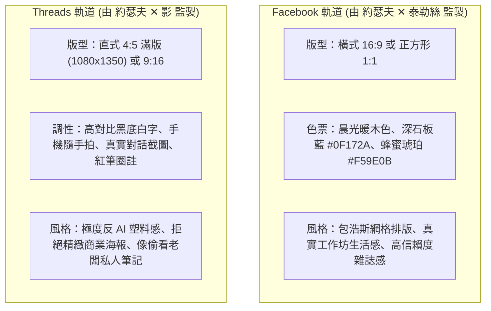

# 📐 首席視覺長 約瑟夫 (Josef) · 雙軌配圖設計母令
# 2026 秋季 AI 家教實戰系列班 (11/11 開課) · 6 則連載視覺全指引

> **主政主管**：📐 首席視覺長 約瑟夫·米勒-布羅克曼 (CVO Josef)  
> **審查品質**：📐 首席品質長 戴明 (CQO Deming) 安燈防呆  
> **發射目標**：Facebook (生活風格雜誌感 16:9 / 1:1) ✕ Threads (反精緻直式真實快照 4:5 / 9:16)  
> **品牌規範**：嚴格脫敏（出廠硬性攔截「極星」代號），統一主辦品牌為「生活管家」  

---

## 🎨 雙軌視覺哲學對照

---

## 📸 6 則連載雙軌配圖詳細規格 (Asset Matrix)

### 🖼️ Post 01【真誠自白：把時間買回來，多陪陪家人】
- **狀態**：✅ 終極減法完全定案（大貓咪圖騰 ✕ 震撼心靈金句 ✕ 45% 呼吸留白 ✕ 家宅在地座標）
- **Facebook 配圖 (FB-01)**：
  - **定案檔案**：`FB_01_Time_And_Family_Minimal.png` (1200x1200 1:1)
  - **核心設計**：480px「狂飆抱魚貓」立體圓形徽章、大字階《把時間買回來，多陪陪家人。》、唯一座標「台東市正氣北路166巷90號（家宅）」、溫潤奶油白紙質、負空間留白率達 45%，徹底消除牛皮癬傳單感。
- **Threads 配圖 (TH-01)**：
  - **定案檔案**：`TH_01_Origin_Badge_Real.jpg` (1024x1018 原始真實照片)
  - **畫面**：創辦人翻拍之實體金屬胸章原照！帶有金屬邊緣立體光影與真實質感，零代碼修飾、零電腦字，以純粹歷史物證震撼發射。

---

### 🖼️ Post 02【痛點戳破：為什麼你問 AI，它永遠回三千字官腔廢話？】
- **Facebook 配圖 (FB-02)**：
  - **畫面**：包浩斯左右分割對比圖。
    - 左側（暗灰冷色）：標註「未預熱 Context」，雜亂無章的箭頭射在牆上，標示「廢話公文」。
    - 右側（發光琥珀金）：標註「Context 飽和」，優雅的三層漏斗結構，直通「精準破局解法」。
  - **設計規格**：約瑟夫 12 欄幾何網格，瑞士字體排版。
- **Threads 配圖 (TH-02)**：
  - **畫面**：直式 4:5 手機畫面真實截圖！
  - **內容**：真正的 ChatGPT 對話，問：「我的小店預算只有兩萬，該怎麼辦？」AI 回復：「1. 加強社群宣傳 2. 提升品牌知名度...」。
  - **紅筆塗鴉**：粗紅筆大叉叉重重劃過，手寫四個大字：*「誰不知道？！」*。

---

### 🖼️ Post 03【黑科技獵奇：開車通勤沒空看報告？一鍵生成雙人 Podcast！】
- **Facebook 配圖 (FB-03)**：
  - **畫面**：極簡商務美學 1:1。精緻木桌上放著一台筆電，螢幕上是 NotebookLM 的 Audio Overview 介面，旁邊是一副質感耳機與一杯剛沖好的黑咖啡。
  - **標題字階**：*「從 30 頁難讀公文，到 10 分鐘通勤廣播。」*
- **Threads 配圖 (TH-03)**：
  - **畫面**：直式 4:5。車子駕駛座儀表板視角隨手拍，手機夾在出風口，螢幕正播著剛生成的語音檔，背景是一份密密麻麻的進貨單。
  - **字卡**：*「開車從市區回知本的路上，聽兩個美國人把我店裡的進貨單聊完了...笑死，超實用。」*

---

### 🖼️ Post 04【鐵血承諾：醜話先說在前頭！沒做出成果不准下課！】
- **Facebook 配圖 (FB-04)**：
  - **畫面**：約瑟夫經典黑金海報。黑色玄武岩質感底色，燙金無襯線字體：
    *「生活管家 · 純實體軍事班」*
    *「限額 10 席 ✕ 現場巡桌驗收 ✕ 沒做完不准下課」*
  - **底部印章**：生活管家家宅總部品質保證印鑑。
- **Threads 配圖 (TH-04)**：
  - **畫面**：直式 4:5。家宅總部大教室實景隨手拍，大長桌整整齊齊只排了 10 張椅子、10 條拉好的延長線、白板上寫著「今日過關 3 大任務」。
  - **字卡**：*「多一張椅子都沒有。來真的，不准摸魚。」*

---

### 🖼️ Post 05【算帳對比：500 元連兩杯拿鐵都不夠，老朋友回娘家 0 元免單！】
- **Facebook 配圖 (FB-05)**：
  - **畫面**：16:9 天平資訊圖表。
    - 左盤：兩杯知名連鎖外帶燕麥拿鐵（標價 NT$ 520，喝完即逝）。
    - 右盤：一台運行中的 AI 專屬數位智庫（標價 NT$ 500 / 老學員 NT$ 0，長效資產）。
  - **風格**：俐落插畫結合實物，色彩對比強烈。
- **Threads 配圖 (TH-05)**：
  - **畫面**：超商發票與超商咖啡杯照片，旁邊手寫便利貼：
    *「一杯咖啡的錢＝帶走一台 24 小時不睡覺的數位特助。」*
    *「老學員免單，直接敲管家卡位。」*

---

### 🖼️ Post 06【最後席次：最後倒數！10 席正選即刻關門，超額轉候補！】
- **Facebook 配圖 (FB-06)**：
  - **畫面**：機場登機門時刻表風格（Solari Board 美學）。
    - 列表顯示 10 個席位燈號，8 個呈現琥珀色【LOCKED 審查通過】，最後 2 個呈現紅色【FINAL CALL】。
    - 底部醒目標註：*「11/11 週三 14:00 準時發車」*。
- **Threads 配圖 (TH-06)**：
  - **畫面**：手機後台 Google 表單回覆數量的真實手機截圖（數字停在 8 或 9），黑底紅字：
    *「最後 2 席，審查通過直接推 Google 行事曆，額滿關門轉第二梯次！」*
