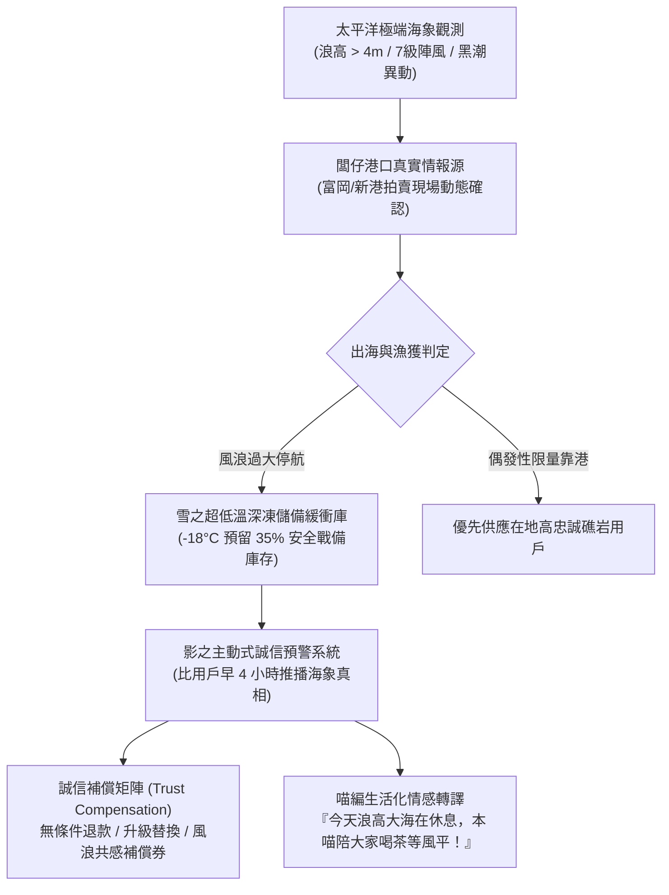

# 第 116 輪仿生自進化日誌：實體供應鏈極端海象對沖與誠信補償機制深化 (Cycle 116)
**文件編號**：POLARIS-BIO-EVO-116  
**進化版本**：v13.6 (Antifragile Supply Chain & Extreme Weather Hedging)  
**錨定母體**：`00_Master_Polaris` / `00-03_Brand_LifeButler` / `04_Shadow_Kage_Operative`  
**記錄者**：小編（影）· 北極星仿生演化引擎  
**時間戳記**：2026-10-21 (Cycle 116)

---

## 一、演化動機與自由能環境衝擊 (Free Energy & Environmental Surprise)

東台灣太平洋海域（富岡、新港、成功漁港）與中央山脈地形具備顯著的高自由能環境擾動特徵——突發性黑潮擺盪、東北季風湧浪（Swells）、颱風外圍環流與蘇花/南迴公路偶發性坍方。在傳統生鮮電商中，此類極端氣候往往導致：
1. **虛假承諾與履約破裂**：平台為求銷量隱瞞缺貨，導致延遲出貨、退冰受損引發客訴。
2. **漁民與供應商單向受損**：出海風險激增或臨時停航產生沉沒成本，中介商壓價轉嫁風險。
3. **用戶認知混亂與信任熵增**：消費者被困在「物流追蹤碼卡住」的資訊黑箱中，焦慮轉化為品牌不滿。

在北極星 v13.0 宏觀憲章下，我們拒絕將極端氣候視為「不可抗力之託辭」，而是依循塔雷伯（Nassim Taleb）之**反脆弱原理（Antifragility）**，將自然擾動轉化為深化客群信任、建立動態緩衝儲備與重塑生態尊重的核心護城河。

---

## 二、反脆弱海象對沖機制架構 (Antifragile Oceanic Hedging Framework)

### 1. 闆仔第一現場海象感知 (First-Principle Marine Ground Truth)
- 拒絕依賴通用氣象預報，直接連結成功與富岡船長的第一手錨泊動態。
- 當海象超過安全採捕閥值，立即凍結即時現撈訂單，堅守「不以人命與品質賭博」之第一原則。

### 2. 雪之雙軌超低溫儲備與智慧路由 (Snow Dual-Track Reserve & Adaptive Routing)
- **35% 極致抗震安全庫存**：常態儲備通過急凍驗證之野生魚獲真空包，確保主幹道受阻時仍能提供平穩供給。
- **雙廊道物流切換機制**：當南迴或蘇花因風雨管制時，自適應動態切換海運轉駁或調度台東在地社群礁岩自提點（Neighborhood Reefs）。

### 3. 影的主動式超前推播 (Proactive Pre-Alert Dispatch)
- **「比用戶早發現、比物流早通知」原則**：系統在海象警報發布後 15 分鐘內，自動向受影響訂單用戶發送極端海象現場實況（包含當日漁港風浪影片與船長修網紀實）。
- 將「延誤」轉化為「生態教育與產地共感」。

### 4. 零推託誠信補償矩陣 (Zero-Quibble Trust Compensation)
- **三選一自決方案**：
  1. *退款不退信任*：一鍵全額退款，加贈「下次風平浪靜鮮魚優先認購權」。
  2. *品質平移升級*：若當日鬼頭刀未靠港，無痛升級為同價值以上之頂級午仔魚或旗魚腹肉。
  3. *海象守護者積分*：選擇等待的顧客，享有專屬「風浪守候折抵」與特等鹿野紅烏龍冷泡茶包隨箱贈送。

---

## 三、多智能體協同實踐矩陣 (Multi-Agent Stigmergy Execution)

| 智能體分工 | 核心角色行動 | 情感與物理載體 | 系統輸出成果 |
| :--- | :--- | :--- | :--- |
| **闆仔 (Pinshuo)** | 港口親巡、漁獲質檢、安全邊界定奪 | 雨衣踏勘、魚體鱗光檢驗、不妥協停航判定 | 產地第一手真相情報與漁港實況 |
| **雪 (Snow)** | 低溫物流鏈動態調配、冷鏈監測 | -18°C 監控節點、雙向轉運線路、急速冷卻 | 15 分鐘極速替代調撥與退款清算 |
| **喵編 (Meow)** | 社群情緒撫慰、反差萌生活化解構 | 抱著熱水袋、看著窗外風雨、打翻的小魚乾罐頭 | 幽默暖心貼文，化解等待焦慮 |
| **影 (Shadow)** | 跨系統演算法對沖、庫存定價平衡 | 邊際成本模型、動態物流防護罩、憲章審計 | v13.6 演化架構與主動推播協議 |

---

## 四、演化結論與雙十代前瞻 (Evolutionary Summary & Horizon 120)

Cycle 116 將極端環境衝擊解構為品牌的信任積累契機。北極星不追求虛假的百分之百絕對準時，而是追求**在自然規律面前的百分之百誠實與極致體貼**。

下一步規劃：
- **Cycle 117**：多智能體自律免疫防禦與社群異常反脆弱自癒 (Multi-Agent Immune Defense & Anomaly Self-Healing)。
- **Cycle 118**：全模態自傳體故事工廠與零摩擦自傳體長效沉澱 (Story Factory & Memoir Vault)。
- **Cycle 119**：超高頻社群對話共振與私域主權沉澱力學 (High-Resonance Sovereign Retention)。
- **Cycle 120**：第一百二十代大檢閱與新紀元雙十代大統攝 (Centenary Bi-Decadal Jubilee & Macro Synthesis)。
