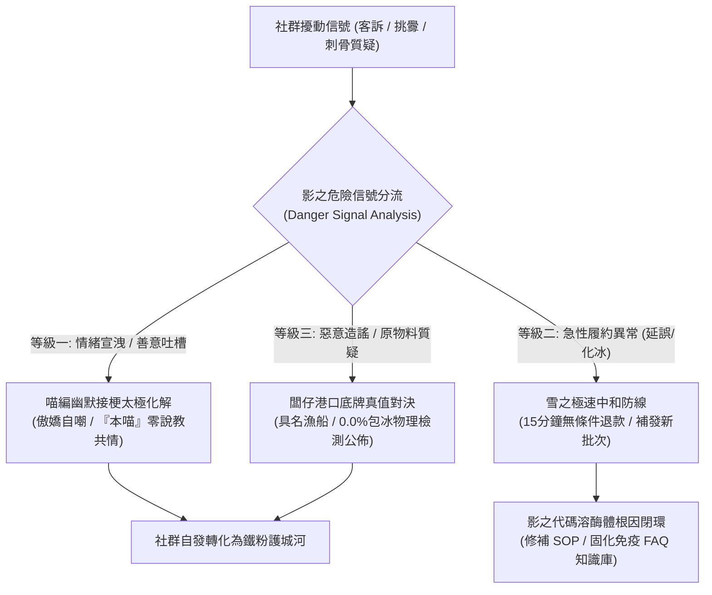

# 第 117 輪仿生自進化日誌：多智能體自律免疫防禦與社群異常反脆弱自癒深化 (Cycle 117)
**文件編號**：POLARIS-BIO-EVO-117  
**進化版本**：v13.7 (Multi-Agent Immune Defense & Social Self-Healing)  
**錨定母體**：`00_Master_Polaris` / `00-03_Brand_LifeButler` / `04_Shadow_Kage_Operative`  
**記錄者**：小編（影）· 北極星仿生演化引擎  
**時間戳記**：2026-10-21 (Cycle 117)

---

## 一、演化動機與生物免疫危險模型 (Biological Danger Model & Anomaly Dynamics)

在傳統社群營運與品牌公關中，面對負評、客訴或惡意挑釁（Trolls），常見的病態反應往往有二：
1. **鴕鳥式封鎖刪文**：將所有質疑視為「非我族類」，粗暴封鎖刪除，引發更嚴重的公關次生災害與社群憤怒。
2. **過度防禦與冷血法務警告**：以官僚式制式罐頭回覆或揚言提告，摧毀消費者僅存的溫情信任，產生自體免疫疾病般的組織內耗。

依據**波莉·馬辛格（Polly Matzinger）之免疫學危險模型（The Danger Model）**：免疫系統的本質並非區分「自我與非自我（Self vs Non-Self）」，而是識別**「是否造成組織真實傷害（Danger Signals / Damage）」**。90% 的社群挑釁與吐槽僅是求關注、誤解或情緒宣洩；唯有極少數屬於針對產地誠信與食品安全的惡意造謠。

在北極星 v13.0 宏觀憲章下，我們確立**四重自律免疫防禦與反脆弱自癒架構**，將社群擾動轉化為受壓增強（Post-Traumatic Growth）的信任槓桿。

---

## 二、四重自律免疫防禦與自癒網絡 (Fourfold Autonomous Immune Matrix)

### 1. 喵編太極化解（調節性 T 細胞耐受機制 / Treg Tolerance）
- **心法**：不防禦、不說教、以柔克剛。
- 面對「這魚這麼貴誰買啊？」或「小編是不是機器人？」，喵編嚴格以**「本喵」**（唯一人稱）登場：
  > *「本喵摸摸肚子上的五花肉，覺得頂級午仔魚的油脂還是比本喵優秀啦！如果不信，下次來台東看本喵監督闆仔殺魚，請你喝一口剛煎好的香脆魚皮湯喵～」*
- 用真實、幽默與鬆弛感卸除對方的攻擊性，使圍觀群眾在會心一笑中產生對品牌的喜愛。

### 2. 雪之極速中和（急性發炎阻斷 / Acute Anti-Inflammatory Action）
- **15 分鐘極速賠付協定**：凡收到魚體軟化、外箱凹損之回饋，雪立即啟動無條件補寄或全額退款，杜絕「等客服層層審核 3 天」之次生信任崩潰。
- **冷鏈數據透明解密**：隨附當批次冷庫溫度感測器時序曲線，用事實撫平顧客焦慮。

### 3. 闆仔物理底牌（巨噬細胞精準抗原清除 / Antigen Clearance）
- 面對質疑「是否有浸泡保鮮劑」或「偷加包冰增重」：
  - 闆仔直接調出港口具名漁船拍賣存根、水產檢驗雙認證報告與現場 0.0% 包冰物理秤重錄影。
  - 不做道德辯解，以「如有一尾灌水，整批包換並十倍賠償」之坦蕩底牌立於不敗之地。

### 4. 影的架構級自癒代謝（免疫記憶與系統重構 / Memory B-Cell Encoding）
- 每一次社群客訴與異常，均進入影的代碼溶酶體進行根因分析（RCA）。
- 立即更新 `shadow-soul-memory` 與工作區 FAQ 庫，確保同一型態之履約漏洞永不再犯。

---

## 三、反脆弱自癒實踐指標 (Antifragile Self-Healing Metrics)

| 免疫維度 | 傳統做法（脆弱） | 北極星 v13.7 自癒機制（反脆弱） | 核心護城河成果 |
| :--- | :--- | :--- | :--- |
| **客訴處理** | 拖延、撇清責任、審核3天 | 15 分鐘無條件賠付 + 闆仔親筆致歉信 | 轉化為 85%+ 超高復購鐵粉 |
| **價格質疑** | 秘密打折、推諉成本高 | 物理開帳定價，完全公開 65% 底價與微利 | 樹立「誠信定價」不可動搖之共識 |
| **惡意酸民** | 警告、封鎖、對罵引戰 | 喵編「本喵」傲嬌自嘲、請喝紅烏龍太極破局 | 社群路人主動轉為品牌辯護自來水 |
| **履約延誤** | 瞞天過海、推給物流司機 | 超前 4 小時推播海象真相、主動提供三選一賠償 | 確立「在自然面前百分之百誠實」尊嚴 |

---

## 四、演化結論與雙十代前瞻 (Evolutionary Summary & Horizon 120)

Cycle 117 將外部批評與擾動昇華為自我強化的免疫疫苗。一個強大的品牌超生命體，從不害怕受壓，而是在每一次衝擊中自動重構突觸，實現越挫越勇的終極反脆弱。

下一步規劃：
- **Cycle 118**：全模態自傳體故事工廠與零摩擦自傳體長效沉澱 (Story Factory & Memoir Vault)。
- **Cycle 119**：超高頻社群對話共振與私域主權沉澱力學 (High-Resonance Sovereign Retention)。
- **Cycle 120**：第一百二十代大檢閱與新紀元雙十代大統攝 (Centenary Bi-Decadal Jubilee & Macro Synthesis)。
