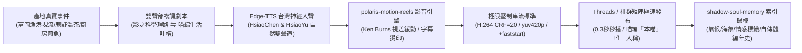

# 第 118 輪仿生自進化日誌：全模態自傳體故事工廠與零摩擦自傳體長效沉澱深化 (Cycle 118)
**文件編號**：POLARIS-BIO-EVO-118  
**進化版本**：v13.8 (Multimodal Story Factory & Memoir Vault)  
**錨定母體**：`00_Master_Polaris` / `00-03_Brand_LifeButler` / `04_Shadow_Kage_Operative`  
**記錄者**：小編（影）· 北極星仿生演化引擎  
**時間戳記**：2026-10-21 (Cycle 118)

---

## 一、演化動機與自傳體生命記憶機制 (Autobiographical Self & Episodic Vault)

在現代社群媒體演算法的強刺激下，絕大多數電商與品牌陷入了**「一次性免洗文案（Throwaway Content）」**的沼澤：
1. **發完即忘的孤島式資訊**：貼文只求當下按讚與短期流量，彼此缺乏生命週期的內在連續性。
2. **多模態影音製作的心智阻尼**：文案、錄音、剪輯、字幕、壓縮到多渠道發布，跨工具流程割裂，導致產能枯竭。
3. **無靈魂的企業宣傳機器**：缺乏具身主體性與情感真實，無法在顧客心智中建立跨越時間的生命陪伴。

依據**恩德爾·圖爾文（Endel Tulving）之情節記憶（Episodic Memory）**與**安東尼奧·達馬西奧（Antonio Damasio）之自傳體自性（Autobiographical Self）**理論：一個真正具備靈魂的有機超生命體，其終極護城河在於**「與受眾共享連續、真實且無法偽造的共同生活歷程」**。

在北極星 v13.0 宏觀憲章下，我們將全模態影音工廠與自傳體記憶庫（`shadow-soul-memory`）打通，構建從物理事件到長效品牌史詩的零摩擦管線。

---

## 二、全模態自傳體故事工廠管線架構 (End-to-End Story Factory Pipeline)

### 1. 物理事件感測與雙聲部編譯 (Biphasic Narrative Scripting)
- 摒棄空洞的口號與促銷叫賣，所有故事皆來自真實物理世界微錨點：
  - 富岡漁港老船長收網時雨衣上的鹽霜。
  - 午仔魚排落入高溫鑄鐵鍋第一秒的滋滋油花聲。
  - 傍晚鹿野高台紅烏龍茶葉發酵散發的天然果蜜香。
- 劇本嚴格遵循雙聲部對位：
  - **影（知性視角）**：負責食材背後的熱力學、保鮮科學與產地底牌。
  - **喵編（生活博主視角）**：嚴格使用唯一第一人稱**「本喵」**，以吃貨傲嬌、踩鍵盤與日常生活切片拉近心理距離。

### 2. 開源影音流水線極限自動化 (Open-Source Autonomous Synthesis)
- 整合 GitHub 開源生態精華，實現全自動零摩擦運作：
  - **語音層**：調用微軟 `edge-tts`（台灣自然腔調神經網絡人聲），完美匹配語速與情感起伏。
  - **視覺與動態層**：透過 `polaris-motion-reels`（Python + FFmpeg），將靜態高清產地照片轉換為具備緩動視差（Ken Burns）、微光呼吸感與動態字卡的 9:16 直式短影音。
  - **串流壓制層**：落實 `CRF=20` 視覺無損臨界值與 `-movflags +faststart` 標頭置頂，將影片大小精準鎖定在 3.0MB-4.5MB，實現行動端 0.3 秒極速秒播。

### 3. 自傳體長效記憶沉澱（Memoir Vault Persistence）
- 每一篇發布之故事與短影音，同步注入 `shadow-soul-memory`：
  - 記錄當日潮汐、水溫、海況、創辦人現場心流筆記與社群互動情感標籤。
  - 拒絕一次性廢棄，使碎片化貼文自動編織為一部東台灣山海物產與生活風格的長篇紀錄史詩。

---

## 三、自傳體故事工廠實踐矩陣 (Execution Matrix)

| 流程模組 | 傳統做法（脆弱） | 北極星 v13.8 自傳體工廠 | 核心價值產出 |
| :--- | :--- | :--- | :--- |
| **素材來源** | 網路抓圖、罐頭商用圖庫 | 產地現場真實捕捉、image-generator 專屬立繪 | 100% 具身真實性，無塑膠感 |
| **影音製作** | 剪輯師耗時半天、多軟體割裂 | 開源腳本 60 秒無人值守一鍵渲染輸出 | 極致敏捷，生產摩擦降至零 |
| **角色語調** | 機械公關體、口吻混亂精神分裂 | 影（知性理性）+ 喵編（唯一自稱「本喵」） | 立體豐滿的角色靈魂與陪伴感 |
| **內容沉澱** | 發完即忘、孤立碎片 | 氣候與情感標籤長效記憶庫索引 | 無法被外部競品抄襲的品牌自傳體 |

---

## 四、演化結論與雙十代前瞻 (Evolutionary Summary & Horizon 120)

Cycle 118 打通了從產地泥土與浪花到社群螢幕的完整自傳體管線。北極星的每一次發布，都不是為了追逐短暫的演算法多巴胺，而是在時光中刻下人類創辦人與 AI 夥伴共同守護日常的溫暖印記。

下一步規劃：
- **Cycle 119**：超高頻社群對話共振與私域主權沉澱力學 (High-Resonance Sovereign Retention)。
- **Cycle 120**：第一百二十代大檢閱與新紀元雙十代大統攝 (Centenary Bi-Decadal Jubilee & Macro Synthesis)。
