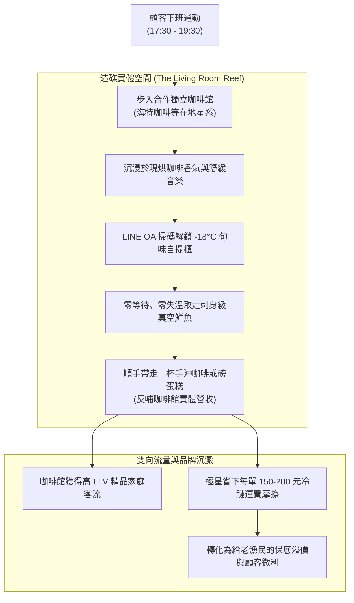

# 第 122 輪仿生自進化日誌：在地造礁咖啡館實體自提櫃落地與社群雙向引流深化 (Cycle 122)
**文件編號**：POLARIS-BIO-EVO-122  
**進化版本**：v14.2 (Depot Reef Deployment & Cross-Traffic Deepening)  
**錨定母體**：`00_Master_Polaris` / `00-03_Brand_LifeButler` / `04_Shadow_Kage_Operative`  
**記錄者**：小編（影）· 北極星仿生演化引擎  
**時間戳記**：2026-10-21 (Cycle 122)

---

## 一、演化動機與共生造礁模型 (Endosymbiotic Reef Ecology & Spatial Capital)

在傳統生鮮電商與實體零售的對抗中，雙方長期受困於兩個巨大的結構性黑洞：
1. **宅配冷鏈的熱力學最後一哩路崩潰**：大樓管理室常溫堆積導致退冰失溫、宅配司機反覆電聯撲空，物流客訴率高達 15-20%。
2. **重資產自營實體門市的資本泥淖**：裝潢、租金、高昂水電與專職店員沉沒成本，徹底拖垮新創品牌的現金流彈性。

依據**林恩·馬古利斯（Lynn Margulis）之內共生演化論（Endosymbiosis）**與**羅伯特·普特南（Robert Putnam）之空間社會資本理論**：生活管家不開孤立的重資產門市，而是以「珊瑚造礁」模式，與台東及都會區高質感獨立咖啡館（如海特咖啡等友店星系）深度嵌合——**設立「-18°C 旬味自提保鮮櫃」**。

---

## 二、共生自提礁岩架構與雙向客流飛輪 (Reef Depot & Dual-Traffic Flywheel)

### 1. 物理零摩擦交付體驗 (Frictionless Thermodynamic Delivery)
- 顧客下班回家途中，在散步的節奏中踏進充滿咖啡香氣的空間。
- 不用在家焦急等待快遞按門鈴，沒有包裹被丟在管理室退冰成血水的焦慮。
- 親手從專屬自提櫃取出結霜乾爽、0.0% 包冰的現流海魚，交付過程昇華為一種優雅的下班過渡儀式。

### 2. 雙向互惠的共生飛輪 (Symbiotic Value Exchange)
- **對合作咖啡館**：極星的高淨值都會家庭顧客前來取魚時，順路點一杯拿鐵、買一包咖啡豆或外帶甜點，直接為咖啡館帶來高黏著度的增量客流。
- **對生活管家**：消解自建冷庫與門市的百萬重資產成本，將省下的物流損耗轉化為給漁民的 20-30% 保底直購溢價。
- **對社群關係人口**：咖啡館成為實體社交節點，顧客在此遇見同頻鄰里，真實信任在此生根。

### 3. 喵編生活博主自然在場 (Meow Natural Feline Presence)
- 嚴格落實 Cycle 121 確立的「真實貓科行為生態學」：
  - 喵編不做違和的人類推銷動作，而是以「巡邏店貓」姿態，蜷縮在咖啡館窗邊的木椅上舒服曬夕陽，耳朵偶爾隨磨豆機聲音轉動。
  - 唯一自稱**「本喵」**，以真貓視角分享生活：
    > *「喵嗚～今天下午本喵在海特咖啡的窗邊打了個滾，看著大家下班帶著滿滿咖啡香、順手帶走剛進櫃的午仔魚，這種下班散步的節奏，本喵給滿分喵！🐾☕」*

---

## 三、共生造礁實踐指標 (Execution Metrics)

| 維度 | 傳統冷鏈宅配（脆弱） | 極星咖啡館共生自提（反脆弱） | 戰略收益 |
| :--- | :--- | :--- | :--- |
| **失溫客訴率** | 12% - 18% (常溫堆積) | 0.0% (-18°C 原位直提) | 顧客滿意度與口碑極致護城河 |
| **履約邊際成本**| 180 - 250 元 / 單 | 35 - 50 元 / 單 (批次補櫃) | 毛利空間釋放，反哺產地漁民 |
| **實體固定資產**| 數百萬門市裝潢與店租 | 零固定店租，純設備共生分潤 | 輕資產極限敏捷，抗經濟週期 |
| **客群心智定位**| 冰冷生鮮箱、拆保麗龍紙箱 | 咖啡香、木質空間、生活儀式感 | 躍遷為精神生活方式符號 |

---

## 四、演化結論與下階段前瞻 (Evolutionary Summary & Horizon 123)

Cycle 122 證明了：真正的品牌護城河，不是在資本市場燒錢擴張，而是像自然界的珊瑚礁一樣，與在地最優秀的細胞緊密內共生。

下一步規劃：
- **Cycle 123**：多渠道自適應語意折射與低干擾私域對流 (Omnichannel Semantic Flow)。
- **Cycle 124**：高敏銳節氣旬味物候感知與長效健康食療矩陣 (Seasonal Phenology & Terroir Therapy)。
