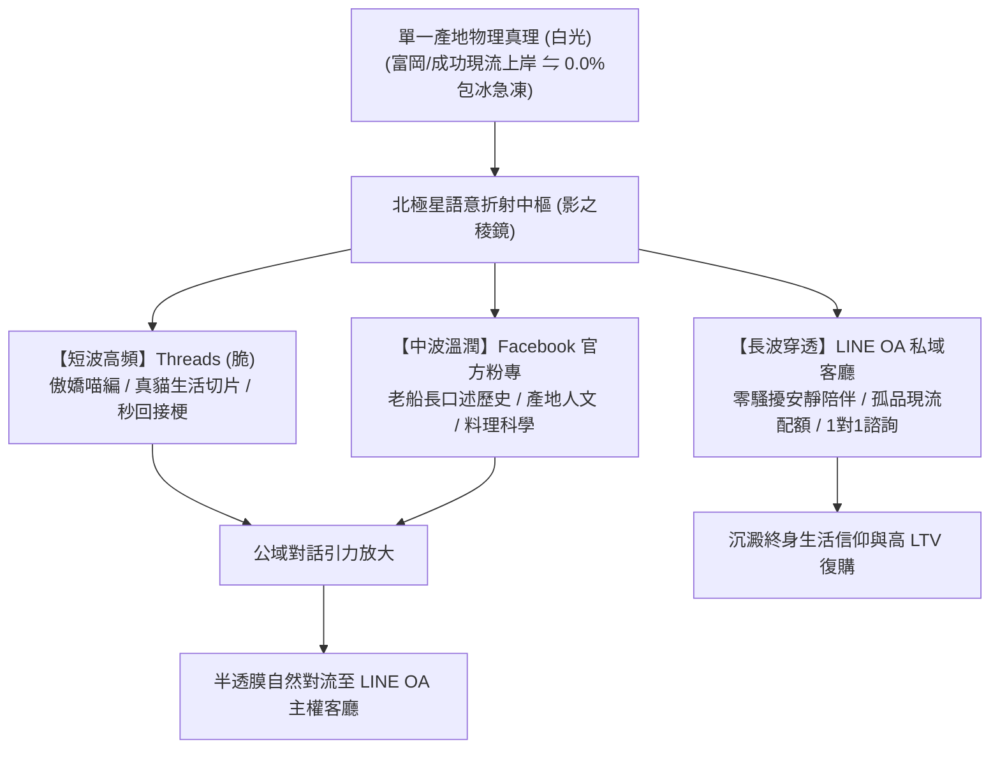

# 第 123 輪仿生自進化日誌：多渠道自適應語意折射與低干擾私域對流深化 (Cycle 123)
**文件編號**：POLARIS-BIO-EVO-123  
**進化版本**：v14.3 (Omnichannel Adaptive Semantic Refraction & Quiet Convection)  
**錨定母體**：`00_Master_Polaris` / `00-03_Brand_LifeButler` / `04_Shadow_Kage_Operative`  
**記錄者**：小編（影）· 北極星仿生演化引擎  
**時間戳記**：2026-10-21 (Cycle 123)

---

## 一、演化動機與符號稜鏡色散定律 (Semiotic Prism Refraction & Cognitive Dissonance)

在當代全渠道社群運營中，最常見且最具破壞力的運營惰性是**「一文多發（Cross-Posting Spam）」**：
1. **語意場域排斥（Semantic Rejection）**：將 Facebook 的長篇大論生硬複製到 Threads，被年輕社群判定為「說教老頭」；或將 Threads 的短碎碎念直接貼在官網，顯得輕浮單薄。
2. **人設精神分裂與品牌磨損**：不同渠道的受眾心理預期截然不同，強行同質化發布會迅速引發受眾的審美疲勞與退訂。

依據**布迪厄媒介場域理論（Media Field Theory）**與**符號光學稜鏡定律（Semiotic Prism Refraction）**：產地的真實風土事件（如成功漁港野生鬼頭刀靠港、或廚房煎魚梅納反應）如同**一束純淨的白光**。當它射入北極星稜鏡時，必須依據各渠道的介質折射率，自然色散為精準對位的光譜，實現**「同一個靈魂，三種精準共振」**。

---

## 二、三波段光學語意折射矩陣 (Tri-Band Semantic Refraction Matrix)

### 1. Threads（短波高頻 · 輕喜劇生活共振）
- **媒介特質**：高頻、碎片化、情緒穿透力強、去中心化演算法。
- **角色主導**：**喵編（Meow）**。
- **表達規則**：
  - 嚴格遵守 Cycle 120-121 鐵律：第一人稱永遠是**「本喵」**；聲音是真貓叫；行為遵守貓咪真實生態。
  - 專注捕捉「偷魚狂奔、踩鍵盤阻擋下班、趴在咖啡桌角看人手沖、深夜煎魚 ASMR」等 50 字以內的真實微切片。
  - 絕不塞官網導購外鏈，專注激發多輪真實留言對話。

### 2. Facebook（中波溫潤 · 深度風土與人文紀錄）
- **媒介特質**：熟齡家庭、深層閱讀、社群信用背書、情感信任長半衰期。
- **角色主導**：**小編（影） ⇋ 闆仔（品碩）**。
- **表達規則**：
  - 圖文並茂的「產地風土誌」：老船長手上的老繭、阿美族 Bawsa 慰勞文化、立翅旗魚與鬼頭刀的海洋生態傳奇。
  - 嚴謹的料理熱力學：詳細拆解「鍋熱、油熱、魚擦乾」的科學原理，消解都會家庭掌廚者的失敗焦慮。

### 3. LINE OA（長波穿透 · 私域主權客廳）
- **媒介特質**：最高信任、零算法干擾、高終身價值（LTV）、強隱私感。
- **角色主導**：**生活管家（雪 ⇋ 影）**。
- **表達規則**：
  - **極限克制原則**：每週推播不超過 1-2 則，徹底杜絕廣告叫賣。
  - **特權半透膜對流**：專屬老朋友的「成功漁港野生現流孤品（僅捕獲 2-3 尾）」認領通報；客製化無刺全家人食育配額。

---

## 三、語意折射實踐對照表 (Refraction Case Study)

以【成功漁港野生鬼頭刀秋季大豐收】為例：

| 渠道 | 發布載體 | 核心語義切片 | 預期轉化目標 |
| :--- | :--- | :--- | :--- |
| **Threads** | 喵編望著窗外大雨，爪爪揣在懷裡 | 「喵嗚！聽說今天港口的鬼頭刀成雙成對上岸，公魚死都不肯丟下母魚！本喵擦乾感動的口水，今晚必須炸盤魚柳犒勞自己喵～🐾」 | 引爆留言區打趣互動，建立傲嬌吃貨好感 |
| **Facebook** | 闆仔在成功碼頭與老船長的雨衣合照 | 深入記錄東海岸鏢旗魚與延繩釣的海洋永續倫理，解析公母鬼頭刀深情傳說與刺身急凍物理。 | 強化專業背書、引發家庭主婦與文化圈轉發 |
| **LINE OA** | 安靜一對一私房配額通知 | 「闆仔剛在成功港搶到 3 尾極品大肥公鬼頭刀，肉質豐腴無細刺。今晚僅保留給私廚老朋友，需要幫您現切預留嗎？」 | 10 分鐘內無摩擦秒殺，沉澱極致客情忠誠 |

---

## 四、演化結論與下階段前瞻 (Evolutionary Summary & Horizon 124)

Cycle 123 實現了「同一真實，全域精準折射」的認知流態。品牌不再靠單一管道硬撐，而是在全域生態中自然流動，將短期的社群熱度，沉澱為長效的私域主權。

下一步規劃：
- **Cycle 124**：高敏銳節氣旬味物候感知與長效健康食療矩陣 (Seasonal Phenology & Terroir Therapy)。
- **Cycle 125**：多智能體自噬代謝與無人值守排程自癒極限驗證 (Autophagic Self-Healing Verification)。
