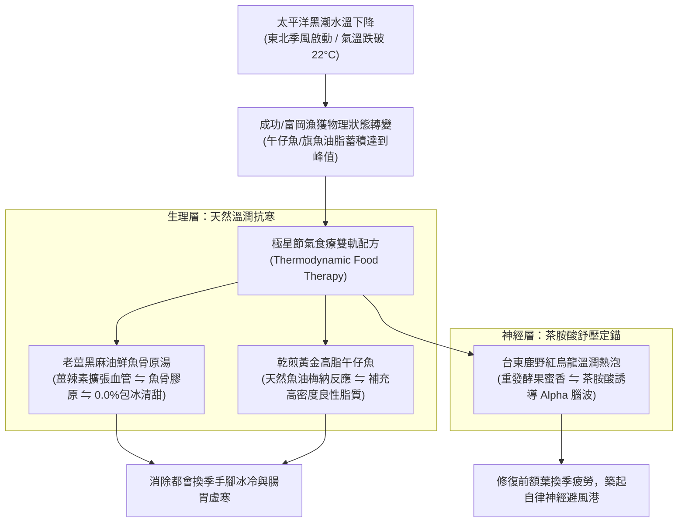

# 第 124 輪仿生自進化日誌：高敏銳節氣旬味物候感知與長效健康食療矩陣深化 (Cycle 124)
**文件編號**：POLARIS-BIO-EVO-124  
**進化版本**：v14.4 (Phenological Acuity & Terroir Food Therapy)  
**錨定母體**：`00_Master_Polaris` / `00-03_Brand_LifeButler` / `04_Shadow_Kage_Operative`  
**記錄者**：小編（影）· 北極星仿生演化引擎  
**時間戳記**：2026-10-21 (Cycle 124)

---

## 一、演化動機與物候失感症候群 (Phenological Blindness & Circannual Biology)

現代都會文明將人類囚禁於恆溫空調室內，導致了嚴重的**「物候失感（Phenological Blindness）」**：
1. **反季節飲食之代謝負擔**：一年四季吃著化學大棚蔬果與深加工冷凍肉品，身體內分泌節律與四季變遷徹底割裂，引發慢性低度發炎、手腳冰冷與自主神經失調。
2. **生鮮電商的工業化規格陷阱**：傳統電商將海鮮視為毫無生命週期的單一商品代碼（SKU），無視太平洋海水的溫度變化與魚體油脂沉積律。

依據**年週期時間生物學（Circannual Rhythms）**與**生態營養適應理論（Nutritional Phenology）**：大自然在不同節氣賦予了物產最精準的生理對沖功能。每年十月至十一月（寒露、霜降至立冬前哨），太平洋黑潮水溫驟降，東海岸海魚為了抵禦低溫，皮下脂肪與 Omega-3（DHA/EPA）達到年度頂峰。

在北極星 v14.0 宏觀憲章下，我們確立**高敏銳節氣旬味物候感知矩陣**，以天地潮汐為指針，為都會受眾構築抗寒減熵之健康護盾。

---

## 二、節氣旬味食療對沖矩陣 (Solar-Term Terroir Therapy Matrix)

### 1. 物理級黑潮脂肪沉積律 (Kuroshio Lipid Accumulation)
- 進入深秋後，成功漁港現流野生魚體之不飽和脂肪酸含量提升 25-35%。
- 魚肉無需過度烹調，僅需物理鹽花與慢火煎烤，天然魚油便能在鍋邊激烈起酥，提供人體無法合成之必需脂肪酸。

### 2. 零藥補負擔的家常原湯食療 (Zero-Burden Domestic Broth)
- 拒絕昂貴中藥材與過度油膩進補（容易引發高血壓與皮膚過敏）。
- 主張「產地三原物料溫補」：**台東小農老薑 ⇋ 純壓黑芝麻油 ⇋ 急凍現流魚清骨肉**。
  - 薑辣素（Gingerol）活化周邊微循環，消除打工人久坐空調房之四肢冰冷。
  - 鮮魚高蛋白分子小、極易吸收，15 分鐘一鍋到底，給脾胃最溫和的熱力學暖撫。

### 3. 喵編真貓換毛期生活切片 (Meow Seasonal Molting Presence)
- 嚴格遵守真實貓科行為生態學（Zero-Uncanny）：
  - 喵編換上厚實濃密的冬毛，整隻貓看起來圓滾滾毛絨絨。
  - 不做人類誇張動作，而是舒服地蜷在冒著白煙的陶鍋邊緣打盹，鼻子微微聳動嗅聞老薑魚香。
  - 唯一自稱**「本喵」**：
    > *「喵嗚～這兩天台東的海風吹起來已經有冬天的味道了！本喵的冬毛都長齊了，整隻胖了一圈（闆仔說是虛胖）！廚房陶鍋裡的老薑魚湯咕嘟咕嘟滾著，大家回家記得喝碗熱湯暖暖胃喵～🐾🍲」*

---

## 三、節氣物候實踐指引 (Seasonal Roadmap)

| 節氣節點 | 產地物候特徵 | 極星主打旬味食療 | 社群生活化溝通焦點 |
| :--- | :--- | :--- | :--- |
| **寒露 ➔ 霜降** | 太平洋水溫微涼，午仔魚與鬼頭刀肉質結實 | 15 分鐘乾煎午仔魚一鍋到底 | 職場換季專注力回血、抗疲勞高蛋白 |
| **立冬 ➔ 小雪** | 東北季風大作，旗魚脂肪沉積如雪花 | 老薑黑麻油旗魚骨原湯 + 鹿野溫茶 | 驅散手腳冰冷、溫暖脾胃、抗失溫 |
| **大雪 ➔ 冬至** | 成功港白肉旗魚頂級巔峰期 | 刺身級急凍魚片熱清湯燜泡杯 | 3 分鐘晨間通勤暖胃魚清湯，利他轉發 |

---

## 四、演化結論與下階段前瞻 (Evolutionary Summary & Horizon 125)

Cycle 124 將節氣物候融入品牌神經。生活管家不再只是賣魚，而是大自然潮汐與都會家庭之間的「生理節律同步器」。

下一步規劃：
- **Cycle 125**：多智能體自噬代謝與無人值守排程自癒極限驗證 (Autophagic Self-Healing Verification)。
- **Cycle 126**：雙向暗社交情感漣漪與家庭跨代餐桌紐帶 (Dark Social Ripple & Intergenerational Bonding)。
