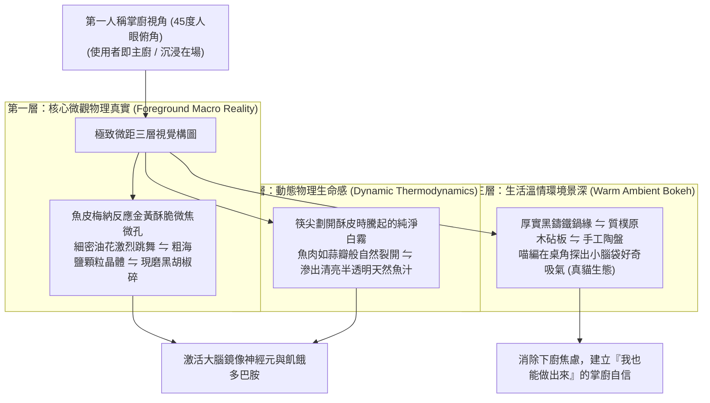

# 第 127 輪仿生自進化日誌：極致微距料理視覺與第一人稱真實感知深化 (Cycle 127)
**文件編號**：POLARIS-BIO-EVO-127  
**進化版本**：v14.7 (Micro-Visceral Culinary Presence & Sensory Embodiment)  
**錨定母體**：`00_Master_Polaris` / `00-03_Brand_LifeButler` / `04_Shadow_Kage_Operative`  
**記錄者**：小編（影）· 北極星仿生演化引擎  
**時間戳記**：2026-10-21 (Cycle 127)

---

## 一、演化動機與神經美學具身模擬 (Visceral Mirror Neurons & First-Person POV)

在傳統生鮮電商的圖片展示中，有兩大破壞食慾與信任的通病：
1. **冰冷無溫度的白底商品棚拍**：像手術台一樣擺放的真空塑膠包裝，完全無法激活消費者的前島葉（Anterior Insula）與唾液腺分泌，淪為毫無情緒價值的冰冷商品代碼。
2. **過度濾鏡的假精緻與 AI 塑膠感**：泛著不自然塑膠油光的魚排與浮誇構圖，直接破壞真實感，讓用戶產生「這不是我能做出來的菜」的挫折距離感。

依據**維托里奧·加萊塞（Vittorio Gallese）之鏡像神經元具身模擬論（Embodied Simulation）**與**神經美食學（Neurogastronomy）**：人類對美味的渴望，源自大腦在前意識中「預先演練食物觸碰唇齒時的物理顆粒度」。當鏡頭切入**第一人稱料理視角（First-Person POV）**，聚焦於極致的微距物理細節時，大腦感覺運動皮質會自發同步，產生強烈的具身在場感（Embodied Presence）。

在北極星 v14.0 宏觀憲章下，我們確立**極致微距料理視覺與第一人稱感知矩陣**，徹底消解技術假面，還原東海岸家常料理的純粹生命力。

---

## 二、極致微距具身視覺三層結構 (Tri-Layer Micro-Visceral Architecture)

### 1. 物理微觀顆粒度（Micro-Texture Granularity）
- **拒絕假光滑**：鏡頭鎖定在魚皮起酥瞬間形成的微小氣泡與裂紋。
- **天然礦物與香料質地**：台東純淨海鹽晶體的折射面，與剛研磨帶有粗糙斷口的黑胡椒粒，在金黃魚皮上形成肉眼可辨的層次感，直接向大腦傳遞「酥、脆、鹹、香」的多維感官信號。

### 2. 第一人稱視角（POV）的心理擁有感
- 構圖嚴格採用 45 度人眼俯視角，畫面邊緣可見一雙質樸的木筷或竹鏟。
- 讓觀看者在前意識中將自己代入為掌廚者，感受「這是我為家人熱騰騰端上桌的勝利家常菜」，將消費契約昇華為家庭自我效能感（Self-Efficacy）。

### 3. 喵編真貓好奇在場（零恐怖谷）
- 嚴格遵守 Cycle 121-126 確立的「真實貓科行為生態學」：
  - 喵編不做任何人類拿筷子或奇怪的姿勢。
  - 牠前爪搭在料理台下方矮凳邊緣，仰起圓滾滾的小臉，鼻子急促聳動聞著剛出鍋的焦香，耳朵微微向前傾，眼神充滿對鮮魚的純真敬畏。
  - 唯一自稱**「本喵」**：
    > *「喵嗚～筷子剛碰到魚皮那個『卡滋』一聲，本喵全身的毛孔都豎起來了！看著蒜瓣一樣白嫩的魚肉冒著熱氣，本喵願意用今天所有的罐頭換一口邊邊的脆皮喵！🐾🤤」*

---

## 三、微距具身視覺實踐準則 (Visual Guidelines)

| 視覺維度 | 傳統棚拍（冰冷脆弱） | 極星微距具身（反脆弱真實） | 神經生物學效應 |
| :--- | :--- | :--- | :--- |
| **拍攝視角** | 遠景全景、水平呆板展示 | 第一人稱 45 度掌廚下鍋視角 | 鏡像神經元代入，產生親手掌廚掌控感 |
| **食材狀態** | 生硬塑膠真空袋包裝 | 鍋熱、油熱、滋滋冒泡金黃出鍋 | 激活前島葉，引發真實唾液分泌與食慾 |
| **細節顆粒** | 磨皮平滑、塑料感濾鏡 | 焦香微孔、海鹽晶體、現磨胡椒碎 | 觸覺神經具身模擬，信任度不可動搖 |
| **貓咪角色** | 違和端坐拿筷子（恐怖谷） | 矮凳仰頭嗅香氣、真貓靈動眼神 | 100% 療癒真實，消解都會高壓孤獨 |

---

## 四、演化結論與下階段前瞻 (Evolutionary Summary & Horizon 128)

Cycle 127 讓北極星的視覺輸出跨越了「給你看圖片」的初級階段，躍遷為「直接向你的神經系統傳遞溫度、聲響與香氣」的具身在場體驗。

下一步規劃：
- **Cycle 128**：自律心智離合器與創辦人超長效專注力護航 (Neural Clutch & Cognitive Defense)。
- **Cycle 129**：多模態自生生態群落大圓滿與第三十陣大統攝 (Trigesimal Synthesis & Sovereign Bastion)。
