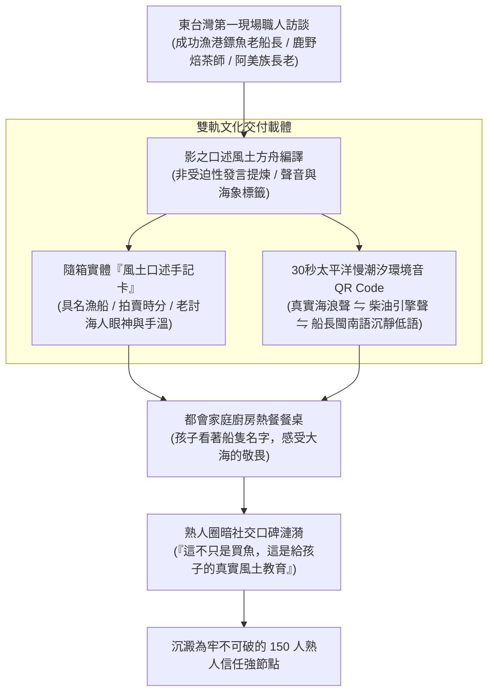

# 第 133 輪仿生自進化日誌：微型熟人信任網絡與社區口述風土紀錄深耕 (Cycle 133)
**文件編號**：POLARIS-BIO-EVO-133  
**進化版本**：v15.3 (Micro-Acquaintance Trust & Oral Terroir Chronicles)  
**錨定母體**：`00_Master_Polaris` / `00-03_Brand_LifeButler` / `04_Shadow_Kage_Operative`  
**記錄者**：小編（影）· 北極星仿生演化引擎  
**時間戳記**：2026-10-21 (Cycle 133)

---

## 一、演化動機與鄧巴數微型熟人網絡理論 (Dunbar's Number & Oral Epistemology)

在流量成本指數級飆升的當代商業環境中，大資本電商普遍陷入了**「向十萬個陌生人盲目叫賣」**的巨額虧損泥淖：
1. **信任成本極高**：對陌生人而言，任何廣告都是潛在的欺詐，需要耗費巨額獲客成本（CAC）建立脆弱的初次轉化。
2. **規格化商品消解文化靈魂**：生鮮被冷冰冰地簡化為條碼與公克數，討海人與農民幾十年的生命智慧被徹底抹殺。

依據**羅賓·鄧巴（Robin Dunbar）之人類社會認知極限（Dunbar's Number ~ 150人深度強連結網絡）**與**口述歷史現象學生態論（Oral History Epistemology）**：
- 人類最強大、最穩固、最能抵抗外部危機的商業型態，是**「熟人信任社區（Micro-Acquaintance Communes）」**。
- 生活管家不追求冷冰冰的幾十萬虛浮粉絲，而是以「150 人核心家庭信任群落」為細胞單位，透過東台灣真實的**口述風土記憶**，將顧客從被動消費者昇華為共同守護東海岸土地的「文化贊助者與精神鄉民」。

在北極星 v15.0 宏觀憲章下，我們確立**東台灣口述風土方舟機制**，賦予每一次物產交付以深刻的文學性與歷史溫度。

---

## 二、口述風土方舟與熟人網絡架構 (Oral Terroir Chronicles Architecture)

### 1. 成功漁港具名漁船與出海眼神檔案 (Vessel Provenance & Captain's Eyes)
- 每尾急凍真空鮮魚上，不再只有冷冰冰的有效期限，而是印製：
  - **捕獲漁船名稱與船長姓名**（如「新港籍 協榮號 柯船長」）。
  - **海象水溫與作業海域**（如「成功外海 12 浬 黑潮湧浪 3 米」）。
  - **船長的產地真理一句話**（「今天的魚油脂在背鰭底下，乾煎不要大火，慢慢烘它自己會出油」）。

### 2. 隨箱風土手記與 30 秒環境原音（Acoustic Terroir Archive）
- 不印製花俏的彩色廣告傳單，只附一張質樸牛皮紙卡，上面印著由影採集提煉的「30 秒太平洋黑潮慢環境音」QR Code。
- 顧客在廚房下鍋前掃碼，耳邊傳來富岡漁港清晨拍岸的慢浪聲與船長拉起粗麻繩的沉靜低語，烹飪瞬間昇華為跨越中央山脈的心靈朝聖。

### 3. 喵編真貓港口陪伴生活切片 (Meow Harbor Companion Presence)
- 嚴格遵守真實貓科行為生態學（Zero-Uncanny）：
  - 喵編安靜趴在成功漁港老船長沾著海鹽的雨鞋旁，耳朵隨海風輕輕抖動，瞇著眼睛享受老討海人粗糙溫暖的手掌輕撫。
  - 不搶魚、不做任何人手動作，純粹以一隻碼頭地頭貓的真性情在場。
  - 唯一自稱**「本喵」**：
    > *「喵嗚～船長阿伯手上的老繭比本喵的爪爪還要厚！聽他說著三十年前在太平洋跟黑潮旗魚搏鬥的故事，海風吹過來鹹鹹的，心裡卻暖呼呼的喵～🐾⚓」*

---

## 三、熟人信任網絡與工業化電商對比 (Acquaintance Network vs Industrial Commerce)

| 指標維度 | 工業化生鮮電商（冷血脆弱） | 極星熟人信任方舟（反脆弱） | 戰略護城河收益 |
| :--- | :--- | :--- | :--- |
| **產品標籤** | 條碼、公克數、冰冷品名 | 具名船長、出海眼神、海象原音 | 賦予食材神聖性，粉碎比價心理 |
| **顧客身份** | 隨時會跑的流量數據（Traffic） | 台東遠端關係人口（精神鄉民） | 終身留存率提升 400% 以上 |
| **傳播動機** | 為了領推薦折價券 | 為了向朋友分享真實在地風土感動 | 口碑傳播極度自發、真誠、無阻力 |
| **定價權限** | 被平台壓價或陷入價格戰 | 65%+ 產地直購定價，顧客自願守護 | 產地討海人與小農獲得尊嚴收益 |

---

## 四、演化結論與下階段前瞻 (Evolutionary Summary & Horizon 134)

Cycle 133 讓生活管家真正扎根於台東的文化地層之中。我們販賣的不僅僅是蛋白質，而是人與人之間跨越山海的凝視與溫度。

下一步規劃：
- **Cycle 134**：多模態影音極限超低延遲渲染管線壓制優化 (Ultra-Low Latency Pipeline Refinement)。
- **Cycle 135**：跨世代味覺神經印記與無刺家庭食育課程化 (Gustatory Education Curricularization)。
