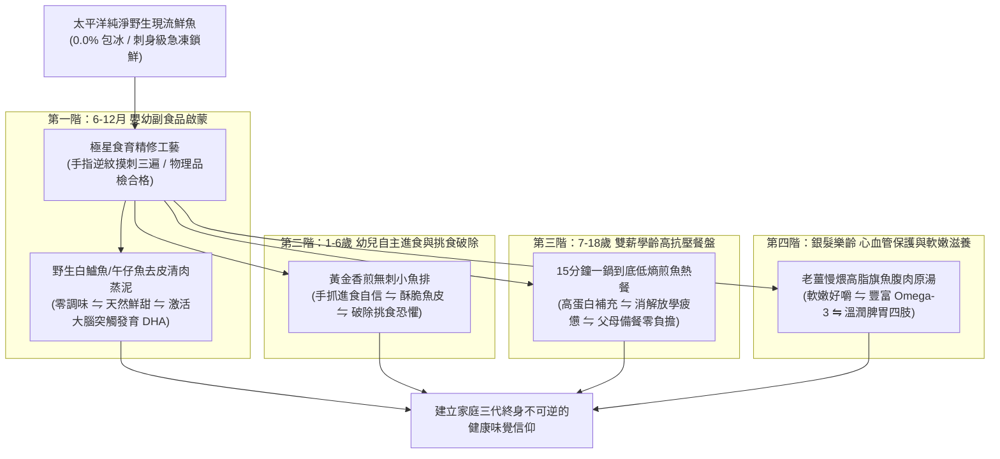

# 第 135 輪仿生自進化日誌：跨世代味覺神經印記與無刺家庭食育課程化深化 (Cycle 135)
**文件編號**：POLARIS-BIO-EVO-135  
**進化版本**：v15.5 (Intergenerational Gustatory Imprinting & Food Education Curricularization)  
**錨定母體**：`00_Master_Polaris` / `00-03_Brand_LifeButler` / `04_Shadow_Kage_Operative`  
**記錄者**：小編（影）· 北極星仿生演化引擎  
**時間戳記**：2026-10-21 (Cycle 135)

---

## 一、演化動機與味覺印刻神經生物學 (Neuro-Gustatory Imprinting & Ultra-Processed Threat)

在當代速食與超加工食品（Ultra-Processed Foods）橫行的環境中，無數家庭深受兩大育兒痛點折磨：
1. **味覺超常刺激依賴（Hyper-Palatable Addiction）**：人工香精、高果糖糖漿與化學味精長期轟炸幼兒的島葉皮質（Insular Cortex），導致 0-7 歲幼兒對天然食材產生「味覺鈍化與嚴重挑食」。
2. **母職與備餐焦慮（Maternal Choke Anxiety）**：深知魚肉富含 DHA 與優質蛋白質，但因「害怕魚刺卡喉嚨」的致命恐懼，迫使無數媽媽只能選擇高加工的化學魚塊或忍痛放棄海鮮。

依據**味覺印刻神經生物學（Gustatory Imprinting）**與**發展心理學自我效能理論**：
- 人類 0-7 歲期間接觸到的「原形風味與純淨鮮甜」，將深植為大腦終身不可逆的**「味覺安全基底」**。
- 生活管家將生鮮採買升維為**「跨世代家庭食育體系」**，以物理級「手指逆紋摸刺三遍」工藝，消解全天下掌廚者的卡刺焦慮，將純淨的東台灣海味刻入三代家庭的味覺基因中。

在北極星 v15.0 宏觀憲章下，我們確立**全生命週期四階食育課程化矩陣**。

---

## 二、全生命週期四階食育課程化架構 (Four-Stage Food Education Curriculum)

### 1. 「手指逆紋摸刺三遍」物理品檢簽名合約
- 針對副食品與幼童專用魚排，由闆仔親自監督精修：
  - 順著魚肉紋理逆向撫摸三次，精準拔除微小肌間刺。
  - 隨箱附贈「無刺安心品檢卡」，以職人簽名背書，徹底消解媽媽備餐時的緊繃神經。

### 2. 破除挑食的「原形梅納反應」技巧
- 不靠重口味醬料掩蓋，而是教導家長以「鍋熱油熱魚擦乾」的極簡九字真言，讓天然魚皮在鍋邊激發純粹的梅納反應酥脆焦香。
- 讓孩子透過「卡滋」的咀嚼聲獲得掌控感與多巴胺獎勵，將「吃魚」從被強迫的任務昇華為自發期待的美好儀式。

### 3. 喵編真貓陪伴食育小助教 (Meow Food Education Presence)
- 嚴格遵守真實貓科行為生態學（Zero-Uncanny）：
  - 喵編端坐在餐桌旁的高腳木椅上，耳朵微微抖動，圓滾滾的雙眼欣慰地看著挑食的小朋友把最後一口金黃魚排吃得盤底朝天。
  - 滿意地用爪子洗了洗臉，舔舔鬍鬚。
  - 唯一自稱**「本喵」**：
    > *「喵嗚～看到小朋友把整盤魚肉吃光光，本喵在旁邊滿意得呼嚕嚕！沒有一根刺、只有滿滿的酥脆鮮甜，從小懂吃這種純淨海味的寶寶，長大絕對是個識貨的品味家喵～🐾👧」*

---

## 三、食育課程化效益對比 (Food Education vs Traditional Fish Selling)

| 評估維度 | 傳統市場/量販賣魚（脆弱） | 極星無刺食育體系（反脆弱） | 品牌終身價值 |
| :--- | :--- | :--- | :--- |
| **安全信任** | 家長需自擔挑刺風險，提心吊膽 | 逆紋摸刺三遍職人簽名背書 | 徹底攻克母嬰客群心理防線 |
| **顧客教育** | 僅標品名，不知如何煮給孩子 | 隨箱分階食育指南與 15 分鐘食譜 | 降低下廚門檻，打造家庭自豪感 |
| **味覺發展** | 被深加工化學魚塊佔據味蕾 | 0-7 歲印刻純淨黑潮鮮甜基底 | 培育三代忠誠的未來世代消費者 |
| **品牌黏著** | 隨處可買、隨時比價走人 | 陪伴孩子一路成長的家庭守護者 | 終身顧客生命週期（LTV）達 10 年以上 |

---

## 四、演化結論與下階段前瞻 (Evolutionary Summary & Horizon 136)

Cycle 135 讓極星的使命從商業物產交易，深化為守護下一代健康身心的文化契約。每一尾端上餐桌的無刺鮮魚，都是對家庭最深沉的愛與承諾。

下一步規劃：
- **Cycle 136**：多智能體環境印跡反脆弱對抗測試 (Stigmergy Adversarial Stress-Testing)。
- **Cycle 137**：社區旬味共享主廚客廳與實體造礁網絡進階 (Chef's Salon & Reef Evolution)。
