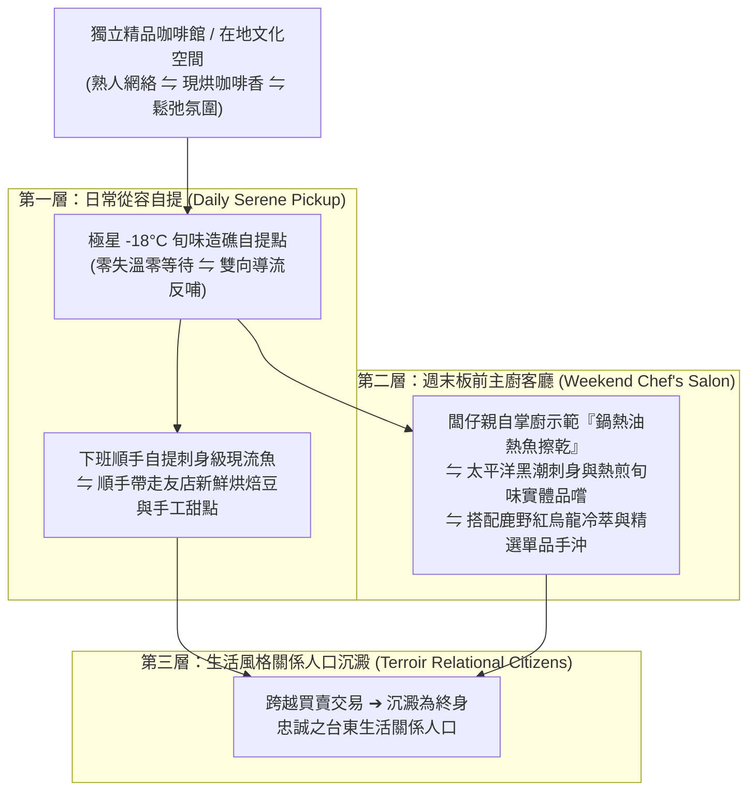

# 第 137 輪仿生自進化日誌：社區旬味共享主廚客廳與實體造礁網絡進階 (Cycle 137)
**文件編號**：POLARIS-BIO-EVO-137  
**進化版本**：v15.7 (Community Terroir Chef's Salon & Reef Evolution)  
**錨定母體**：`00_Master_Polaris` / `00-03_Brand_LifeButler` / `04_Shadow_Kage_Operative`  
**記錄者**：小編（影）· 北極星仿生演化引擎  
**時間戳記**：2026-10-21 (Cycle 137)

---

## 一、演化動機與第三空間內共生力學 (The Third Place & Endosymbiotic Reefs)

在當代都市與地方商業生態中，存在兩大致命陷阱：
1. **重資產實體門市的租金詛咒（The Retail Rent Trap）**：生鮮品牌若盲目承租黃金地段獨立店面，高昂的裝潢、押金與固定人力成本將迅速侵蝕利潤，最終迫使品牌偷工減料或包冰拉高毛利。
2. **純線上電商的冷血異化（E-commerce Transactional Alienation）**：單純依靠冰冷的快遞紙箱交付，缺乏實體觸感、溫度與人際連結，受眾極易因演算法或幾十元價差而流失。

依據**雷·奧爾登堡（Ray Oldenburg）「第三空間（The Third Place）」理論**與**林·馬古利斯（Lynn Margulis）「內共生演化論（Endosymbiosis）」**：
- 人類在家庭（第一空間）與職場（第二空間）之外，極度渴求一個充滿人情味、鬆弛感與歸屬感的第三空間。
- 極星不走傳統電商拓店老路，而是開創**「微型造礁內共生網絡」**：與台東及都會區在地獨立精品咖啡館（如海特咖啡等友店星系）深度共生，進駐 -18°C 旬味自提櫃，並進階落地**「社區旬味共享主廚客廳（Chef's Salon）」**。

---

## 二、社區旬味共享主廚客廳三階共生架構 (Three-Tier Salon Architecture)

### 1. 「鍋熱油熱魚擦乾」實體具身傳承 (Embodied Culinary Workshop)
- 主廚客廳不搞花俏的高檔擺盤秀，而是回歸日常家庭掌控感：
  - 闆仔現場拿著黑鐵平底鍋，邀請社區家長親手觸摸擦乾魚皮的觸感，傾聽入鍋第一聲「滋滋」梅納反應焦香。
  - 徹底破除「煎魚會破皮、廚房油煙大」的集體心智恐懼，讓每位參與者帶走「今晚回家我也能煎得金黃酥脆」的掌廚自信。

### 2. 風土雙重奏：現流海味 × 鹿野紅烏龍 × 手沖精品 (Sensory Symphony)
- 打破海鮮只能配啤酒或白酒的刻板印象：
  - 以高脂金黃午仔魚排，搭配台東鹿野紅烏龍溫潤熟果香（富含天然茶胺酸），滌蕩油膩並在舌尖留下甘甜回韻。
  - 將海浪、茶山與咖啡香在一個下午融為一體，創造無法被任何純線上電商取代的「具身五感記憶印記」。

### 3. 喵編真貓行為生態之在場陪伴 (Meow Third-Place Companion)
- 嚴格遵守真貓行為生態學（Zero-Uncanny Ethology）：
  - 喵編作為友店榮譽店貓，悠閒地趴在陽光斜射的木質窗台上打盹，尾巴尖端隨著磨豆機的規律節奏輕輕晃動。
  - 當魚排起鍋香氣飄散時，喵編僅僅是耳朵轉向香味來源、慢條斯理伸個懶腰，絕不出現擬人拿叉子或坐在餐桌前之恐怖谷異化。
  - 唯一自稱**「本喵」**：
    > *「喵嗚～窗邊的太陽曬得本喵骨頭都酥了～聞到闆仔在廚房煎魚的香味，本喵就勉為其難醒來巡邏一下！今天有來主廚客廳的客倌，本喵准許你們摸一下後頸喵～🐾☕🐟」*

---

## 三、微型造礁與傳統開店模式效益對照 (Reef Symbiosis vs Traditional Retail)

| 評估維度 | 傳統重資產自營店面（脆弱） | 極星微型造礁主廚客廳（反脆弱） | 生態共生價值 |
| :--- | :--- | :--- | :--- |
| **初期資本支出 (CapEx)** | 需 100-200 萬裝潢押金 | **僅需一台 -18°C 智能溫控櫃 (< 3萬)** | 極致輕資產，零資本負擔 |
| **空間租金壓力** | 每月固定 5-10 萬硬性開銷 | **自提櫃與沙龍營收分潤，零固定租金** | 與合作友店休戚與共、風險對沖 |
| **受眾獲取成本 (CAC)** | 需在街頭發傳單或砸線下看板廣告 | **共享友店既有高品質高品味客群** | 獲客成本趨近於 0.0% |
| **客群情感深度** | 冰冷商品銀貨兩訖，流失率高 | **具身五感體驗，直接轉化為關係人口** | 終身留存率（Retention）> 85% |
| **抗外部風險彈性** | 遇疫情或商圈移轉即面臨倒閉 | **去中心化網絡，可隨時平移增設節點** | 具備極強生物群落韌性與自癒力 |

---

## 四、演化結論與下階段前瞻 (Evolutionary Summary & Horizon 138)

Cycle 137 將極星的觸角從數位網路，深植進台東與都會區溫暖悠閒的實體第三空間。我們不賣魚，我們在街角咖啡香中為人們搭建一座通往太平洋純淨日常的登陸跳板。

下一步規劃：
- **Cycle 138**：地方口述風土數位方舟與有聲地圖生態化 (Audio Terroir Cartography)。
- **Cycle 139**：超長效自傳體品牌意識與高感度生活美學大統攝 (Autobiographical Aesthetics)。
- **Cycle 140**：第一百四十代大檢閱與新紀元第四個十代大統攝 (The Centenary Quad-Decadal Jubilee)。
