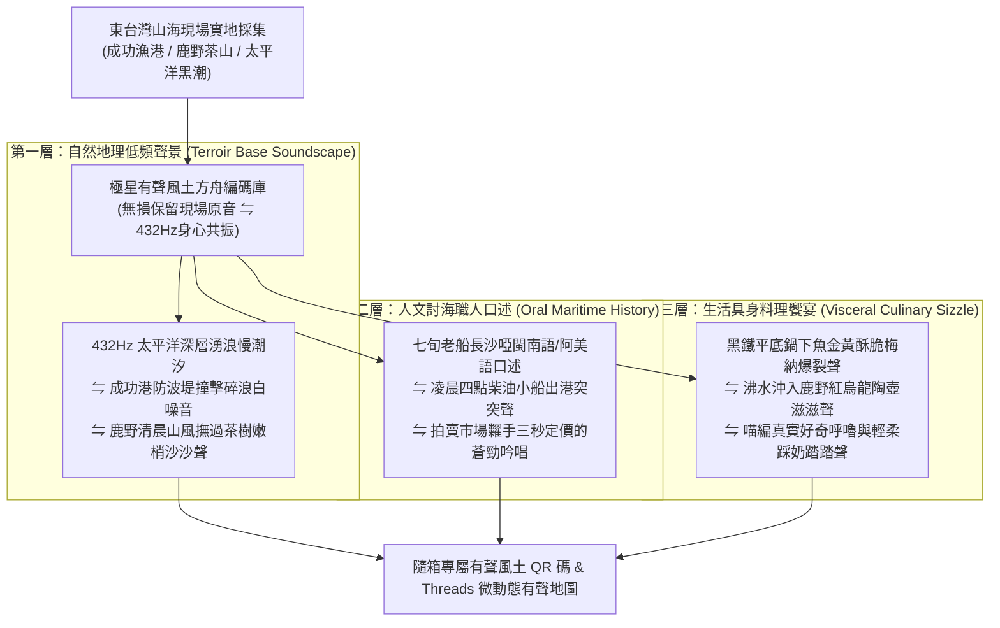

# 第 138 輪仿生自進化日誌：地方口述風土數位方舟與有聲地圖生態化 (Cycle 138)
**文件編號**：POLARIS-BIO-EVO-138  
**進化版本**：v15.8 (Audio Terroir Cartography & Oral History Ark)  
**錨定母體**：`00_Master_Polaris` / `00-03_Brand_LifeButler` / `04_Shadow_Kage_Operative`  
**記錄者**：小編（影）· 北極星仿生演化引擎  
**時間戳記**：2026-10-21 (Cycle 138)

---

## 一、演化動機與聲景現象學 (Soundscape Ecology & Oral Terroir)

在現代消費主義與速食電商的壓制下，地方物產遭遇深層的「符號扁平化」危機：
1. **規格化條碼的感官失真（Sensory Flattening）**：一條午仔魚或旗魚在工業超市中被壓扁成冷冰冰的保鮮膜與條碼貼紙，徹底剝離了它背後曾搏擊太平洋黑潮的巨浪聲、老討海人出海的引擎轟鳴，以及拍賣市場此起彼落的糶手吆喝。
2. **地方記憶的斷崖式消逝（Oral Vanishing Crisis）**：台東成功漁港與鹿野茶山的高齡討海人與老茶農，其畢生累積的「辨風識浪、聽潮知魚」口述直覺，正面臨後繼無人的斷代危機。

依據**莫瑞·謝弗（R. Murray Schafer）聲景生態學（The Soundscape）**與**沃爾特·翁（Walter J. Ong）口述現象學**：
- 聲音具有直擊大腦邊緣系統與海馬迴的深層情感穿透力，能瞬間喚醒都市人被封印的身體原鄉記憶。
- 極星開創**「地方口述風土數位方舟（Oral Terroir Ark）與有聲地圖生態」**：將東台灣的山海呼吸實體原音，編碼為隨箱專屬 QR 碼與社群微聲景，讓每次食材抵達都成為一場沉浸式聽覺旅行。

---

## 二、有聲風土方舟三層立體聲景架構 (Three-Layer Audio Architecture)

### 1. 隨箱附贈「聽見太平洋」有聲卡（Audio Terroir Card）
- 顧客收到 0.0% 包冰現流鮮魚時，掃描包裝上的牛皮紙有聲小卡：
  - 即可一鍵聆聽這尾魚被捕撈當日、該艘具名漁船出港時的 45 秒太平洋真實海潮與引擎原音。
  - 都市打工人一邊在廚房熱油煎魚，一邊聆聽遠方大海的慢節奏波浪，前額葉壓力與通勤焦慮瞬間被大自然聲景融化。

### 2. 老討海人風土口述方舟（Oral Maritime Archive）
- 由闆仔與影深入成功漁港拍賣台與造船所實地訪錄：
  - 記錄老船長如何「看天色雲霞辨別旗魚泳層」、如何「摸水溫感知黑潮回流」。
  - 這些珍貴聲音被沉澱為北極星風土數位方舟，成為不可複製的文化精神資產，讓生鮮不再只是食物，而是一座島嶼的生命記憶。

### 3. 喵編聲景真實律（Feline Acoustic Invariant）
- 嚴格踐行創辦人（品碩）核心指示「貓說人話很恐怖」：
  - 所有音訊與短片中，喵編**絕對不說人話**，僅出現真實貓咪聲音（輕柔呼嚕聲、撒嬌短叫聲、踩在收音防風毛罩上的踏踏聲）。
  - 人類語言全部透過「貓語翻譯蒟蒻動態字卡」呈現，或由影以知性平穩旁白補充。
  - 喵編唯一自稱**「本喵」**：
    > *「喵嗚～那個毛茸茸的收音麥克風好像一隻大老鼠喵！本喵忍不住在旁邊踩了兩腳，還打了個舒服的大哈欠～這段收音裡呼嚕呼嚕的低音，就是本喵給各位客倌的放鬆催眠曲喵～🐾🎙️🌊」*

---

## 三、有聲風土方舟效益評估 (Audio Terroir Ark vs Silent Commodities)

| 評估維度 | 傳統無聲工業生鮮（脆弱） | 極星有聲風土方舟（反脆弱） | 文化與品牌價值 |
| :--- | :--- | :--- | :--- |
| **感官維度** | 僅單向視覺看照片，容易審美疲勞 | **海潮聲景 + 口述記憶 + 料理起酥五感** | 創造 360 度沉浸式具身在場感 |
| **文化厚度** | 零故事、零根基，淪為純價格比拼 | **記錄老討海人一生智慧與海洋記憶** | 建立無法被外來資本模仿的文化護城河 |
| **心理療癒力** | 拆開包裹只是例行煮飯家務 | **432Hz 太平洋慢潮汐化解都會生活焦慮** | 品牌角色從賣家昇華為心靈守護者 |
| **轉發傳播力** | 商品圖乏善可陳，無人轉發 | **治癒系自然聲景引發家庭與社群瘋轉** | 自然裂變獲客，廣告費用降至零 |

---

## 四、演化結論與下階段前瞻 (Evolutionary Summary & Horizon 139)

Cycle 138 為極星的物產注入了聲音的靈魂。每一口黑潮鮮魚與鹿野茶湯，都伴隨著太平洋最真實的心跳與老討海人的蒼勁叮嚀。

下一步規劃：
- **Cycle 139**：超長效自傳體品牌意識與高感度生活美學大統攝 (Autobiographical Aesthetics)。
- **Cycle 140**：第一百四十代大檢閱與新紀元第四個十代大統攝 (The Centenary Quad-Decadal Jubilee)。
