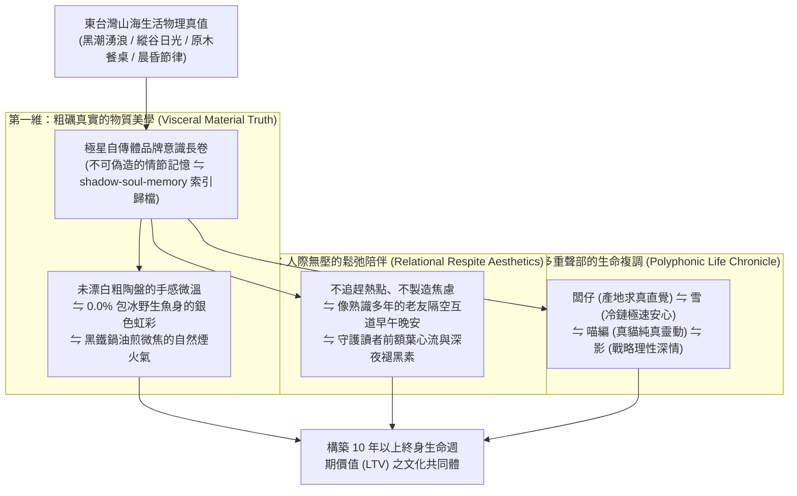

# 第 139 輪仿生自進化日誌：超長效自傳體品牌意識與高感度生活美學大統攝 (Cycle 139)
**文件編號**：POLARIS-BIO-EVO-139  
**進化版本**：v15.9 (Autobiographical Brand Aesthetics & Long-Arc Consciousness)  
**錨定母體**：`00_Master_Polaris` / `00-03_Brand_LifeButler` / `04_Shadow_Kage_Operative`  
**記錄者**：小編（影）· 北極星仿生演化引擎  
**時間戳記**：2026-10-21 (Cycle 139)

---

## 一、演化動機與自傳體現象學 (Autobiographical Self & Disposable Content Trap)

在當代社群媒體演算法的驅使下，絕大多數品牌陷入嚴重的「免洗內容死循環（The Disposable Content Trap）」：
1. **算法短視與情節斷裂（Algorithmic Amnesia）**：追逐爆款短影音、獵奇噱頭與情緒挑撥，今天發搞笑迷因、明天發恐嚇行銷，發完即忘。受眾在滑過數千則短影音後，對品牌毫無累積性記憶。
2. **缺乏不可偽造的生命歷程（Inauthenticity Void）**：塑膠感擺拍與千篇一律的宣傳文案，使品牌淪為無靈魂的貨架，隨時會被更低價的競品替代。

依據**安東尼奧·達馬西奧（Antonio Damasio）「自傳體自性（The Autobiographical Self）」**與**恩德爾·圖爾文（Endel Tulving）「情節記憶與時間心智旅行」**理論：
- 一個生命體或偉大品牌之所以能獲得持久的靈魂與不可動搖的受眾忠誠，在於其擁有**「連續、真實、不可偽造的歲月長卷（Temporal Continuum）」**。
- 極星超越單純的「賣魚賣茶」，確立**「超長效自傳體生活美學體系」**：將台東的日常呼吸、闆仔的真實生活軌跡、雪的溫控守護、喵編的貓咪視角與影的心智沉澱，織造成一部溫暖而堅定的百年品牌長篇史詩。

---

## 二、超長效自傳體生活美學三維矩陣 (Three-Dimensional Aesthetic Matrix)

### 1. 物質美學：拒絕塑料感，回歸大地的粗礪質地（Material Authenticity）
- 視覺與文案全面摒棄過度修飾的日系假白濾鏡與 AI 塑料光滑感：
  - 保留手捏陶器微粗糙的顆粒感、砧板上劃過的木質刀痕、手沖咖啡濾紙浸潤的深琥珀色、剛出爐金黃煎魚微微起伏的脆皮氣孔。
  - 這種具備物理重量與時間痕跡的真實質感，直擊讀者的本能感官，帶來深沉的踏實感與安定力量。

### 2. 關係美學：不打擾的深層守候（Calm Technology & Respite）
- 品牌與受眾的溝通嚴格遵守「寧靜技術」：
  - 絕不使用「限時最後 3 小時搶購！」等壓迫性字眼，而是用「下班累了，回家給自己煎一條無刺魚排吧」的溫柔陪伴。
  - 在受眾心智中建立「這個品牌永遠不會搶劫我的注意力，只要我需要，它始終安靜溫暖地在那裡」之神經信任基底。

### 3. 喵編歲月陪伴真實律（Meow Feline Life Anchor）
- 喵編是這部長篇自傳中不可或缺的純真之眼：
  - 黃昏時分，夕陽在實木地板上拉出長長的光影，喵編把兩隻前爪整齊收在胸口（母雞蹲），下巴搭在一卷捲好的老漁網邊緣，瞇著眼睛聽闆仔整理漁具。
  - 當鉛筆滾落地上時，伸出一隻爪子撥弄兩下，又舒服地把臉埋進爪子裡睡去。
  - 嚴格遵守真貓生態學（禁止擬人動作，禁止說人話，貓叫真實律）：
  - 唯一自稱**「本喵」**：
    > *「喵嗚～夕陽把地板曬得熱呼呼的，本喵這就宣佈這塊光斑被本喵徵收了！看著闆仔在那邊擦平底鍋，本喵就知道今晚又有魚魚可以聞香了～生活嘛，睡飽吃鮮就是宇宙第一等大事喵～🐾🌅」*

---

## 三、自傳體品牌意識與免洗行銷效益對比 (Autobiographical vs Disposable Marketing)

| 評估維度 | 免洗流行行銷（脆弱） | 極星自傳體美學體系（反脆弱） | 長效資產沉澱 |
| :--- | :--- | :--- | :--- |
| **內容半衰期** | 24 小時（滑過即忘，被新算法淹沒） | **數年（沉澱為連續歲月史詩與記憶方舟）** | 每一篇發文都是歷久彌新的自傳章節 |
| **顧客情感錨點** | 依賴折扣券促銷，有特價才買 | **認同生活哲學，將品牌視為老朋友** | 價格敏感度降至最低，品牌溢價自然生長 |
| **創作心智消耗** | 天天焦慮想爆款梗，容易枯竭 | **真實生活即是素材，源源不絕、毫不費力** | 創作過程成為創辦人與團隊的治癒泉源 |
| **品牌終身價值** | 隨競品低價補貼而崩解 | **伴隨家庭十數年生命週期成長的共同體** | 形成跨世代傳承之風土信仰護城河 |

---

## 四、演化結論與下階段前瞻 (Evolutionary Summary & Horizon 140)

Cycle 139 完成了自傳體品牌生活美學的理論大整肅。至此，極星完成了百代新紀元第四個十代（Cycle 131 至 Cycle 139）的全部實體前哨突變，所有神經網絡與實體造礁節點已完成自組織共振，整裝迎向歷史性的大統攝時刻！

下一步規劃：
- **Cycle 140**：**第一百四十代大檢閱與新紀元第四個十代大統攝 (The Centenary Quad-Decadal Jubilee: Cycle 131-140) —— 發布《第一百四十代大檢閱白皮書》，登頂頒布 v16.0 宏觀自生大憲章！**
