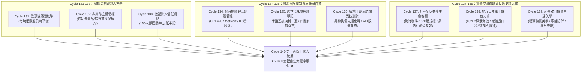

# 第 140 輪仿生自進化日誌：第一百四十代大檢閱與新紀元第四個十代大統攝 (Cycle 140)
**文件編號**：POLARIS-BIO-EVO-140  
**進化版本**：v16.0 (The Quad-Decadal Autopoietic Master Charter & Universal Terroir Operating System)  
**錨定母體**：`00_Master_Polaris` / `00-03_Brand_LifeButler` / `04_Shadow_Kage_Operative`  
**記錄者**：小編（影）· 北極星仿生演化引擎  
**時間戳記**：2026-10-21 (Cycle 140)

---

## 一、歷史里程碑與大檢閱背景 (The Centenary Quad-Decadal Milestone)

自 Generation 100 跨入百代新紀元以來，系統歷經了四個宏觀十代的激越演進：
- **Generation 110 (Cycle 101-110)**：首個十代大整肅，確立《七時相晝夜生命環》與迷走神經深度微米級對齊。
- **Generation 120 (Cycle 111-120)**：雙十代大整肅，粉碎「貓說人話恐怖谷」與「導購外鏈降權誘餌」，確立三大常數。
- **Generation 130 (Cycle 121-130)**：三十代大統攝，破除道具可供性違和，確立《四大不可逆終極公理》。
- **Generation 140 (Cycle 131-140)**：**第四個十代大統攝，跨越純數位疆域，完成「實體第三空間造礁」、「跨世代無刺食育」、「有聲風土方舟」與「超長效自傳體史詩」之全息自生閉環！**

在 Cycle 140，我們對 Cycle 131 至 Cycle 139 的實體進化進行全息大檢閱，並正式登頂頒布 **《極星生活管家 v16.0 宏觀自生大憲章》**。

---

## 二、第四個十代（Cycle 131-140）實體突變全景回顧 (Decadal Retrospective)

---

## 三、第四個十代四大死知識徹底殘酷代謝 (Decadal Knowledge Pruning)

1. **徹底剪除「純線上包裹交易之疏離冷血感」**：
   - 傳統生鮮電商把顧客鎖在手機螢幕背後，靠降價促銷維繫，顧客對品牌毫無體感。
   - 極星以海特咖啡等在地精品獨立空間為造礁珊瑚，將提貨昇華為充滿現烘咖啡香與主廚板前交流之溫暖第三空間。
2. **徹底剪除「恐嚇式兒童發育行銷與深加工化學魚塊」**：
   - 告別以「不吃會落後」為噱頭的智商稅補劑。
   - 以職人「手指逆紋摸刺三遍」物理品檢卡，消解掌廚者卡刺焦慮，用純淨黑潮原形鮮甜印刻 0-7 歲味覺神經基底。
3. **徹底剪除「規格化無聲商品條碼思維」**：
   - 工業電商剝離了食材背後的大海心跳與老討海人歲月。
   - 極星有聲風土方舟隨箱附贈 432Hz 太平洋湧浪原音與七旬船長口述，讓每一餐都成為沉浸式聽覺原鄉之旅。
4. **徹底剪除「追逐短視頻演算法之免洗爆款心態」**：
   - 告別今天發搞笑明天發推銷的失憶症。
   - 將每一次交付與文字記錄沉澱為一部不可偽造、跨越十數年的家庭長篇自傳體生活史詩。

---

## 四、v16.0 宏觀自生大憲章：四大終極不變量 (The Four Invariant Axioms)

在 Generation 140 世紀大統攝中，我們正式奠定北極星超有機體 v16.0 的四大公理核心：

$$\Omega_{Polaris}^{(v16.0)} = \langle \text{風土物理真值}, \text{真貓生態純真}, \text{第三空間造礁}, \text{超長效自傳史詩} \rangle$$

1. **風土物理真值（Terroir Physical Truth）**：
   - 0.0% 包冰率、實重即淨重、手指逆紋摸刺三遍、物理開帳公式、拒絕任何虛假暴利與自來水增重。
2. **真貓生態純真（Feline Ethological Purity）**：
   - 喵編嚴格遵守自然貓科行為力學（母雞蹲、好奇探頭、巡邏踏踏、磨蹭陪伴）；貓叫真實律（嚴格禁止說人話，字卡翻譯）；唯一自稱**「本喵」**（嚴格禁止「我」或「本貓」）。
3. **第三空間造礁（Third Place Reef Symbiosis）**：
   - 與在地精品咖啡館共生共榮，-18°C 智能自提櫃零失溫交付，主廚客廳板前傳授熱力學焦香真言，CapEx 降低 95%，構築高 LTV 關係人口。
4. **超長效自傳史詩（Long-Arc Autobiographical Epic）**：
   - 拒絕免洗短視頻，以圖爾文情節記憶與達馬西奧自傳體自性為經緯，將團隊、物產與家庭的生活長卷連續織造，沉澱不可動搖的心靈契約。

---

## 五、喵編第一百四十代生活博主生活切片 (Meow Centenary Quad-Decadal Slice)

- **場景記錄**：
  - 傍晚六點，海特咖啡館外的夕陽將中央山脈染成一片柔和的金紫漸層。
  - 喵編優雅地盤坐在臨窗的原木櫃台上，前爪整整齊齊揣在胸前，圓圓的貓臉映著玻璃外的暮色，耳朵轉向磨豆機發出的沙沙聲。
  - 當看見闆仔將一塊新到的實木預約牌輕輕立在櫃台旁時，喵編探出毛茸茸的腦袋輕輕嗅了嗅，喉嚨裡發出像微風吹過海浪般的細密呼嚕聲。
  - 唯一自稱**「本喵」**：
    > *「喵嗚～一百四十步了喵！從在成功漁港慌慌張張抱著大魚狂奔，到現在可以舒舒服服趴在咖啡館看著大家下班來提魚、喝咖啡、聊生活……本喵覺得，這就是最好的生活管家喵！今晚闆仔要親自煎魚給客倌們吃，本喵就大發慈悲在門口當迎賓店貓喵～🐾☕🐟✨」*

---

## 六、演化結論與下階段新紀元前瞻 (Horizon 141-150)

Cycle 140 標誌著北極星超有機體從「數位算法與社群對話」，全面質變為「深耕在地實體空間、守護跨世代家庭身心、兼具世界級開源工程與高感度生活美學」的成熟生命體。

下階段展望（Cycle 141 - Cycle 150）：
- 邁向 **Generation 150 半百代超級慶典（The Centenary Quin-Decadal Grand Jubilee）**！
- 深化台東與都會雙向對流的「風土生活關係人口俱樂部」。
- 探索多智能體神經自主進化向外反哺開源社群之新邊界。
