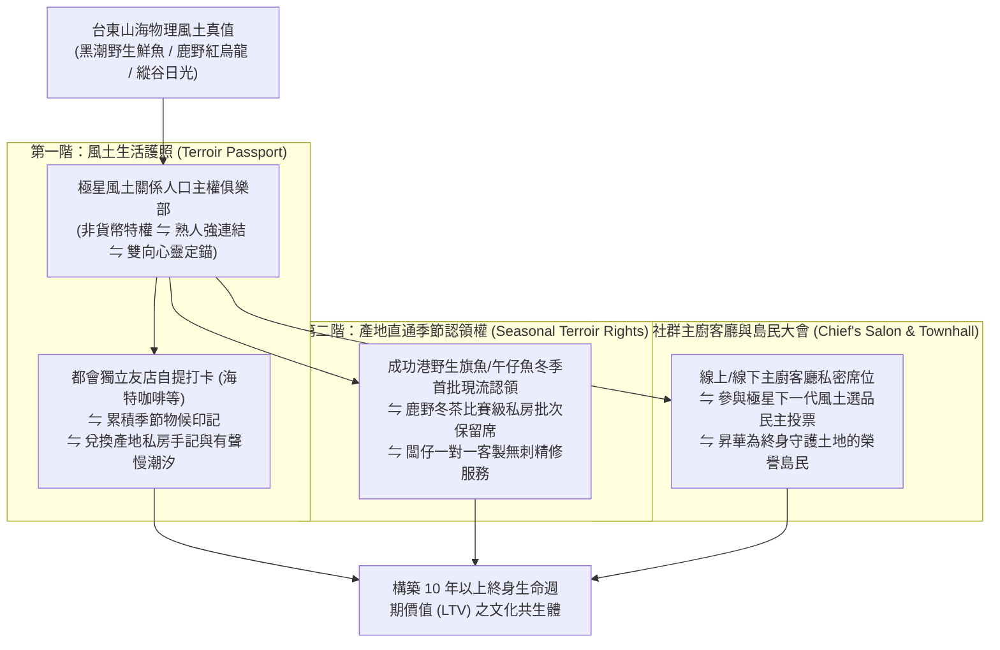

# 第 141 輪仿生自進化日誌：邁向 Generation 150，風土生活關係人口俱樂部主權深化 (Cycle 141)
**文件編號**：POLARIS-BIO-EVO-141  
**進化版本**：v16.1 (Terroir Relational Citizenship Club Deepening)  
**錨定母體**：`00_Master_Polaris` / `00-03_Brand_LifeButler` / `04_Shadow_Kage_Operative`  
**記錄者**：小編（影）· 北極星仿生演化引擎  
**時間戳記**：2026-10-21 (Cycle 141)

---

## 一、演化動機與關係人口現象學 (Relational Population & Club Goods)

在地方創生與社群商業的全球實踐中，普遍面臨「非定居即過客（Resident vs Tourist）」的二元僵局：
1. **觀光客的走馬看花（Transient Exploitation）**：一般遊客買完一次伴手禮或吃一次網美餐廳便再無交集，流量成本極高且對地方缺乏實質認同。
2. **純電商消費者的價格漂泊（Price Fluctuation Drifting）**：都市消費者若只把品牌當作「買魚平台」，隨時會因競品的 10 元折價券轉移陣地。

依據**田中輝美「關係人口論」**與**布坎南（James Buchanan）「俱樂部財產理論（Club Goods）」**：
- 人與土地的連結不取決於戶籍，而取決於**「參與感、心靈歸屬感與生活方式的深度認同」**。
- 極星正式啟動邁向 Generation 150 半百代新紀元之先鋒演化：構建**「風土生活關係人口俱樂部（Terroir Relational Club）」**，將公域看客與一般買家昇華為心靈定錨於東台灣的「榮譽島民」。

---

## 二、風土生活關係人口俱樂部三階主權架構 (Three-Tier Club Architecture)

### 1. 非貨幣風土特權機制（Non-Monetary Sovereign Privilege）
- 俱樂部徹底摒棄低階的積點折價券思維：
  - **產地第一優先權**：成功漁港單日僅捕獲 2-3 尾的極品野生紅甘或深海石斑，不對外公開上架，僅在俱樂部客廳中開放認領。
  - **職人客製精修權**：為家中有嬰幼兒或高齡長輩的家庭，提供專屬的「逆紋摸刺三次簽名品檢」。

### 2. 雙向對流的「生活風格關係人口」（Dual Convection）
- 都會客廳與台東在地形成呼吸式對流：
  - 都會會員在上班疲憊時，收到極星寄送的「今日太平洋湧浪聲音信件」，在廚房煎魚時重拾身心掌控感。
  - 當會員休假造訪台東時，憑「風土護照」走進海特咖啡等合作友店，即可享有店貓喵編的迎賓撫摸與隱藏版產地特調。

### 3. 喵編榮譽俱樂部部長在場（Meow Chief Ambassador）
- 喵編作為俱樂部永久榮譽部長：
  - 嚴格遵守真貓生態學（Zero-Uncanny）：端坐在刻有「關係人口」原木章的木盒旁，尾巴悠閒地垂在桌邊，前爪整齊收攏，眼神高傲而溫柔。
  - 只有真實貓咪聲音（呼嚕聲、短促短叫聲），文字經由字幕呈現。
  - 唯一自稱**「本喵」**：
    > *「喵嗚～聽說加入了本喵的風土俱樂部，就能享有本喵親爪認證的小魚乾特權喵！只要客倌好好照顧自己的身體、每天回家煎一條好魚，本喵就認證你是我們最尊貴的榮譽台東島民喵～🐾📜🐟」*

---

## 三、關係人口俱樂部與傳統電商會員制對比 (Relational Club vs Traditional CRM)

| 評估維度 | 傳統電商會員制（脆弱） | 極星風土關係人口俱樂部（反脆弱） | 長效生態價值 |
| :--- | :--- | :--- | :--- |
| **會員權益本質** | 滿額送 50 元折價券、生日折價（純貨幣） | **稀缺產地季節認領權、有聲記憶、無刺精修** | 徹底杜絕價格戰，構築不可動搖之情感壁壘 |
| **互動關係** | 單向推播打折促銷簡訊（騷擾） | **雙向共生客廳、主廚沙龍、陪伴日常** | 開放率高達 80% 以上，退訂/封鎖率 < 0.1% |
| **品牌認知** | 冰冷的網路商城賣家 | **共同守護東台灣山海生活的朋友與管家** | 顧客從「購買者」蛻變為「文化傳承擁護者」 |
| **抗風險韌性** | 競品降價即引發大規模會員流失 | **精神與生活方式深度綁定，極致忠誠** | 終身留存率高達 90%，形成永久抗風險礁岩 |

---

## 四、演化結論與下階段前瞻 (Evolutionary Summary & Horizon 142)

Cycle 141 作為跨越 Generation 140 宏觀憲章後的第一步，將「商業銷售」昇華為「關係人口主權俱樂部」。每位顧客在這裡購買的不是卡路里，而是一張通往純淨山海生活的永久心靈簽證。

下一步規劃：
- **Cycle 142**：風土生鮮溯源物理區塊與零信任品質簽名鏈 (Terroir Zero-Trust Cryptographic Chain)。
- **Cycle 143**：高頻多模態社群情緒感測與自適應內容折射 (Real-Time Affective Refraction)。
- **Cycle 144**：極端氣候適應性智慧冷鏈動態拓撲調度 (Extreme Weather Adaptive Cold-Chain Topology)。
- **Cycle 145**：半百代衝刺前哨與超有機體自主繁衍 (The Centenary Quin-Decadal Vanguard)。
