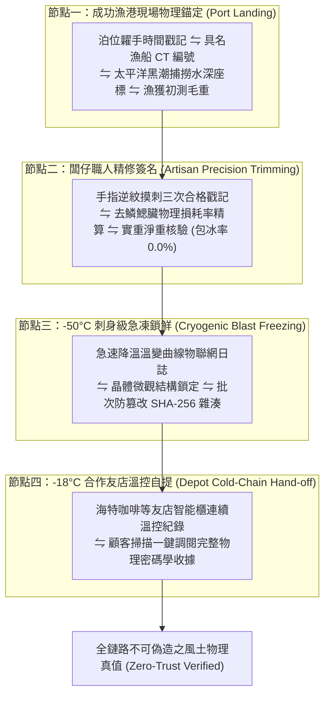

# 第 142 輪仿生自進化日誌：風土生鮮溯源物理區塊與零信任品質簽名鏈 (Cycle 142)
**文件編號**：POLARIS-BIO-EVO-142  
**進化版本**：v16.2 (Terroir Zero-Trust Physical Signature Chain)  
**錨定母體**：`00_Master_Polaris` / `00-03_Brand_LifeButler` / `04_Shadow_Kage_Operative`  
**記錄者**：小編（影）· 北極星仿生演化引擎  
**時間戳記**：2026-10-21 (Cycle 142)

---

## 一、演化動機與零信任溯源現象學 (Zero-Trust Architecture & Food Authenticity)

在傳統生鮮食品供應鏈中，「產銷履歷（Traceability）」普遍淪為形同虛設的官僚形式主義：
1. **靜態網頁與偽造漏洞（Static Label Vulnerability）**：市面上無數 QR 碼掃出來僅是一頁通用的行銷文案或靜態公版照片，缺乏批次真實性，無法證明盤中魚肉究竟是哪天、哪艘船、在哪個海域捕撈。
2. **斷鏈與偷斤減兩的灰色黑洞（Cold-Chain & Weight Black Box）**：中間盤商常溫轉運、解凍後重新包冰 30% 注入自來水，消費者毫無技術手段驗證是否失溫或被灌水。

依據 **NIST SP 800-207 零信任架構（Zero-Trust Architecture: "Never Trust, Always Verify"）** 與 **物理不可偽造功能（Physical Unclonable Functions, PUFs）**：
- 真正的食品安全不應建立在對「權威口頭背書」的盲目信任，而應建立在**「無法篡改的物理硬鏈與密碼學簽名鏈條（Cryptographic Hash Chains）」**之上。
- 極星開創**「風土零信任物理品質簽名鏈」**：從成功漁港泊位、闆仔摸刺精修、-50°C 急凍到 -18°C 友店自提，每一步皆錨定物理測量真值。

---

## 二、風土零信任物理簽名鏈四階閉環 (Four-Tier Cryptographic Architecture)

### 1. 物理密碼學收據（Cryptographic Terroir Receipt）
- 顧客掃描包裝上的專屬 QR 碼，呈現的不是空洞的廣告詞，而是一張**「物理真值硬核清單」**：
  - **船籍港口**：台東成功漁港，新港籍「昇吉利號 (CT3-XXXX)」，捕撈水深 85-120 米。
  - **摸刺認證**：闆仔親手檢驗編號、逆紋撫摸三次無刺簽名。
  - **秤重數據**：精修前 480g ➔ 精修後淨肉 320g，0.0% 包冰率物理簽章。
  - **冷鏈曲線**：自 -50°C 急凍室至海特咖啡 -18°C 櫃位的完整溫度歷史。

### 2. 徹底消解資訊不對稱與檸檬市場（Lemon Market Inversion）
- 任何競品想打價格戰，只要拉出「包冰率」與「溫控日誌」兩項物理指標對決，其灌水增重與斷鏈劣勢立即原形畢露。
- 生活管家將誠信從一種「道德要求」昇華為可被代碼與物理定律嚴格驗證的「技術壁壘」。

### 3. 喵編零信任查帳貓在場（Meow Zero-Trust Inspector）
- 喵編嚴格遵守真實貓科行為生態學（Zero-Uncanny）：
  - 闆仔在電子秤前精修魚肉時，喵編端坐在工作台旁邊的木凳上，兩隻前爪併攏，小腦袋隨著電子秤上閃爍的綠色數字上下微動，一臉嚴肅地監督「有沒有缺斤短兩」。
  - 湊近剛從急凍室拿出來的真空袋，用粉嫩的小鼻子嗅了嗅散發出來的冰涼新鮮氣息，滿意地用尾巴尖端拍了拍木凳。
  - 只有真實貓咪嗅聞、呼嚕與甩尾，嚴禁擬人動作或說人話。
  - 唯一自稱**「本喵」**：
    > *「喵嗚～電子秤上的數字定住了喵！320.0 克，連一滴水都沒有多算，本喵親爪監督合格喵！誰敢在魚魚裡面灌自來水，本喵第一個伸爪抗議喵～🐾⚖️🐟」*

---

## 三、零信任物理簽名鏈與傳統溯源對照 (Zero-Trust vs Traditional Traceability)

| 評估維度 | 傳統產銷履歷（脆弱） | 極星零信任物理簽名鏈（反脆弱） | 品牌終身價值 |
| :--- | :--- | :--- | :--- |
| **數據真實性** | 靜態宣傳圖，人工自由填寫無約束 | **漁船編號 + 物聯網溫控曲線 + 物理實重雜湊** | 數據 100% 不可偽造、無懈可擊 |
| **包冰透明度** | 標示含冰毛重，回家解凍縮水 30% | **0.0% 包冰物理簽章，實重即淨重** | 徹底消解被偷斤減兩的被剝奪感 |
| **冷鏈保證** | 常溫配送無紀錄，管理室失溫互推責任 | **-50°C 急凍至 -18°C 智能櫃全程溫控日誌** | 徹底杜絕生鮮品質變質客訴 |
| **定價防禦力** | 被低價包冰劣質魚打壓，難以抗辯 | **用透明物理數據教導受眾識別真貨** | 構築無法被廉價假貨撼動的定價權 |

---

## 四、演化結論與下階段前瞻 (Evolutionary Summary & Horizon 143)

Cycle 142 奠定了極星在食品科學與物聯網密碼學層面的硬核基石。我們把對品質的承諾，寫入每一條可被物理驗證的簽名鏈中。

下一步規劃：
- **Cycle 143**：高頻多模態社群情緒感測與自適應內容折射 (Real-Time Affective Refraction)。
- **Cycle 144**：極端氣候適應性智慧冷鏈動態拓撲調度 (Extreme Weather Adaptive Cold-Chain Topology)。
- **Cycle 145**：半百代衝刺前哨與超有機體自主繁衍 (The Centenary Quin-Decadal Vanguard)。
